<div align="center">

# STEALTH MISSION 89

### FLIGHT MANUAL

*Ten aircraft. Ten theaters. One war that never stops.*

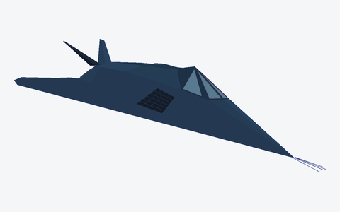

</div>

---

## Fly your way

If you flew a certain stealth fighters simulator at night on a 386 DOS PC in the early nineties, you'll feel 
right at home: the Nighthawk has not changed, the radar bar graph, the theaters from Libya to Korea, the 
satisfaction of a bomb through a hangar roof and nobody ever knowing you were there. Every *Classic* switch in 
the options brings back the DOS era version of individual game aspects: the cockpit, the HUD, the avionics, the 
flight model, the missiles, even the VGA palette, scanlines and pixelize effects.

But while you can visit the past in SM89, you are not stuck there. The *Modern* options give you F-16 style 
avionics with a targeting pod, an aerodynamic flight model, missiles that use proportial navigation, a sky 
with the accurate stars and moon of the mission's date. Seven more aircraft stand beside the F-117A, a modern 
war in Ukraine joins the old theaters, and the dynamic campaign turns the missions into a war that runs on in 
real time, with armour, helicopters, drones and multiplayer up to 64 players. On top of it all, you can fly 
on your Linux, Mac or Windows machine, or in a browser, or in VR - both with your PC and also directly on 
your Steam Frame in standalone mode.

But unlike the old DOS games, you are not constrained to single missions and a randomized career mode. Stealth 
Mission 89 features a realtime campaign that you can play together with friends and strangers. Fly a variety of 
aircraft including helicopters, not just the F-117. Construct your own air defense sites, build drone command 
centers and remotely pilot recon, attack and interceptor drones.

## CONTENTS

| | |
|---|---|
| [Introduction: The Night Belongs to Us](#introduction-the-night-belongs-to-us) | Radar wars, stealth, and the modern sky |
| [1. Getting Started](#1-getting-started) | The menu, the mission screen, options, controls |
| [2. Tutorial](#2-tutorial) | Your first and second missions |
| [3. The Flight Line](#3-the-flight-line) | The ten aircraft: their history, and what they do in the game |
| [4. In the Cockpit](#4-in-the-cockpit) | HUD, panels, warning lights, MFD pages, the in-flight menu, the kneeboard |
| [5. Sensors and Targeting](#5-sensors-and-targeting) | Locking targets, the targeting pod, the helmet sights |
| [6. Arms and Equipment](#6-arms-and-equipment) | Every weapon, its range and how to deliver it |
| [7. Techniques and Tactics](#7-techniques-and-tactics) | Radar and stealth, defeating missiles, flying low, landing, ejecting |
| [8. Single Missions and the Career](#8-single-missions-and-the-career) | Mission kinds, the planner, the debrief, the career |
| [9. The Dynamic Campaign](#9-the-dynamic-campaign) | The front, the mission board, the ground war, the enemy's moves, air defence and logistics |
| [10. Drone Warfare](#10-drone-warfare) | Geran waves, drone defense, the drone command center and its drones |
| [11. Multiplayer](#11-multiplayer) | Joining, hosting, dedicated servers |
| [12. Areas of Conflict](#12-areas-of-conflict) | The ten theaters |
| [13. Know Your Enemy](#13-know-your-enemy) | Aircraft, air defences, ships and armour |
| [Appendices](#appendices) | Keys, your files, glossary |


---

# INTRODUCTION: THE NIGHT BELONGS TO US

> **RIO HATO, PANAMA. 20 December 1989, shortly before 1am in the morning.**
> Two black aircraft cross the Pacific coast of Panama in the dark. Nobody on the ground hears
> them coming. Their bomb bays swing open for a few seconds, two 2,000 lb bombs fall into the open
> ground beside the barracks of the Panamanian Defence Force, and the bays close again. Minutes
> later, the 75th Ranger Regiment's paratroopers are dropping onto the airfield. The two aircraft
> are already on their way home to Nevada, a round trip of some eighteen hours with tankers along
> the route.
>
> A year before, the Pentagon had released one grainy photograph of the machine that rumour had
> called the "F-19". Now the **Lockheed F-117A Nighthawk** had flown its first combat mission. The
> goal was not to destroy the enemy compound but to create a shock-and-awe effect, which the F-117
> achieved. Thirteen months later, over Baghdad, the time for warning shots was over.

**STEALTH MISSION 89** puts you in the cockpit of the aircraft that changed air warfare that night,
and of seven others that each answered the same question in their own way: *how do you go where
the enemy's radars and missiles are waiting for you, do your job, and come home?*

## Radar wars

For as long as there have been aircraft, there have been people trying to shoot them down, and for
most of that time the hard part was finding them. In 1935 a team under Robert Watson-Watt showed
the British Air Ministry that a radio beam bounced back from a bomber flying through it. Five
years later a chain of radar stations along the English coast let a few RAF squadrons meet the
Luftwaffe's raids where they came in instead of patrolling blindly, and the bomber had lost its
greatest advantage for good.

Radar improved faster than anyone could hide from it. Pulse radars measured the range to a target
by timing the echo; Doppler radars learned to separate a moving aircraft from the hills behind it
by the shift in the echo's frequency, the same effect that makes a passing train's whistle drop in
pitch. Radars small enough to fit in a fighter's nose let night fighters shoot down bombers their
pilots never saw. And after the war, radar learned to steer missiles. The surface-to-air missile
(SAM) announced itself on 1 May 1960, when an SA-2 brought down Francis Gary Powers' U-2 at
70,000 ft over Sverdlovsk. Over North Vietnam, a few years later, the SAM and the radar-directed
gun made every strike a battle.

The answers came in three kinds:

- **Fly where the radar can't see.** A radar beam travels in straight lines; the earth curves and
  hills block it. The F-111, the Tornado and every low-level strike aircraft since were built to
  fly at a few hundred feet, in the radar shadow of the terrain. Airborne radars that look down
  from above (AWACS) took much of that shadow away.
- **Blind it.** Jammers drown the radar's echo in noise, chaff fills the sky with false echoes,
  flares lure heat-seekers away, and anti-radiation missiles such as the HARM ride the radar's
  own beam back to it. Every measure brought a counter-measure, and the electronic war became as
  important as the bombs.
- **Don't reflect.** How far away a radar sees an aircraft depends on its *radar cross section*
  (RCS), how much of the radar's energy it sends back. Flat panels angled away from the
  transmitter, edges aligned into a few directions, radar-absorbent material on the skin, engine
  inlets screened and the weapons carried inside: the result is an aircraft that a radar sees at a
  fraction of the range it sees a conventional jet.

The third answer is what experts named "low observability", while the world came to know it as **stealth**.
In 1975 a Lockheed engineer, Denys Overholser, came across a paper by the Soviet physicist Pyotr 
Ufimtsev on how electromagnetic waves scatter from edges. With it, and with the computers of the 
day, Lockheed's Skunk Works could for the first time *calculate* the radar cross section of a 
shape made of flat facets. The shape they calculated looked like nothing that should fly. 
Nicknamed the "Hopeless Diamond", it flew as the Have Blue demonstrator in December 1977, and 
four years later as the F-117A.

## The modern sky

Stealth didn't end the contest; it moved it. The SA-3 battery that brought down an F-117A over
Serbia in March 1999 did it with an old radar, patience and good intelligence on the stealth
fighters' routes. Today's long-range SAM systems such as the S-400 (SA-21) link dozens of radars
across hundreds of kilometres, and low-frequency search radars see stealthy shapes from further
away than the fire-control radars they cue.

And since 2022 the war in Ukraine has added something the planners of 1989 hadn't foreseen: 
thousands of cheap drones. Slow, propeller-driven one-way attack drones fly hundreds of
kilometres to their targets; small reconnaissance drones spot artillery and armour for the guns;
first-person-view drones hunt single tanks; and fast interceptor drones are launched to meet the
attack drones in the air. An air force no longer fights only other aircraft and SAMs, but swarms
of machines that cost less than one of its missiles.

Stealth Mission lets you play both Cold War theaters where the F-117A's stealth is the
whole story, as well as in a 2026 Ukraine where you fly a fighter against drone waves one night 
and command your own drones from a bunker the next. The dynamic campaign joins them into a war 
that runs on in real time, with armour columns grinding towards each other on the ground, 
helicopters carrying troops to take places, and the enemy answering every move you make.


---

# 1. GETTING STARTED

## 1.1 The main menu

The main menu chooses what to play. Each choice opens its own screen; **BACK** (or Esc) returns.

| Button | What it is |
|---|---|
| **SINGLE MISSION** | One generated mission in the theater, situation and aircraft you choose (chapter 8). The quickest way into the air. |
| **CAREER** | A pilot's record over tours of duty of twelve sorties, with promotions, medals and a pilot who can be killed or captured (chapter 8.4). |
| **DYNAMIC CAMPAIGN** | A whole theater at war, running on in real time: missions from a board, armour columns and helicopter insertions taking ground, an enemy that strikes back (chapter 9). |
| **MULTIPLAYER** | The dynamic campaign together with up to 64 pilots: join a server or host one (chapter 11). |
| **OPTIONS** | Your own settings for every game: game, graphics, sound, controls (1.3). |
| **QUIT** | Back to the desktop. (In the browser version: DOWNLOAD and DISCORD instead.) |

The game also runs in a **VR headset** through any OpenXR runtime: *FLY IN VR* on the mission screen, *IN
VR* on a saved campaign, or start the game with `--vr` to have the menus in VR headsets too. The menus
then float on a panel in front of you: point a controller at it, pull the trigger to click, push the
thumbstick to scroll; the left menu button brings the panel back in front of you.

## 1.2 The single mission screen

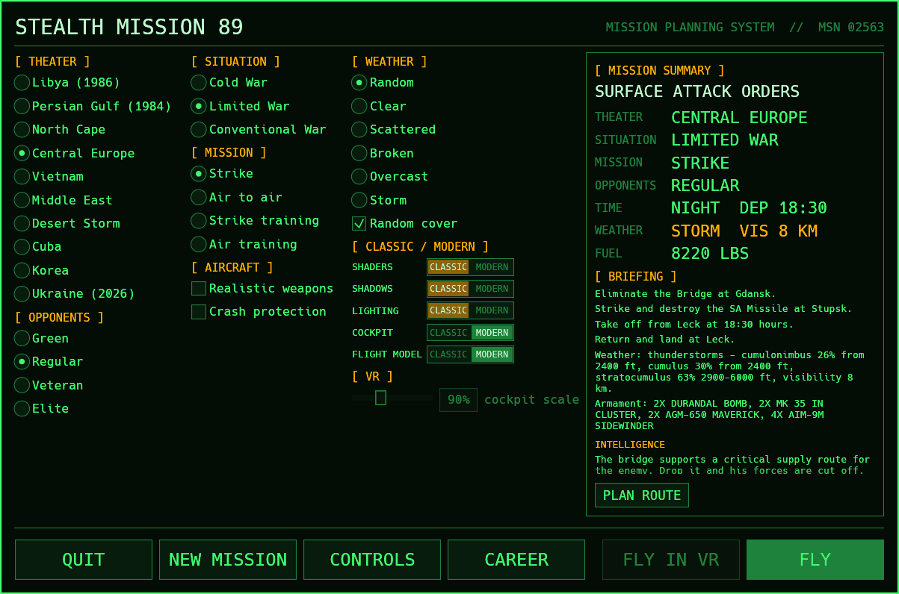

Each change on this screen generates a new mission, and the summary on the right describes it. Rest the
mouse on an option for a short description.

| Group | Options |
|---|---|
| **Mission** | *Theater*: the ten areas of conflict (chapter 12). *Situation*: Cold War (covert operation, few enemy aircraft), Limited War (air defences on alert) or Conventional War (all enemy forces active); the briefing states the rules of engagement. *Opponents*: Green, Regular, Veteran or Elite crews; higher levels bring more ships and patrols and more sensitive radars. *Mission*: Strike, Air to air, Strike training, Air training, or Drone defense (Ukraine only, chapter 10.2). |
| **Conditions** | *Weather*: Random (from the theater's climate), Clear, Scattered, Broken, Overcast or Storm; with *Random cover* off a slider sets the main cloud layer's cover. Clouds block optical seekers and eyes on both sides; radar sees through them. *Start time*: night is 18:00-06:00; *Random* rolls a morning or evening take-off. *Moon*: the real moon of the mission's date, or a fixed phase from new (enemy pilots see you at 2 km) to full (4 km). |
| **Vehicle** | The ten aircraft of chapter 3. *Realistic weapons* (F-117A only): two bays, no gun, no AIM-9 or AIM-120, no carrier operations. |
| **Simulation** | *Damage*: *Game* hits damage systems but never bring you down; *Real* hits can destroy the aircraft, start fires and damage the flight controls. *Guidance*: *Classic* DOS era missiles, or *Real* missiles that fly proportional navigation, glide after burn-out and loft against distant targets. *Air defence*: *Real* adds anti-aircraft guns and MANPADS teams (chapter 13.3). *Crash protection*: an automatic pull-up near the ground; collisions are not fatal. These switches belong to each game, not to OPTIONS. |

| Button | Function |
|---|---|
| NEW MISSION | New objectives with the same options. |
| LOAD | Missions saved in flight (*Save mission* in the in-flight menu), newest first; LOAD flies one on, paused. DELETE removes one save and DELETE ALL every save, each after a confirmation. |
| PLAN ROUTE | The mission planner (chapter 8.2). |
| LOADOUT | The stores on each station or bay, seen from above: click one and pick its load (*Same on both sides* mirrors it). Greyed out weapons are out of stock. BRIEFED restores the briefed stores, CLEAR empties everything. |
| FLY IN VR | Use a connected OpenXR VR headset with this mission. |
| FLY | Take off. |

Helicopter missions are short ones near a friendly base; in the UH-60 and the CH-47, the targets become insertions.

## 1.3 Options

OPTIONS holds your own settings, saved for every later game. The in-flight menu (Esc) has the same
pages for what can change in flight.

| Tab | Settings |
|---|---|
| **Game** | *Cockpit*, *HUD*, *Avionics*, *Flight model*: Classic (DOS era) or Modern. This manual describes the modern ones; the modern flight model is aerodynamic with fly-by-wire (released, the stick holds the attitude), and the helicopters and the AV-8B always fly it. *Auto trim*. *Cockpit tooltips*. *Player labels* and their size (multiplayer). *VR cockpit size*. *Tacview* export and real-time telemetry (chapter 8.3). *GIF recording*: size and frame rate; **F12** starts and stops a recording, saved in your Pictures folder. |
| **Graphics** | *Shaders*, *Shadows*, *Point lights* (cockpit lamps, flares, explosions and runway lights light the scene), *Time of day* (the sun, moon and the real stars of the mission's date and place move with the clock), *Anti-aliasing*, *Automatic scenery detail* in VR. **Effects**: camera shake, combat flashes, night barrage, cockpit night lighting, night vision goggles, snow, ground mist, cloud shadows, sunbeams, vapour and downwash, night sky. **Retro**: VGA colours, scanlines and *Pixelize* (the whole 3D view in big square pixels like an MS-DOS game; the menus and tooltips stay sharp, the anti-aliasing is off while it is on; a slider sets the size of the blocks, 2 to 5 screen pixels), for the full 1991 look. |
| **Sound** | *Master*, *Engine*, *Effects*, *Warnings* and *RWR* volumes; *Radar warning tones*: all, detections only, launches only, or off. *Engine low-pass* muffles the engines inside the cockpit. |
| **Controls** | *Keys and joystick* (1.4). *Head/Eye tracking*. |

## 1.4 Controls

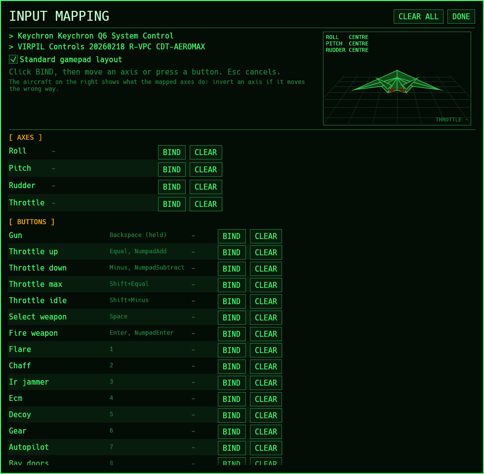

OPTIONS > CONTROLS > *Keys and joystick* maps your joysticks, throttles, pedals and gamepads. Every
change is saved at once.

- **Search** (under the title) keeps only the actions whose name holds what you type.
- **Axes**: roll, pitch, rudder, throttle, the sensor/cursor slew pair and the Harrier's nozzles. Click
  **BIND** and move the axis; *Invert* reverses it, *dead zone* sets the neutral range. The F-117
  outline in the corner moves with the mapped axes: if it goes the wrong way, invert.
- **Buttons**: every action in the game, with its key. Click **BIND** and press a button; a hat or an
  axis pushed past halfway works too.
- A standard **gamepad** works without mapping: left stick to fly, right stick for the rudder,
  triggers for the throttle, face buttons for fire, gun, weapon select and bay doors.

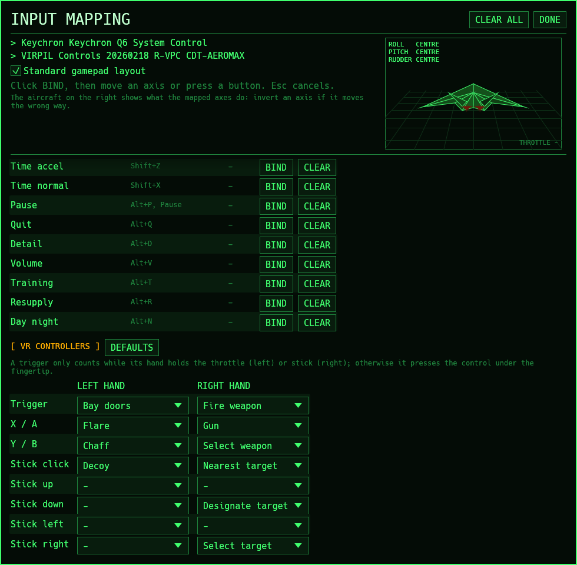

**VR controllers.** The last section assigns an action to each controller input. The defaults work like
a HOTAS: grab the stick with the right hand and the throttle with the left.

| | Right controller (stick) | Left controller (throttle) |
|---|---|---|
| Trigger | Fire weapon | Wheel brakes (held) |
| A / X | Gun (held) | Flare |
| B / Y | Select weapon | Chaff |
| Thumbstick | Up nearest target ahead, down clear target, right next target, left designate | Slews the displays' cursor |
| Stick click | Push-to-talk (PTT, held) | Lock cursor target |

**Head and eye tracking.** With *Head/Eye tracking* on, the cockpit view follows your head, picked up by an
infrared tracker, an eye tracker, a webcam or a phone, through OpenTrack (FreeTrack output, or UDP on port 4242). **Home** recentres the view.

Due to restrictions in the TrackIR EULA that are incompatible with open-source projects, we can't use their SDK to support TrackIR devices directly.
As a workaround, you can use [FreePIE](https://andersmalmgren.github.io/FreePIE/) with the script below.
FreePIE runs alongside the TrackIR software and acts as a bridge between it and the game. The script captures TrackIR input data and converts it into FreeTrack-compatible output.

```
def update():
    freeTrack.yaw = -(trackIR.yaw/180)
    freeTrack.pitch = -(trackIR.pitch/90)
    freeTrack.roll = -(trackIR.roll/90)
    freeTrack.x = -trackIR.x
    freeTrack.y = trackIR.y
    freeTrack.z = trackIR.z

if starting:
    trackIR.update += update

diagnostics.watch(freeTrack.yaw)
diagnostics.watch(freeTrack.pitch)
diagnostics.watch(freeTrack.roll)
diagnostics.watch(freeTrack.x)
diagnostics.watch(freeTrack.y)
diagnostics.watch(freeTrack.z)
```

Thank you fritzjoel for this tip!

The complete list of keys is in Appendix A and in [keys.md](keys.md).


---

# 2. TUTORIAL

## 2.1 Your first mission

The best way to learn the Nighthawk is to fly it where nobody can hurt you. In a **training** mission the
enemy shoots at you, but hits do you no harm, and **Alt R** reloads your weapons whenever you want.

**In the menu.** Choose SINGLE MISSION, then:

- *Theater*: **Central Europe**. *Situation*: **Cold War**. *Opponents*: **Green**.
- *Mission*: **Strike training**.
- *Weather*: **Clear**. *Start time*: **22:00**: the F-117A is a creature of the night.
- *Vehicle*: **F-117A**, *Realistic weapons* off.

Read the briefing under the mission summary: the primary target, the secondary, and the base you land at.
Press **PLAN ROUTE** to see the route over the map with the radars' reach in orange (chapter 8.2), then
**FLY**.

**Take-off.** You are lined up on the runway. Check that the gear lights show three green lamps and the
bay doors are shut.

1. Full throttle: **Shift =**. The engines spool up and you roll.
2. At about 160 kt ease the stick back (**Down arrow**, or pull your joystick). The nose comes up and
   you fly.
3. **Gear up** (6) as soon as you are climbing. Leave the throttle at full until you are clear of the
   ground, then come back to about 80 % (**-**).

**Finding the way.** The HUD's heading tape shows a caret over the heading to the current steerpoint, and
a diamond sits on the steerpoint itself. The bottom right of the HUD shows its number, distance and
time to go. The easy way: press **7** for the **autopilot**, which flies the route for you. Use the
time it gives you to look around the cockpit: hold the right mouse button and move the mouse. Rest the
mouse on any button or light and its tooltip tells you what it is.

**Staying unseen.** Look at the **radar bar graph** under the right MFD. As you approach the enemy, yellow
bars grow from the left: the radars' sweeps. Green bars from the right are your own visibility. If they
meet in red, you've been seen. Fly lower (300-500 ft is fine over flat country), don't bank steeply,
keep the doors shut and stay below 500 kt, and the bars stay apart. If a radar does see you, you'll hear
the warning tone and the TRACK lamp may light: turn away, descend, and the site loses you again.
Shift Z speeds up time on the long legs; it drops back to normal the moment anything happens.

**The attack.** Ten or fifteen kilometres from the target:

1. Press **Space** until the HUD shows the bomb you were given (bottom left). A GBU-12 Paveway is the
   simplest.
2. Press **T** to lock the nearest target ahead. The targeting pod's picture on the MFD shows it, its
   name and its range; the HUD boxes it. If it isn't the primary target, press **B** for the next one.
3. For a Paveway, climb: it is released from 15,000 ft and up, out of reach of the guns. Fly the flight
   path marker onto the steering line.
4. When the **LOCK** lamp lights steadily and the HUD says **IN RNG**, open the bay: **8**.
5. **Enter** releases the bomb. Close the bay at once (**8**).
6. Keep the target locked and in sight until the bomb hits: Shift F4 follows it down, if you like.

The HUD reports the result, and the objective on the ORD page and the kneeboard is ticked. Do the same on
the secondary target.

**Going home.** Press **PgDn** until the steerpoint is your landing base, and **7** if the autopilot is off.
Approaching the base, take the autopilot out (**7**) and land (chapter 7.9): **F9** for the ILS steering
bars, gear (**6**) and flaps (**9**) down, the flight path marker on the runway threshold, throttle back
over the threshold, brakes (**0**) once you are down. **Esc** and *End mission* takes you to the debrief.

## 2.2 Your second mission

Now do it for real. Change *Mission* to **Strike** and *Opponents* to **Regular**, and fly again. This
time hits hurt, and a detected aircraft is a hunted one. A few things to try:

- **Plan the route** around the orange areas in the planner: click a leg to add a point, drag it out of
  the radar's reach.
- **Use the terrain.** Fly the valleys; radars can't see you over mountains.
- **Fight back with countermeasures.** If a missile is fired at you (the LAUNCH or IR lamp, a
  warning tone), turn hard, release **chaff** (2) against radar missiles or **flares** (1) against
  infrared ones (chapter 7.6).
- **Look at the flight map** after the debrief: it shows where the radars came closest to seeing you.

When you've brought a few F-117As home, try the others. The **F-16C** with HARMs against the SAM sites
(chapter 6.4), the **AH-1Z** in a short helicopter mission, the **AV-8B** off the ground vertically
(chapter 3.5). Then start a **career** (chapter 8.4), or go straight to the **dynamic campaign**
(chapter 9), where all of them fight one war together.


---

# 3. THE FLIGHT LINE

Ten aircraft stand ready on the flight line. Choose yours in the single mission screen's *Vehicle*
section, in the career's options, or on a campaign briefing's LOADOUT page. Each has its own
cockpit, its own flight model and its own place in the war. This chapter tells where each one came
from, and what it does in the game.

| | Aircraft | In one line |
|---|---|---|
|  | [**F-117A NIGHTHAWK**](#31-f-117a-nighthawk) | Stealth attack aircraft: unseen at night, deep in enemy country. |
| 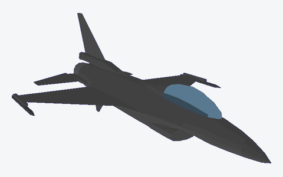 | [**F-16C FIGHTING FALCON**](#32-f-16c-fighting-falcon) | Multirole fighter: fast, agile, HARMs and air-to-air missiles; no stealth at all. |
| 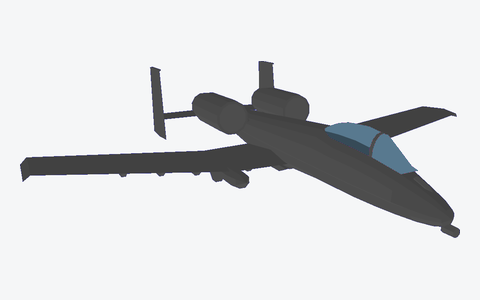 | [**A-10C THUNDERBOLT II**](#33-a-10c-thunderbolt-ii) | Close air support: slow, rugged, eleven stations, loiters over the battlefield. |
| 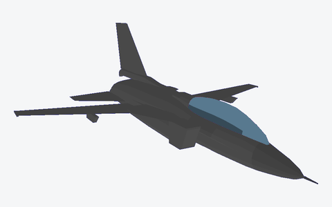 | [**TORNADO IDS**](#34-tornado-ids) | Low-level strike: swing wings and a terrain following radar that flies it at 65 ft. |
| 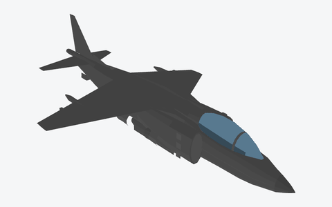 | [**AV-8B HARRIER II**](#35-av-8b-harrier-ii) | V/STOL attack jet: vectored thrust, hovers and lands anywhere. |
| 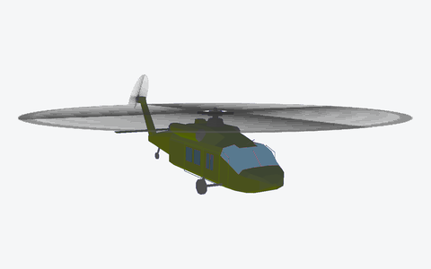 | [**UH-60 BLACK HAWK**](#36-uh-60-black-hawk) | Unarmed transport helicopter: insertions, rescues, sling loads. The only way to take a place by air. |
| 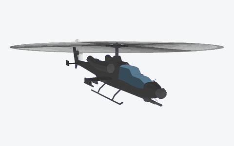 | [**AH-1Z VIPER**](#37-ah-1z-viper) | Attack helicopter: turret gun and Hellfires that follow the pilot's eyes. |
| 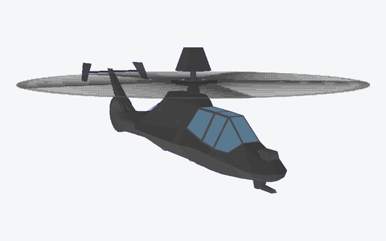 | [**RAH-66 COMANCHE**](#38-rah-66-comanche) | Stealth scout helicopter: barely seen while slow, weapons inside its bay doors. |
| 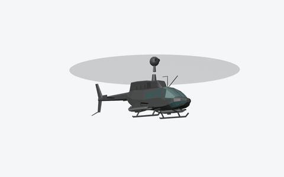 | [**OH-58D KIOWA WARRIOR**](#39-oh-58d-kiowa-warrior) | Armed scout helicopter: small and nimble, a sight above its rotor, Hellfires, Stingers or .50 cal pods. |
| 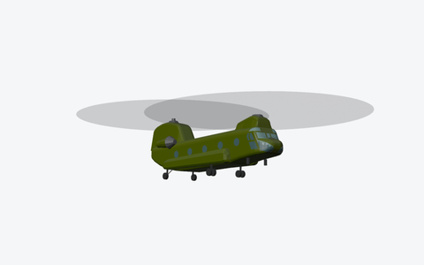 | [**CH-47F CHINOOK**](#310-ch-47f-chinook) | Unarmed tandem-rotor cargo helicopter: sling loads for logistics and resupply. |

## 3.1 F-117A NIGHTHAWK


In 1974 the Defense Advanced Research Projects Agency asked the American aircraft industry a simple
question: how small could an aircraft's radar signature be made? Lockheed wasn't invited, having
built no fighters for a decade, but talked its way in. Its Skunk Works, the secret design shop
that had built the U-2 and the SR-71, had the program it needed: ECHO, written by Denys Overholser
from the equations of a Soviet physicist, which worked out the radar return of a shape built from
flat triangles. The computers of the day could only handle flat facets, so the aircraft would have
to be made of them.

The faceted "Hopeless Diamond" beat Northrop's design in the radar test range, and two small
demonstrators were built as **Have Blue**. The first flew on 1 December 1977. Both were lost in
accidents, but not before they had proved the idea: in the tests, radars could barely find them.
In November 1978 the Air Force ordered a full-sized operational aircraft under the code name
**Senior Trend**.

The F-117A first flew on 18 June 1981 at Groom Lake, and the first unit was operational in October
1983, at Tonopah Test Range in Nevada, so secret that its pilots flew only at night and lived a
double life with an A-7 squadron as cover. The aircraft couldn't fly fast or turn hard. Its two
General Electric F404 engines, the F/A-18's without afterburners, breathed through gridded inlets
and exhausted through long flat slots that cooled and hid the hot gas. Its flight control
computers held an aerodynamically unstable shape in the air. It carried two bombs inside, and it
had no radar of its own: it found its targets with infrared sensors and a laser, and it found its
way with an inertial navigation system.

The "F-19" of the rumours was officially admitted to exist in November 1988, flew its first combat
mission over Panama in December 1989, and became famous in January 1991. On the first night of
Desert Storm the F-117As hit Baghdad, the most heavily defended city outside the Soviet Union, and
came back without a scratch. Over the war they flew about 1,300 sorties and dropped some 2,000 tons
of laser-guided bombs. One F-117A was shot down, over Serbia in March 1999 (its pilot was rescued);
the type was retired in 2008, though a few still fly as training adversaries. 59 production
aircraft were built.

Real F-117A missions had pilots fly the aircraft to a designated waypoint, at which point the
FLIR system would automatically point at the predetermined target location. The pilot then had to 
perform minor corrections and drop their bombs. The trips to and from the target were long and 
required in-air refueling - often multiple times. All available information points to the F-117
never having any sort of RWR, nor did it possess countermeasures or the maneuverability to even hope
to bleed off an incoming missile's energy.

| **F-117A NIGHTHAWK** | |
|---|---|
| *Role* | Stealth attack aircraft, one pilot |
| *Manufacturer* | Lockheed (Skunk Works), USA |
| *First flight* | 18 June 1981 |
| *Wingspan / length / height* | 13.20 m / 20.09 m / 3.78 m |
| *Engines* | 2 × General Electric F404-F1D2, 48 kN (10,600 lbf) each, no afterburner |
| *Maximum take-off weight* | 23,800 kg (52,500 lb) |
| *Maximum speed* | Mach 0.92 |
| *Armament* | Two internal bays, one 2,000 lb class weapon each |

**IN THE GAME.** The F-117A is the aircraft this game and it's inspiration DOS games were built 
around: an attack aircraft radars only see at short range, provided its bay doors stay shut.
It is subsonic (about 560 kt at sea level, drag rising steeply above Mach 0.85), has no afterburner, 
pulls 7 g and stalls at about 120 kt clean. It has no radar warning scope; instead the fictional EGR/EAR 
**radar bar graph** shows how close each radar sweep came to finding you (chapter 7.2).

**Weapons.** Two internal bays, with *Realistic weapons* on, or four (the two wing bays are marked
*Not on the real aircraft*). Each bay takes one kind of store, several of the smaller ones: up to four
Sidewinders, three AMRAAMs, two Mavericks, two Paveways, three Mk 82s, one HARM or Harpoon and so
on (the LOADOUT page shows the count). The bays open with **BAY** (8); nothing leaves a closed bay,
and an open one adds 24 to your EMV. The F-117A has the 20 mm gun (510 rounds) in the game's own
version only: with *Realistic weapons* there is no gun, no AIM-9 and AIM-120, and no carrier
operations.

**Cockpit.** A modern panel laid out roughly like the real aircraft's, with a large centre display between
two MFDs and the third MFD on the HSI (chapter 4.11), or the DOS era classic panel (OPTIONS > GAME >
*Cockpit*).

**Best for.** Reconnaissance, strike, interdiction, anti-ship and SEAD deep in enemy country; CAS if
nothing better is free. Fly it low, slow and at night, and the enemy will rarely know you were there.

## 3.2 F-16C FIGHTING FALCON


The F-16 was born from an argument. In the late 1960s a small group of officers and analysts in the
Pentagon, led by the fighter pilot John Boyd and nicknamed the "Fighter Mafia", argued that the US
Air Force's fighters had become too big, too heavy and too expensive, and that what won air
combat was a small aircraft that could turn, climb and accelerate better than its enemy. Their
Lightweight Fighter program of 1972 asked for exactly that. General Dynamics' YF-16 flew in January
1974 (its first "flight" was an unplanned hop on a taxi test) and beat Northrop's YF-17 in a
fly-off; the YF-17 went on to become the Navy's F/A-18.

The F-16 was the first production fighter to fly entirely by wire, its computers keeping a
deliberately unstable airframe pointed where the pilot wanted. Its pilot sat high under a bubble
canopy, reclined 30° to bear the g, with the stick on the right console. It could pull 9 g and keep
it up, more than its pilots could. Four European NATO members chose it as the "deal of the
century" in 1975, the first aircraft reached a squadron in 1979, and from 1984 the F-16C brought a radar
with medium-range missiles, better cockpit displays and the ability to carry nearly everything in
the inventory.

The F-16C Block 50 of 1991 and its Block 52 sister took over the "Wild Weasel" role, hunting enemy
SAM sites with HARM anti-radiation missiles, and gained the Joint Helmet-Mounted Cueing System that
lets its pilot aim missiles by looking at the target. More than 4,600 F-16s have been built, and
the type has been in production for almost half a century.

| **F-16C FIGHTING FALCON (Block 50)** | |
|---|---|
| *Role* | Multirole fighter, one pilot |
| *Manufacturer* | General Dynamics, later Lockheed Martin, USA |
| *First flight* | 2 February 1974 (YF-16, officially) |
| *Wingspan / length / height* | 9.96 m / 15.06 m / 4.88 m |
| *Engine* | 1 × General Electric F110-GE-129, 129 kN (29,000 lbf) with afterburner |
| *Maximum take-off weight* | 19,200 kg (42,300 lb) |
| *Maximum speed* | Mach 2.0 |
| *Armament* | 20 mm M61 cannon, 9 stations for missiles, bombs, pods and tanks |

**IN THE GAME.** The F-16C is the no-nonsense fighter of the game: Mach 1.2 on the deck and about Mach 1.9 high in
afterburner, 9 g, and it rolls at 240° a second, more than twice the F-117A's rate. All its stores
hang outside, so it is easy to spot by enemy radar (+24 EMV). Its **RWR scope** shows every radar 
painting you (see *Cockpit* below). The pilot wears the **HMCS** (Helmet Mounted Cue System) 
(chapter 5.3) which enhances situational awareness and allows the pilot to lock their Sidewinders
onto enemies simply by looking towards them.

**Weapons.** Nine stations: Sidewinders or AMRAAMs on the wingtips and outer pylons (1-3, 7-9);
Harpoon, Penguin and anything else air-to-ground on 3 and 7; HARMs, Mavericks and bombs on 4 and 6;
the camera, a fuel tank or cargo on the centreline (5). Stores are loaded in mirrored pairs. The 20 mm
gun carries 510 rounds.

**Cockpit.** The F-16C has its own cockpit, laid out roughly like the real Block 50's:

* **Up-front controls** under the HUD: **COM1** (volume), **MENU**, and the master modes **A-A**
  (again: NAV) and **A-G** (again: CCIP / CCRP). On the keypad **1 T-ILS** (ILS), **4 STPT**
  (WAY page), **6 TIME** (time acceleration), **7 MARK** (designate), **DCLT** and **NVG** work.
* **DED** (amber, right of them): radio channels, steerpoint and target, clock, bearing,
  distance and ETA to the steerpoint, time on target or fuel.
* **Flight instruments** in the middle: the attitude indicator with airspeed and altimeter, the
  AOA and vertical velocity tapes, the **HSI** below. An **MFD** on each side (the top and bottom
  button rows work).
* **Top left**: master caution, STALL, TRACK and IR lights, the **LAUNCH** light and the
  **RWR** scope. **Top right**: ENG FIRE, ENGINE and FLCS, with the engine instruments and fuel
  down the right edge. The other warning lights are on the right console.
* **Left slope**: gear handle and lights, **FLAPS**, **BRAKE**, **AUTO** (autopilot) and the
  target buttons (NEAR, NEXT, NONE, WPN, DTL). **Right slope**: clock and countermeasures (chaff,
  flare, decoy, ECM, IRJ). Side stick on the right console, throttle on the left.

The **AOA indexer** left of the HUD: red top chevron slow, green circle on speed, amber bottom
chevron fast.

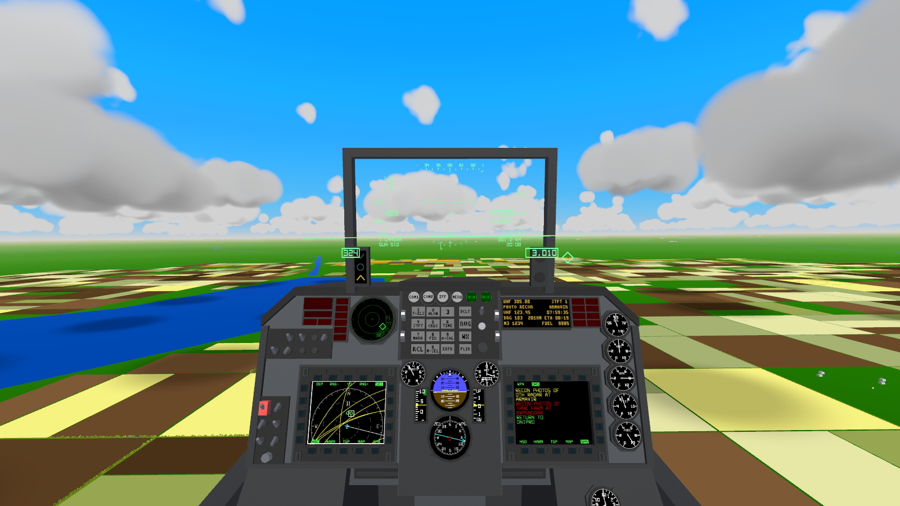

The F-16 has no radar bar graph. The **RWR** shows every radar that sees the aircraft at its bearing
(up = ahead). It shows no range: the nearer the centre, the more dangerous (launching or tracking
SAMs innermost). Symbols: the SAM type (`2` SA-2, `10` SA-10, `N6` SA-N-6, `HK` Hawk, `RA`
Rapier, ...), aircraft radars with a hat (`29` MiG-29, `AW` AWACS). Dim = searching, bright =
tracking, a diamond = the most dangerous, a flashing circle = a missile in the air. The A-10C has
the same RWR scope beside its attitude indicator; the other aircraft show the same picture on the
HARM format (chapter 4.10), and the RAH-66 on its threat scope (chapter 3.8).

**Best for.** SEAD with HARMs, combat air patrol, defending against raids and drone waves, intercepting
helicopters, and hunting the enemy's AWACS; anything else at a much higher radar signature. In a
campaign it is the only aircraft offered for CAP, DEFEND and AWACS missions.

## 3.3 A-10C THUNDERBOLT II


Over Vietnam, the US Air Force had learned the hard way that fast jets were poor at supporting
troops on the ground: they flew too fast to find small targets and were too fragile to linger
over AAA. Its close air support was flown by A-1 Skyraiders, piston-engined aircraft from
the 1940s. The A-X program of 1966 asked for a modern replacement that could fly low and slow, carry
a heavy load, survive hits and stay over the battlefield for hours, and the Cold War soon gave it
a target: the thousands of Warsaw Pact tanks that would pour into West Germany in a war.

Fairchild Republic's YA-10 beat Northrop's YA-9 in 1973. The design was built around its gun, the
General Electric GAU-8/A Avenger, a seven-barrel 30 mm cannon nearly as long as a car that fires
depleted-uranium armour-piercing rounds at 3,900 rounds a minute. The pilot sits in a titanium
"bathtub"; the flight controls are doubled and run as cables if the hydraulics are shot away; the
engines hang high on the rear fuselage, screened from below by the wings and tail. The aircraft was
designed to come home on one engine, half a tail and one elevator, and indeed several have.

The A-10 entered service in 1977. It was never loved by the fast-jet community, which nicknamed
it the "Warthog". It is said that lift is provided not by the wings, but by the repellant force 
force of the ground due to the aircraft's uglyness. Its retirement has been announced many times, 
but each time a war proved its value: in Desert Storm A-10s destroyed hundreds of Iraqi tanks 
and artillery pieces. The A-10C upgrade of the 2000s gave it a glass cockpit, a targeting pod 
and precision-guided weapons.

| **A-10C THUNDERBOLT II** | |
|---|---|
| *Role* | Close air support, one pilot |
| *Manufacturer* | Fairchild Republic, USA |
| *First flight* | 10 May 1972 (YA-10) |
| *Wingspan / length / height* | 17.53 m / 16.26 m / 4.47 m |
| *Engines* | 2 × General Electric TF34-GE-100A turbofans, 40 kN (9,065 lbf) each |
| *Maximum take-off weight* | 21,000 kg (46,000 lb) |
| *Maximum speed* | about 380 kt (700 km/h) |
| *Armament* | 30 mm GAU-8/A cannon (1,174 rounds), 11 stations |

**IN THE GAME.** Slow (about 380 kt low), with no afterburner, 7.3 g, but tough and economical with its
fuel: the A-10C loiters over the battlefield where the jets have to come and go. Its decelerons double
as the speed brake. Like the F-16C, it carries everything outside (+24 EMV), and it has an **RWR
scope** on its panel (chapter 3.2). Its cannon rounds kick up heavy strikes on the ground.

**Weapons.** Eleven stations. Sidewinders on the outer stations (1, 11), Mavericks and bombs on the
wing pylons (2-3, 9-10), bombs or fuel tanks on 4 and 8, bombs under the fuselage (5, 7), and the
camera, a tank or cargo on the centreline (6). It carries no AMRAAM, HARM, Penguin or Harpoon: briefed
ones are left on the ground. The gun has 510 rounds.

**Cockpit.** Two MFDs either side of a large attitude indicator with the HSI under it and the RWR scope
beside it; the countermeasures panel above, the up-front keypad (T-ILS, STPT, TIME, MARK) under the HUD,
fire handles and caution panel, and a centre stick.

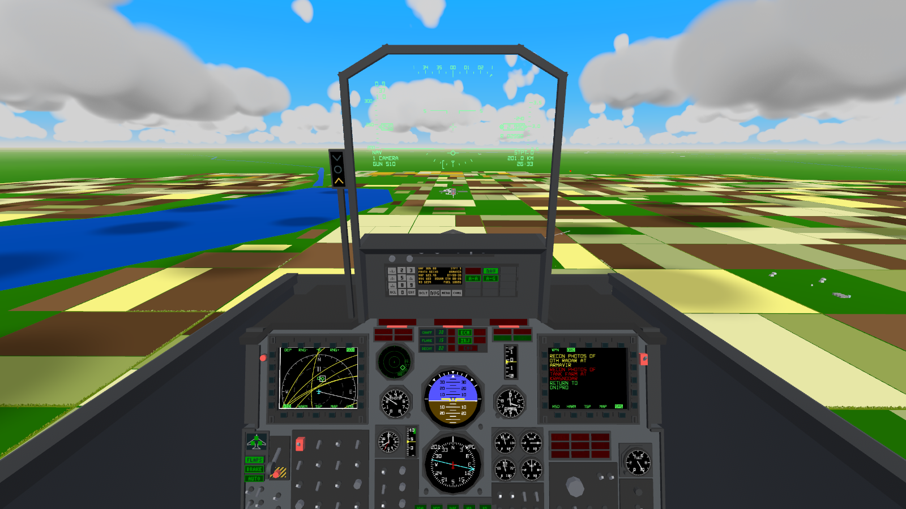

**Best for.** Close air support above all: guns, MANPADS and armour columns. It is the first choice
for CAS missions, and a good escort for insertions.

## 3.4 TORNADO IDS


In the late 1960s Britain, West Germany, Italy and, for a time, Belgium, the Netherlands and Canada were
all looking for the same aircraft: one that could replace the Starfighters, Buccaneers and Vulcans
of the day, strike deep into Warsaw Pact territory at low level, and do it by night and in bad
weather. They pooled their efforts in a Multi-Role Combat Aircraft program and founded the Panavia
company in 1969 to build it, with the engines from a joint company of Rolls-Royce, MTU and Fiat,
Turbo-Union.

The **Tornado** first flew on 14 August 1974 at Manching in Bavaria. Its wings swept from 25° for
take-off and slow flight to 67° for a dash at over 800 kt down on the deck, and its terrain
following radar let it fly at 200 ft or less over hills, at night, hands off. A navigator in the
back seat ran the navigation and attack system, and thrust reversers let it land on a shortened,
bomb-damaged runway. It entered service in 1980 with the RAF, the Luftwaffe, the German Navy and
the Italian Air Force, and a trinational training unit at RAF Cottesmore taught crews from all
three nations together.

Its first war was the hardest test of the low-level doctrine it was built for. In January 1991
RAF Tornados attacked Iraqi airfields at low level with JP233 runway-cratering dispensers, and
lost aircraft doing it; the crews soon switched to medium altitude and laser-guided bombs. Tornados
went on to fly over Bosnia, Kosovo, Iraq, Libya and Syria. Nearly 1,000 were built; the RAF retired
its last in 2019, while the Luftwaffe flies them on into the 2020s.

| **PANAVIA TORNADO IDS** | |
|---|---|
| *Role* | Low-level strike and interdiction, two crew |
| *Manufacturer* | Panavia (BAe, MBB, Aeritalia), UK / Germany / Italy |
| *First flight* | 14 August 1974 |
| *Wingspan / length / height* | 13.91 m spread, 8.60 m swept / 16.72 m / 5.95 m |
| *Engines* | 2 × Turbo-Union RB199 Mk 103, 43.8 kN dry, 76.8 kN (17,270 lbf) with afterburner each |
| *Maximum take-off weight* | 28,000 kg (61,700 lb) |
| *Maximum speed* | Mach 2.2 at altitude, about 800 kt at low level |
| *Armament* | 2 × 27 mm Mauser BK-27 cannon, stations under the fuselage and the swivelling wing pylons |

**IN THE GAME.** The Tornado IDS is the game's low-level specialist. It reaches about Mach 1.2 low and
past Mach 1.6 high, has afterburners, pulls 7.5 g and approaches at about 130 kt with full flaps. Its
stores are external (+24 EMV): it survives by flying under the radar, not by hiding from it.

**Swing wings.** The wings sweep by themselves: fully forward (25°) for take-off, landing and slow
flight, back to 67° between Mach 0.6 and 0.9, taking six seconds for the full travel. Lowering the flaps
brings them fully forward.

**Terrain following radar (TFR).** Engage the autopilot (**AUTO**, key 7) and the Tornado follows the
terrain at **65 ft**, over hills, buildings, trees and power lines, while still steering to the
waypoint. The TFR looks 20 seconds ahead (at least 3 km), dives at up to 17° and climbs at up to 34°,
allowing for a 1.5 g pull-up. Moving the stick takes it back. The **E-scope** in a housing above the
left MFD shows what the radar sees 0-5 km ahead, from 15° below to 10° above the flight path: the
terrain profile and the steering template over it. Terrain above the template means a climb is
coming. The radar scans with the autopilot off too, so the E-scope warns you when you fly by hand.

**Weapons.** Eight pylons. Sidewinders or AMRAAMs on the wing rails (1, 8); HARMs, Penguins, Mavericks,
Paveways, every bomb, Durandals, fuel tanks or a Sidewinder on the swivelling wing pylons (2, 7); the
same plus the Harpoon, the camera or cargo on the forward shoulder pylons (3, 6); HARMs, Mavericks,
bombs or tanks on the aft shoulder pylons (4, 5). A pylon carries one missile or Paveway, three Mk 82s
on a triple rack, or two of most cluster bombs. 510 rounds for the gun, with heavy strikes.

**Cockpit.** Three MFDs like the F-117A's: the centre one high under the HUD, the left one and the third
(starting on the HSI) on the wings. The up-front controls are those of the F-117A (NAV, AIR, GND, LOCK,
DCLT, NVG, ILS, MENU, VOL, TIME, STPT, ORD) around the DED, with the EMV bar graph and a centre stick.

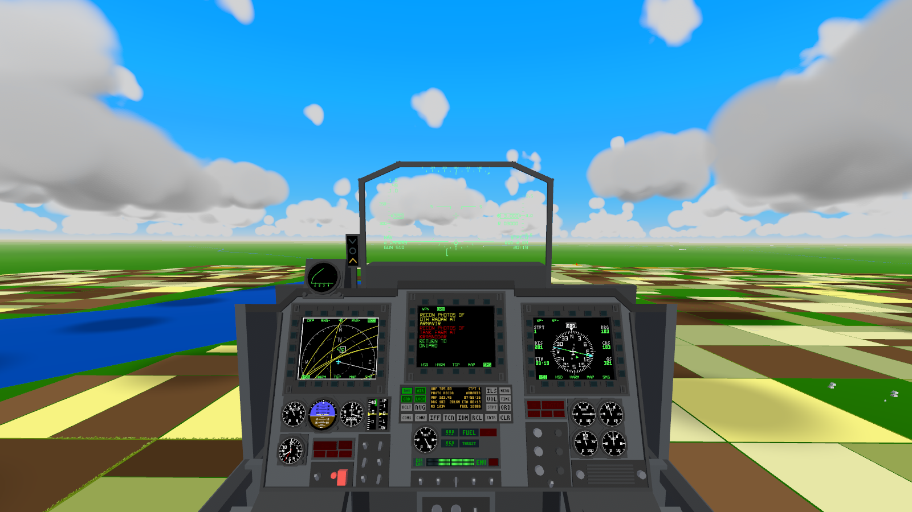

**Best for.** Interdiction and SEAD (second choice after the F-117A and the F-16C), strike, anti-ship
and reconnaissance at low level.

## 3.5 AV-8B HARRIER II


In the 1950s the French engineer Michel Wibault had the idea of an engine that could swivel its
thrust, and Bristol Aero Engines and Hawker in Britain built it: the Pegasus, a turbofan whose air
and hot gas leave through four nozzles on the sides of the fuselage that the pilot can turn from
pointing straight back to pointing down and slightly forward. On 21 October 1960 the Hawker P.1127
hovered on the end of a tether. A fighter that needed no runway could hide in a forest clearing
and fly from a car park when the enemy's first strike had cratered every airfield.

The P.1127 became the Kestrel and then the **Harrier**, the first operational vertical/short
take-off and landing (V/STOL) jet, with the RAF in 1969. The US Marine Corps, which wanted an
aircraft that could fly from small ships and roads close to its troops, bought it as the AV-8A.
McDonnell Douglas and British Aerospace then built the **Harrier II** together: a bigger, composite
wing with more fuel and more stations, raised cockpit, and lift improvement devices under the
fuselage that trap the jet's air cushion on landing. The AV-8B flew in November 1981 and joined the
Marines in 1985.

A Harrier pilot has one control no other jet has: the nozzle lever beside the throttle. Nozzles
aft, it flies like a conventional jet. Nozzles down, it hovers on the column of thrust, steered by
small reaction-control jets at the nose, tail and wingtips. In between it can take off in a few
hundred feet, land on a pad, and even turn the nozzles in forward flight to stop dead in the air
("VIFFing"). Harriers fought in the Falklands in 1982 (the Royal Navy's Sea Harriers and the RAF's
GR.3s) and AV-8Bs over Kuwait in 1991, flying from ships and forward strips close behind the front.

| **AV-8B HARRIER II** | |
|---|---|
| *Role* | V/STOL attack aircraft, one pilot |
| *Manufacturer* | McDonnell Douglas / British Aerospace, USA / UK |
| *First flight* | 5 November 1981 (full-scale development aircraft) |
| *Wingspan / length / height* | 9.25 m / 14.12 m / 3.55 m |
| *Engine* | 1 × Rolls-Royce Pegasus F402-RR-408 vectored thrust turbofan, 105 kN (23,500 lbf) |
| *Maximum take-off weight* | 14,100 kg (31,000 lb) after a short take-off run |
| *Maximum speed* | about 585 kt (1,080 km/h) at sea level |
| *Armament* | 25 mm GAU-12 cannon pod, 6 wing stations and a centreline station |

**IN THE GAME.** The AV-8B flies like a subsonic attack jet (about 570 kt low, 8 g, no afterburner)
until you turn the nozzles. It always flies the modern flight model. It takes off with 6,000 of its
7,750 lb of fuel so that it can lift off vertically, and it burns fuel fast in the hover: plan for
short sorties, or take off short with a run. Its stores are external (+24 EMV).

**The nozzles.** The nozzle lever turns the four nozzles from aft (0°) through the **hover stop**,
where the thrust points straight down at the Harrier's nose-up ground attitude, to the **braking stop**
(98.5°), pointing slightly forward.

| Key | Nozzles |
|---|---|
| F | One 10° notch down (held: keep moving, pausing at the hover stop) |
| R | One notch aft |
| Shift F | To the hover stop |
| Shift R | Fully aft |

A joystick axis can be bound to *Nozzles (Harrier)* (chapter 1.4); in VR the nozzle lever is inboard
of the throttle, with a tick every 10° and a firm one at the hover stop. The HUD shows **NOZ** and the
angle. With the nozzles down the reaction controls take over from the wings as the airspeed falls;
released, the stick holds the attitude. Below 40 kt with the nozzles past 20° the HUD switches to hover
symbology: the pitch ladder centres on the boresight and a drift vector shows where you are sliding.

**Vertical take-off.** Nozzles to the hover stop (Shift F), full power, and the Harrier lifts off at
about 90 % thrust. Climb clear of obstacles, then ease the nozzles aft notch by notch (R) as the speed
builds and the wings take over.

**Short take-off.** Nozzles aft, full power; after a short run, a few notches down rotates you into
the air with less fuel burnt than a vertical take-off. A carrier needs no catapult.

**Vertical landing.** Slow down with the nozzles at the braking stop if you are fast, arrive over the
spot below 50 kt, nozzles at the hover stop, and settle with the throttle. Under 50 kt any flat spot
counts as a landing, like a helicopter's: a road, a field, a carrier deck without a wire.

**Weapons.** Nine stations: Sidewinders on the rails (1, 9); Sidewinders, Mavericks, Paveways and
bombs (no Durandal) outboard (2, 8); Mavericks, every bomb and fuel tanks on the intermediate pylons
(3, 7); the same plus the Harpoon inboard (4, 6); the camera, a tank or cargo on the centreline (5).
No AMRAAM, HARM or Penguin. The gun pod in the game has 510 rounds.

**Cockpit.** The AV-8B Night Attack's: two MFDs either side of the up-front controller (scratchpad,
COMM windows and the option display: DCLT, NVG, MENU, VOL), MASTER CAUTION and MASTER WARNING lights,
the engine panel with the **nozzle angle needle**, the flap switch (CRUISE / AUTO / **STOL**, the flaps
key) and a fuel panel with BINGO.

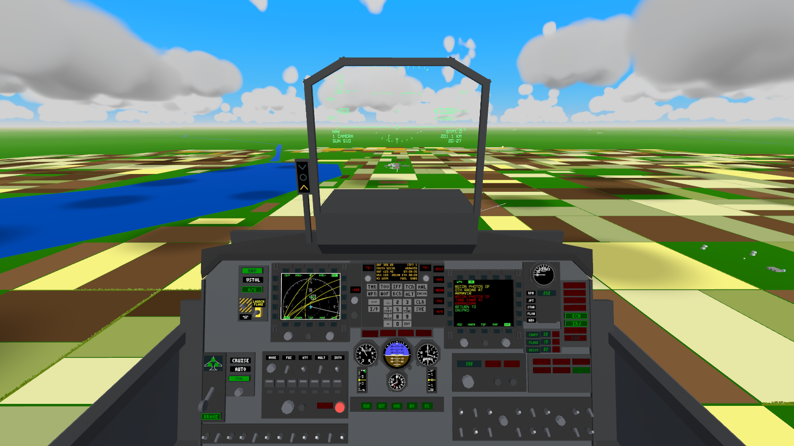

**Best for.** Close air support (second choice after the A-10C) and escort, from bases close to the
front, or from a carrier.

## 3.6 UH-60 BLACK HAWK


Vietnam was the helicopter's war. The Bell UH-1 "Huey" carried the US Army's troops into battle and
out of it, carried the wounded to hospitals within the hour, and was shot down in its thousands.
The Army learned what it wanted next: a helicopter that carried a full infantry squad, could fly
on one engine, take hits from small arms and crash survivably, and fit into a C-130 transport.

The Utility Tactical Transport Aircraft System (UTTAS) competition was won by Sikorsky's YUH-60A
over Boeing Vertol's YUH-61A in December 1976. The **Black Hawk** has two General Electric T700
turboshafts, a four-bladed main rotor with titanium spars, a tail rotor canted 20° to add lift, and
armoured, crashworthy seats and fuel tanks. It entered service in 1979 and first went to war in
Grenada in 1983. Over Mogadishu in 1993, two Black Hawks downed by rocket-propelled grenades became
the subject of a book and a film.

More than 5,000 have been built in dozens of versions: troop transport, medical evacuation, combat
search and rescue (CSAR) that goes deep into enemy territory for downed aircrews, special
operations, and the US Navy's Seahawk. A Black Hawk can carry eleven fully equipped soldiers, or a
howitzer or a vehicle on its cargo hook.

| **UH-60 BLACK HAWK** | |
|---|---|
| *Role* | Utility and assault helicopter, two pilots and crew chiefs |
| *Manufacturer* | Sikorsky, USA |
| *First flight* | 17 October 1974 (YUH-60A) |
| *Rotor diameter / length / height* | 16.36 m / 19.76 m (rotors turning) / 5.13 m |
| *Engines* | 2 × General Electric T700-GE-701C, 1,410 kW (1,890 shp) each |
| *Maximum take-off weight* | 10,000 kg (22,000 lb) |
| *Maximum speed* | about 160 kt (295 km/h) |
| *Payload* | 11 troops, or 4,000 kg (9,000 lb) on the cargo hook |

**IN THE GAME.** The Black Hawk is unarmed: no stores, no gun. What it has is the job nobody else can
do. Flown with the helicopter flight model (the throttle keys move the collective), it reaches about
140-190 kt in level flight depending on its weight and the air, has fixed wheels (the gear key does
nothing) and no ejection seat.

- **Insertion.** Land within 1.5 km of a place's airfield (or its city) and stay on the ground for 15
  seconds: the troops are out, and the place is yours (chapter 9.6). In a single mission the UH-60's
  targets become insertions.
- **CSAR.** Land beside a downed pilot, wait 30 seconds for the pilot to board, and bring them home
  to a friendly base (chapter 9.9).
- **Sling loads.** Hover over a cargo crate (below 50 ft, slower than 15 kt, within 8 m) to hook it,
  fly it to a new air defence site and set it down by its helipad (chapter 9.14). Hover over an air
  defence unit to resupply it.

**AUTO** in a helicopter holds altitude and speed (at least 80 kt) and steers to the waypoint; moving the
cyclic or the collective disengages it.

**Cockpit.** Two MFDs, the up-front caps and the countermeasures and cautions on the centre console.

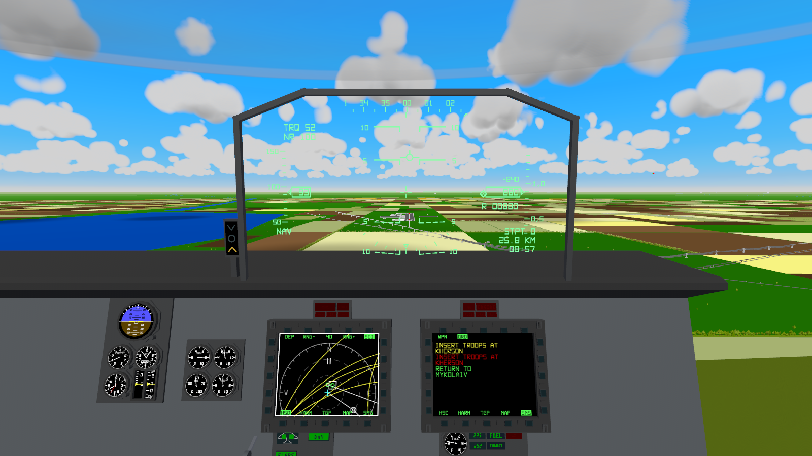

**Best for.** In a campaign it is the only aircraft for INSERTION, flies LOGISTICS and RESUPPLY
(as does the CH-47), is the first choice for CSAR, and flies nothing else.

## 3.7 AH-1Z VIPER


The first attack helicopter was improvised. In 1965 Bell took the engine, transmission and rotor of
its UH-1 Huey, put a slim fuselage under them with a gunner in front and the pilot above and
behind, and added a chin turret and stub wings for rockets. The **AH-1 Cobra** flew that September
and was in action over Vietnam two years later. It was half the width of a Huey, much faster, and
much harder to hit.

The US Army replaced its Cobras with the AH-64 Apache. The Marine Corps, which flies its helicopters
from ships, kept the narrow Cobra, gave it two engines (the AH-1J SeaCobra and AH-1W SuperCobra) and
in 1996 began the H-1 upgrade program, which rebuilt it almost from the ground up. The **AH-1Z Viper**
first flew on 7 December 2000 and entered service in 2011. It has a four-bladed, bearingless
composite rotor, new engines, a glass cockpit shared with the UH-1Y utility helicopter, and a
Target Sight System that finds and lasers targets from far beyond the range of the guns below.

The Viper's crew wears helmet-mounted displays that put the flight and targeting symbols on the visor
wherever they look; its three-barrel 20 mm turret gun follows the gunner's eyes. It carries up to 16
Hellfire missiles and, on its wingtips, a pair of Sidewinders for self-defence against helicopters
and slow aircraft.

| **AH-1Z VIPER** | |
|---|---|
| *Role* | Attack helicopter, two crew |
| *Manufacturer* | Bell, USA |
| *First flight* | 7 December 2000 |
| *Rotor diameter / length / height* | 14.6 m / 17.8 m / 4.4 m |
| *Engines* | 2 × General Electric T700-GE-401C, 1,340 kW (1,800 shp) each |
| *Maximum take-off weight* | 8,400 kg (18,500 lb) |
| *Maximum speed* | about 220 kt (410 km/h) in a dive, 160 kt cruise |
| *Armament* | 20 mm M197 turret gun, 16 Hellfire, 2 AIM-9 Sidewinder, rockets |

**IN THE GAME.** The Viper tops out near 180 kt in level flight, sits on skids and is armed for the
job: a **turret gun** (510 rounds), **16 Hellfires** on the stub wings (four on each of the inner
stations) and a **Sidewinder** on each wingtip, a full load every time. Its stores are external.

Its **helmet-mounted display** (chapter 5.4) puts the symbology wherever you look, and the targeting pod
and turret follow your eyes: fire a Hellfire without a lock and it goes where you are looking. The
turret is two entries in the weapon cycle: **GUN HMS** (the turret follows the helmet) and **GUN TGP**
(it follows the pod).

**Cockpit.** The UH-60's panel, narrowed: two MFDs, the up-front caps, no gear lights.

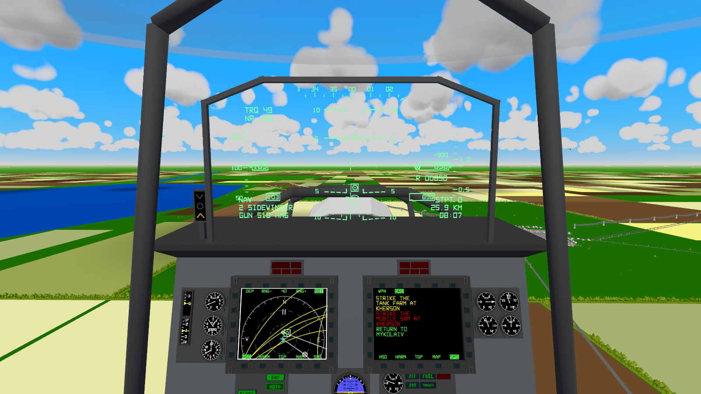

**Best for.** Escorting insertions (first choice), close air support against guns, MANPADS and armour,
and intercepting enemy helicopters.

## 3.8 RAH-66 COMANCHE


In the early 1980s the US Army began its Light Helicopter Experimental (LHX) program to replace its
thousands of Vietnam-era scout and light attack helicopters with one advanced design. The program
shrank as the Cold War ended, until it was a single aircraft: an armed reconnaissance helicopter
that would scout ahead of the Apaches and find the enemy before the enemy found it.

The Boeing-Sikorsky team won in 1991 with what became the **RAH-66 Comanche**, the first helicopter
designed for stealth. Its fuselage was made of faceted composite panels; its five-bladed main rotor
had a bearingless hub hidden under a fairing; its tail rotor was buried in a shrouded fan; its
gun swung back into a fairing when not in use; and its missiles rode inside, on bay doors that
opened only to fire. The engines' exhaust was mixed with cool air and spread along the tail boom
to cut the infrared signature. Its radar cross section was said to be several hundred times smaller than
the Apache's.

The first Comanche flew on 4 January 1996. Two prototypes were built and flew for eight years of
tests. But the program was expensive, the Army's priorities had moved to the wars in Afghanistan
and Iraq and to drones, and in February 2004 it was cancelled after nearly $7 billion had been
spent. One of the prototypes is on display at the US Army Aviation Museum in Alabama.

| **RAH-66 COMANCHE** | |
|---|---|
| *Role* | Stealth armed reconnaissance helicopter, two crew |
| *Manufacturer* | Boeing / Sikorsky, USA |
| *First flight* | 4 January 1996 |
| *Rotor diameter / length / height* | 11.90 m / 14.28 m / 3.39 m |
| *Engines* | 2 × LHTEC T800-LHT-801, 1,165 kW (1,563 shp) each |
| *Maximum take-off weight* | 7,900 kg (17,400 lb) |
| *Maximum speed* | about 175 kt (324 km/h) |
| *Armament* | 20 mm XM301 turret gun; on each internal bay door 3 Hellfire or 6 Stinger |

**IN THE GAME.** The Comanche is the stealthy helicopter. Its signature depends on its speed: radars
barely see it hovering or creeping along (a thirty-second of the F-117A's detection score), and it
grows steadily until at 180 kt and above it is as visible as an F-117A. Its EMV from height, speed and
bank is about a third of the normal value in the hover. Open bay doors, the gear and the ECM jammer
count in full. Slow down near the radars.

**The bays.** Its weapons ride inside, on the two bay doors: **three Hellfires or six Stingers per
door** (the default is Hellfires in both). Press fire and the doors open, the weapon leaves as soon as
they are open, and they close by themselves four seconds after the last shot. BAY (8) works by hand
too. The **FIM-92 Stinger** is a very short range infrared missile (1-6 km, farther head-on), aimed like
the Sidewinder, by helmet or HUD.

**Flight.** Retractable gear (the gear key works), level speed up to about 195 kt, slower in roll and
pitch than the AH-1Z but just as quick on the pedals.

**Sights.** The AH-1Z's: the full helmet display, the pod and the turret gun (510 rounds, heavy strikes)
following your eyes, GUN HMS and GUN TGP.

**Cockpit.** Two large MFDs side by side and two portrait **MPDs**. The left MPD is a threat scope: the
radars around you at their range and bearing, their missile envelopes, your own radar return as a
bloom with a dashed ring where they can't see you, a 30-second strip chart, and a warning, caution and
advisory list that flashes until you press master caution. The right MPD is the engine page. Keys: LDG
GEAR, PARK BRAKE, NAV / A-A / A-G, ECM, IRJ, **LASE** (designate); on the pedestal the standby attitude
screen, CHAFF, FLARE, DECOY, DCLT, NVG, MENU, VOL, TIME and AUTO.

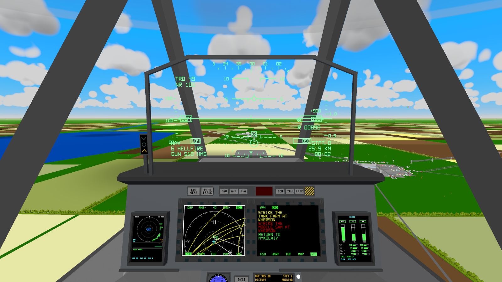

**Best for.** Escort (second choice), CAS and intercepting helicopters, and anything that means
sneaking up on an air defence site at walking pace.

## 3.9 OH-58D KIOWA WARRIOR


The Bell OH-58 Kiowa began as the military version of the Bell 206 JetRanger, the US Army's light
observation helicopter from 1969: a scout that flew ahead of the gunships in Vietnam, found the
enemy and called in the fire. By the end of the 1970s the Army wanted a scout that could see by
night and in bad weather, and stay hidden while it looked.

Bell won the Army Helicopter Improvement Program (AHIP) in 1981 with the **OH-58D**: a more
powerful engine, a four-bladed rotor and, on top of the mast, a ball the size of a beach ball. The
**mast-mounted sight** holds a television camera, a thermal imager and a laser designator above the
rotor, so the helicopter can hover behind a ridge or a tree line with only the ball showing and
find targets for others. The first one flew on 6 October 1983. Armed OH-58Ds escorted tankers
in the Persian Gulf in 1987-88, and the **Kiowa Warrior**, with weapons pylons on both sides, became
the standard version. It flew in the Gulf War, the Balkans, Afghanistan and Iraq, and was retired
in 2017.

| **OH-58D KIOWA WARRIOR** | |
|---|---|
| *Role* | Armed reconnaissance helicopter, two pilots |
| *Manufacturer* | Bell Helicopter, USA |
| *First flight* | 6 October 1983 |
| *Rotor diameter / length / height* | 10.67 m / 12.85 m (rotors turning) / 3.93 m (top of the sight) |
| *Engine* | 1 × Rolls-Royce (Allison) T703-AD-700, 485 kW (650 shp) |
| *Maximum take-off weight* | 2,495 kg (5,500 lb) |
| *Maximum speed* | about 125 kt (232 km/h) |
| *Armament* | Two universal weapons pylons: 2 Hellfire, 2 Stinger, rockets or a .50 cal machine gun pod each |

**IN THE GAME.** The Kiowa Warrior is the small, quick helicopter: quicker than the AH-1Z on the
cyclic and the pedals and answering the collective sooner, but draggier with its sight and pylons,
so the level speed tops out near 130 kt. It carries 750 lb of fuel and has skids, so the gear key
does nothing.

**The pylons.** One on each side, each with **two Hellfires**, **two Stingers** or an **M3P .50 cal
machine gun pod** (500 rounds), or nothing (the default is Hellfires on the left and a gun pod on
the right; change them on the LOADOUT page). The pods are its gun: they fire along the nose, so aim
with the helicopter; with the gun selected the helmet display shows the pipper. The outer missile
goes first, and the model shows what is left.

**Sights.** The targeting pod is the **mast-mounted sight**: always working, looking from above the
rotor, slaved to the lock or to your eyes like an attack helicopter's (chapter 5.2). Hide low behind
a hill with only the sight above it, lock, and fire Hellfires over the crest. The full helmet display
(chapter 5.4) shows where the sight is looking.

**Cockpit.** One wide panel across both seats (the pilot in the right one) under a low glareshield:
two large MFDs either side of the centre column with the standby instruments and the engine gauges,
the CDU and the caution and countermeasure panels on the console between the seats.

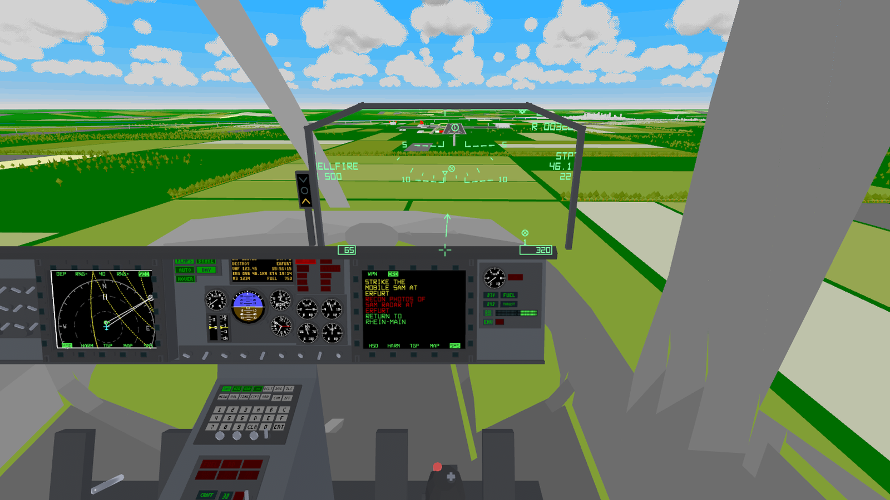

**Best for.** CAS, ESCORT and INTERCEPT against helicopters close to the front, and finding targets
from behind cover.

## 3.10 CH-47F CHINOOK


In 1956 the US Army asked for a turbine-powered helicopter that could lift a howitzer, a truck or
a platoon. Frank Piasecki's company, by then Vertol and later part of Boeing, had built tandem-rotor
helicopters since the 1940s: two rotors, one at each end of a long fuselage and turning opposite
ways, so neither needs a tail rotor to hold its torque and all the engine power goes into lift. The
YCH-47A first flew on 21 September 1961, and the **Chinook** entered service the next year.

In Vietnam Chinooks carried artillery to mountaintop fire bases, moved whole battalions and
recovered more than 11,000 downed aircraft on their cargo hooks. In the Falklands in 1982 a single
RAF Chinook, "Bravo November", the only one left after the *Atlantic Conveyor* was sunk, carried
troops, guns and casualties for weeks, once with 81 soldiers aboard. Rebuilt again and again, the
Chinook is still in front-line service more than sixty years after its first flight; the
**CH-47F**, from 2007, has a glass cockpit with digital displays and a digital flight control
system that holds the hover by itself.

| **CH-47F CHINOOK** | |
|---|---|
| *Role* | Heavy-lift cargo helicopter, two pilots and a flight engineer |
| *Manufacturer* | Boeing (Vertol), USA |
| *First flight* | 21 September 1961 (YCH-47A) |
| *Rotor diameter / length / height* | 18.29 m (each) / 30.14 m (rotors turning) / 5.68 m |
| *Engines* | 2 × Honeywell T55-GA-714A, 3,529 kW (4,733 shp) each |
| *Maximum take-off weight* | 22,680 kg (50,000 lb) |
| *Maximum speed* | about 170 kt (315 km/h) |
| *Payload* | 33-55 troops, or up to about 12,000 kg (26,000 lb) on the cargo hooks |

**IN THE GAME.** The Chinook is the cargo helicopter: unarmed, no stores, no gun. Flown with the
helicopter flight model, it feels different from every other helicopter in the game:

- **No torque.** Its two three-bladed rotors turn opposite ways and cancel each other's torque:
  raising or lowering the collective does not swing the nose, so the pedals stay where they are.
  The pedals yaw it by tilting the rotors apart, the cyclic pitches it by moving lift from one rotor
  to the other.
- **Heavy.** Slower in roll and yaw than the UH-60, slow to change its rotor speed, and with ground
  effect reaching higher under its wide rotors (about 60 ft). Plan a hover early.
- **Fast.** The level speed tops out near 165 kt. It carries 6,800 lb of fuel, and its two big
  turbines burn a lot of it.
- Fixed wheels (the gear key does nothing) and no ejection seat.

**Sling loads.** In a campaign the Chinook flies **LOGISTICS** and **RESUPPLY**, the same way as
the UH-60: hover over a crate to hook it and set it down by a new site's helipad, or hover at an air
defence unit to resupply it (chapter 9.14). It flies no insertions, no rescues and no combat
missions. In a single mission it flies the UH-60's insertions.

**Cockpit.** Two seats, the pilot in the right one. In front of the pilot two MFDs; in the middle
of the panel a larger display with the **engine page** (the RAH-66's: rotor speed, both engines'
torque, temperatures, oil, fuel and fuel flow, chapter 3.8); the copilot's two MFDs stay dark.
Left of the left MFD, over the engine gauges, the F-16's round RWR scope (chapter 3.2) shows the
radars painting you; fixed wheels and no weapons mean no gear lights, gear handle, FLAPS or BAY,
and there is no EMV bar graph. The
panel is low and cut away under the MFDs: below it, on both sides of the pedals, the big chin
windows look down at the ground, the best view of a hook load in the game. Eyebrow windows above
the windshield show the sky in a turn.

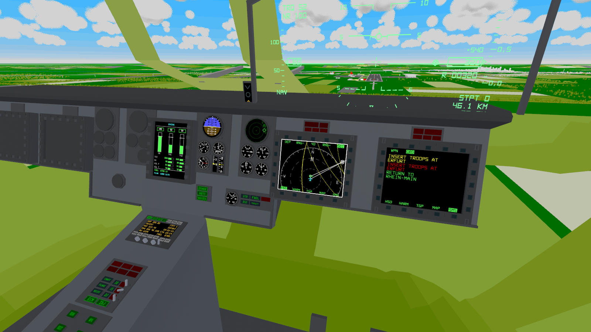

**Best for.** LOGISTICS and RESUPPLY, and nothing else.


---

# 4. IN THE COCKPIT

Every aircraft in the game has its own cockpit, but they share one language: the same HUD, the same
multi-function display formats, the same keys. This chapter describes it on the F-117A and the F-16C;
chapter 3 tells what each of the others adds.

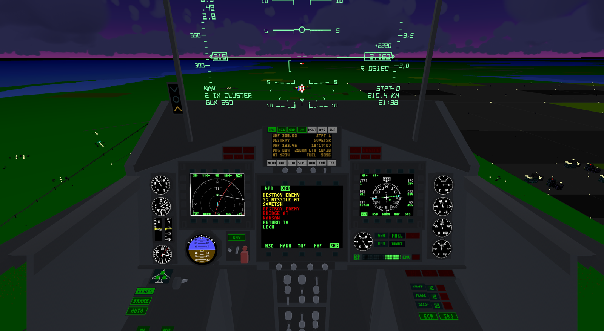

The view shows the head-up display (HUD) at the top and the instrument panel below it. Hold the
**right mouse button** to look around; turn the **mouse wheel** while holding it (or hold Numpad `*` / `/`) to zoom in. **Click** a button on the panel to press it. Every button
has a keyboard equivalent (Appendix A). Rest the mouse on a button, display, instrument or warning
light and a **tooltip** names it, says what it does and shows its keys; parts hidden behind the
stick, the throttle or the glare shield can't be pointed at.

With head or eye tracking (chapter 1.4) the view follows your head; **Home** recentres it. In VR
you simply look around, and press the cockpit's buttons with a fingertip.

For comparison, the **classic cockpit** (menu: *Cockpit: Classic*) uses a DOS era panel with
the 77×60-pixel displays and lit lamps instead of labelled bezel buttons:

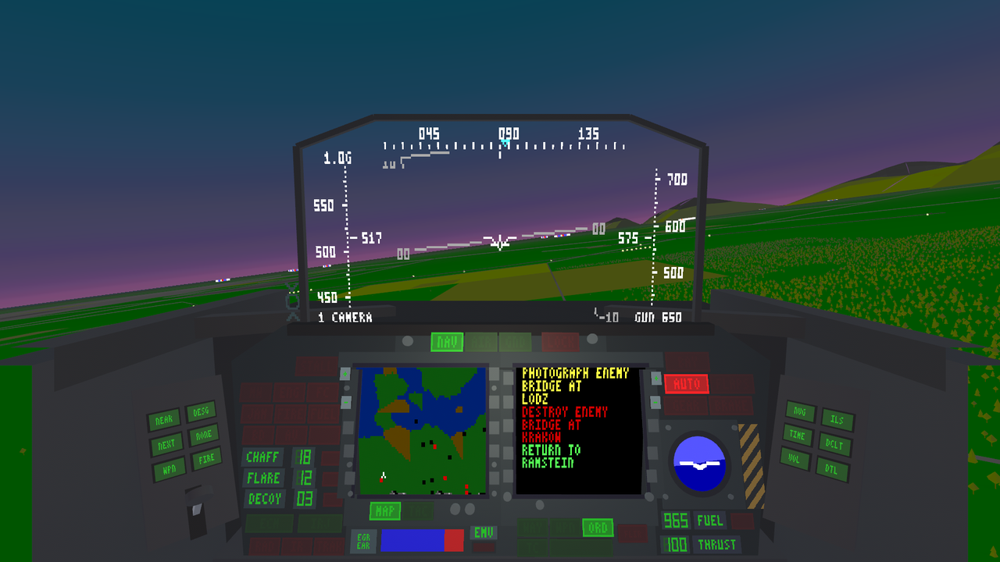

The rest of this manual describes the modern cockpit.

## 4.1 The HUD

The modern HUD is drawn in green in the style of the F-16's (in VR the F-117A's symbology is
drawn at half the size, about the F-16C's, so it stays in the middle of the large combiner):

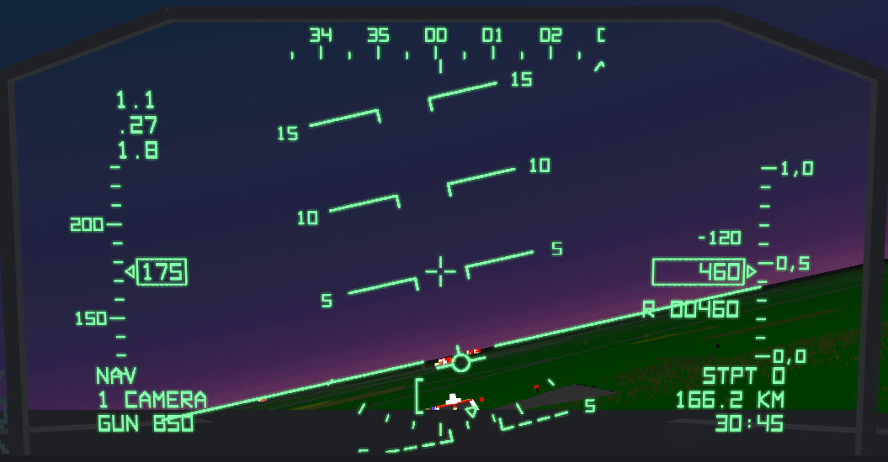

* **Top:** heading tape (tens of degrees) with the caret of the current steerpoint.
* **Top left:** g load, Mach number and the highest g of the flight.
* **Left / right:** airspeed scale (knots) and altitude scale ("1,5" = 1,500 ft) with the boxed
  readouts; climb rate in feet per minute above the altitude box, radar altitude ("R") below it
  under 5,000 ft.
* **Centre:** gun cross at the boresight and the flight path marker (the circle with wings: where
  the aircraft is going). The pitch ladder is centred on the flight path marker: a rung every
  5°, solid above the horizon, dashed and bent below it. With the gear down, the bracket left of
  the marker shows the approach angle of attack: marker in the middle of the bracket = on speed,
  high = fast, low = slow.
* **Bottom:** bank angle scale; mode, selected weapon and gun rounds (left); steerpoint number,
  distance and time to go (right). Messages such as "*Dessau detected*" appear at the top.

The modes add their own symbols:

* **NAV:** a diamond on the steerpoint on the ground; when the steerpoint is outside the HUD it
  waits at the HUD's edge in its direction, crossed out.

In every mode a small circle with a dot marks where the targeting pod looks while the TGP page is
up on an MFD, on the AH-1Z always (the classic HUD shows it and the steerpoint diamond too;
chapter 5).
* **AA:** the target designator box with the missile diamond once locked, the range below it;
  with an air-to-air missile selected the steering circle and dot, *SHOOT* in range, and the
  launch zone scale (maximum and minimum range, target range caret).
* **AG:** the target designator box (*IN RNG* in range); for guided bombs the azimuth steering
  line with the release cue that slides down to the flight path marker. With a free-fall or
  retarded bomb the bombsight replaces *AG* at the bottom left with its mode, **CCIP** or
  **CCRP** (chapter 5.1, *Bombing*), and the bottom right shows the slant range in nautical miles
  (*F004.2*) to the impact point (CCIP) or the target (CCRP), the time to release (CCRP,
  *REL 0:12*) and the bomb's time of fall (*TOF*):
  * **CCIP:** the bomb fall line runs down from the flight path marker to the pipper, a small
    circle with a dot where a bomb released now would land. While that point is below the HUD
    the pipper stays at the HUD's edge and the time delay cue crosses the line: dive steeper or
    wait.
  * **CCRP:** the azimuth steering line runs through the target designator box; the solution
    cue (a short bar on the line) slides down towards the flight path marker as the release
    point comes up and reaches it at release.
* **Gun** selected (in every mode): the gun pipper, where the target has to be for the rounds to
  hit (allowing for their flight time, the target's motion and drop). Without a lock it shows
  where the rounds hit the ground within 4 km; with a lock an arc around it unwinds with the
  range and *SHOOT* flashes within 2 km.

The **classic HUD** (menu: *HUD: Classic*) is a DOS era low-resolution HUD, as in the
classic cockpit picture above.

The HUD mode caps are the first four of the up-front display's top row (chapter 4.2):

| Button | Function |
|---|---|
| NAV | Navigation mode: steering to the current waypoint. |
| AIR | Air-to-air mode: aircraft targets. |
| GND | Air-to-ground mode: ground targets. |
| LOCK | Lamp: blinks while a target is designated, steady when the target is within weapon range. Pressing it designates a target (as N). |

F2 cycles through the modes; V declutters the HUD.

## 4.2 The F-117A's panel

The panel is laid out like the real F-117A's:

* **Up-front display** under the HUD: the **DED** (radio channels, steerpoint and target, clock,
  bearing, distance and ETA to the steerpoint, fuel) between two rows of caps (tables below).
* **Displays**: the large **centre display** (the right MFD's pages, chapter 4.9) between the
  **left MFD** and the **third MFD**, which starts on the **HSI** page (chapter 4.11). The warning
  lights sit over the side MFDs' inner corners.
* **Instruments**: airspeed, altimeter, AOA and vertical velocity tapes and the clock down the
  left edge; RPM, FTIT, oil pressure and nozzle position down the right. Under the left MFD the
  **attitude indicator** and the **BAY** cap; under the right MFD fuel, thrust and the radar bar
  graph.
* **Slopes and consoles**: the gear handle and aircraft systems on the left slope, the
  countermeasures on the right. Side stick on the right console, throttle on the left.

| Up-front display, top row | Key | Function |
|---|---|---|
| NAV, AIR, GND, LOCK | F2, N | HUD modes and designation (chapter 4.1). |
| DCLT | V | HUD declutter. |
| NVG | F4 | Night vision goggles. |
| ILS | F9 | Instrument landing system: the landing guidance on the centre display and, approaching a runway, the F-16-style ILS steering bars on the HUD (*ILS* at the bottom left): the localizer bar (upright) and glideslope bar (level) are referenced to the flight path marker; fly the marker to where they cross to be on the centreline and the 3° glide path. Each bar stops at full scale (2.5° off the centreline, 0.7° off the glide path). |

| Up-front display, bottom row | Key | Function |
|---|---|---|
| MENU | Esc | Open or close the in-flight menu (chapter 4.7). |
| VOL | Alt V | Sound level. |
| TIME | Shift Z / Shift X | Time acceleration on/off. Each press of Shift Z, like each click on the cockpit TIME button, goes faster (ACCEL, ACCEL x2, ACCEL x3, up to three times the plain acceleration), then back to normal time; Shift X returns to normal time at once. Acceleration ends automatically when a radar detects the aircraft or a weapon is released. |
| STPT | F7 | Waypoints. |
| ORD | F10 | Mission orders. |
| COM, IFF | - | Not used. |

## 4.3 Warning lights

The lights are dark when inactive. Left: **MASTER CAUTION** (missile warning), **STALL**
(airspeed below stall speed, blinks), **TRACK** (an enemy radar tracks the aircraft), **IR**
(an infrared missile is in flight) and **LAUNCH** (a radar-guided missile is in flight).
Right: **ENG FIRE** (fire on board), **ENGINE** (engine damage), **FLCS** (fire control
damage), **JAM** (jammer damage: ECM and IRJ fail) and **AV** (avionics damage). The caution
lights at the top of the right slope: **FUEL** (fuel system damage), **BD** (bay door damage:
the doors stay open); the others are not used.

A fire on board also sounds the fire warning siren until the fire is out (with realistic damage
a fire burns out or blows the aircraft up; with game damage it burns on, leaking fuel). A damaged aircraft
trails smoke (grey, black when badly hit), and flames while it burns.

## 4.4 Gear, aircraft systems and targeting (left slope)

The gear handle (its arm shows the gear position: down = gear down) with the gear lights left
of it (an aircraft outline with a green lamp at each wheel while the gear is down), the caps
under them, and below them ahead of the throttle the target buttons. The **BAY** cap is under
the left MFD.

| Button | Key | Function |
|---|---|---|
| Gear handle | 6 | Landing gear. |
| FLAPS | 9 | Flaps: extend over about 3 s; more lift and a higher angle of attack limit, about 20 % lower stall speed. |
| BRAKE | 0 | Wheel brakes on the ground, speed brake in the air. |
| AUTO | 7 | Autopilot: flies to the current waypoint. |
| BAY | 8 | Weapon bay doors open/close. Weapons can only be released with open bays. |
| NEAR | T | Lock the nearest target ahead. AIR or GND mode depends on the selected weapon. |
| NEXT | B | Select the next target. |
| NONE | Shift B | Clear the target. No automatic acquisition until the next target or camera key. |
| WPN | Space | Select the next weapon, after the last one the gun. |
| DTL | Alt D | Detail level. |

The selected weapon is released with Enter, the gamepad's A button or the right VR trigger while
the hand holds the stick.

## 4.5 Countermeasures (right slope)

| Control | Key | Function |
|---|---|---|
| CHAFF | 2 | Release chaff. The counter shows the remaining stock; the lamp on the right lights on release. |
| FLARE | 1 | Release a flare. |
| DECOY | 5 | Release a decoy. |
| ECM | 4 | Radar jammer on/off (lit when on). |
| IRJ | 3 | IR jammer on/off (lit when on). Switches itself off after 20 s of continuous use and must cool down. |

## 4.6 Fuel, thrust and the radar bar graph

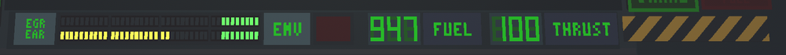

Under the right MFD, right of the fuel quantity: **FUEL** (fuel in lbs divided by 10) with the
**LOW FUEL** lamp (blinks below bingo fuel) and **THRUST** (in percent); under them the
**EGR/EAR radar bar graph** (described in chapter 7.2) with the **EMV** warning lamp (lit for
2 s after each detection).

Bingo fuel, below which every aircraft's low-fuel light (BINGO, LOW FUEL) blinks and the
helicopters' displays list LOW FUEL, is about what gets that aircraft home with a reserve:

| Aircraft | Fuel (lbs) | Bingo (lbs) |
|---|---|---|
| F-117A, F-16C | 10,000 | 2,000 |
| Tornado IDS | 11,000 | 2,500 |
| A-10C | 10,700 | 1,800 |
| AV-8B | 6,000 | 1,500 |
| UH-60A, AH-1Z, RAH-66 | 2,400-2,600 | 400 |
| OH-58D | 750 | 150 |
| CH-47F | 6,800 | 1,200 |

## 4.7 The in-flight menu

**Esc** (also Pause, Alt P, the gamepad's Start button, the **MENU** cap of the F-117A's up-front
display or the F-16C's **MENU** key) opens the menu and pauses the flight: in VR a screen in front of the pilot, on
the desktop over the middle of the window. In VR, touch an
entry with a fingertip and pull the trigger, or use a thumbstick and A / X. On the desktop, click
an entry or use the arrow keys and Enter (gamepad: d-pad and A). Esc, BACK or the gamepad's B go
back a page; on the first page they close the menu.

| Entry | Function |
|---|---|
| Resume | Closes the menu (as does Esc again). |
| Save mission | Single missions only, while still in the aircraft: saves the flight as it is (the world, your aircraft, route, stores and the flight's record); LOAD in the single mission screen flies it on (chapter 1.2). Views, MFD pages and the kneeboard start afresh. |
| Options | The pages of the main menu's OPTIONS (chapter 1.3) that apply in flight, below. |
| Key guide | The keys as bound, the mouse or the VR controllers. Type to keep only the keys whose description holds the text (any case); Backspace deletes, the field's X or Esc clears it. In VR, a fingertip on the field and the trigger open a keyboard on the screen: touch a key and pull the trigger to type, DONE closes it. |
| End mission | Ends the flight and goes to the debrief. |

| Page | Entries |
|---|---|
| Game | *Cockpit* (F-117A only), *HUD*, *Avionics*, *Auto trim*, *Tooltips*, *Cockpit size* (VR only, 70-150 %: the size of the cockpit and the world in the VR headset). The flight model and Tacview are set in the main menu. |
| Graphics | *Shaders*, *Shadows*, *Point lights*, *Time of day*, *Anti-aliasing*, *Sun and moon* (with the classic time of day), *Auto scenery detail* (in VR). |
| Effects | The effect switches of OPTIONS > GRAPHICS: shake, flashes, barrage, night lighting, NVG, snow, mist, cloud shadows, sunbeams, vapour, night sky; VGA colours, scanlines and pixelize. |
| Sound | The *Master*, *Engine*, *Effects*, *Warnings* and *RWR* volumes in steps of 10 % (left / right or the < > halves), *Engine low-pass*. |
| Controls | *Head tracking* (desktop), *Keys and joystick*: the input mapping (chapter 1.4) over the view, in VR on a panel in front of you (point a controller, the trigger clicks); DONE returns to the menu. The key guide. |

Changes apply at once and are saved as the defaults for the next flight.

## 4.8 The kneeboard

A kneeboard lies on your left thigh: look down to read it. Its tabs: **BRIEF** (orders,
objectives, weather, armament, rules of engagement), **ROUTE** (each leg's bearing, distance and
time), **MAP** (the route and the SAM ranges) and **TARGET** (a close-up of the primary target and
the intelligence summary). Achieved objectives are ticked.

* Desktop: click a tab; **K** shows the board large over the view and turns its pages; **Esc** puts it away (a second Esc opens the menu).
* VR: touch a tab with a fingertip; **K** or the *Kneeboard* action hides or shows it. Squeeze
  the grip with a hand on the board to pick it up and leave it floating in the cockpit.

## 4.9 The MFD pages (classic avionics)

Most panels have two multi-function displays (MFDs); the F-117A and the Tornado have three. The
F-117A's right MFD is the large centre display, the Tornado's sits high under the HUD, and the third
MFD of both starts on the HSI (4.11; with the modern avionics it shows any format). With the **classic avionics** (menu: Classic /
Modern, Avionics) they show the low resolution pages described here; the **modern avionics** are in
chapter 4.10. The labelled buttons above and below each screen select the pages and their
functions. The button of the active page is lit.

| Left MFD buttons | Function |
|---|---|
| MAP / TAC | Select the page (key F3 toggles). |
| NUP / HUP | Map orientation: north up or heading up (Alt F3). |
| ZM- / ZM+ | Zoom out / in (Alt X / Alt Z). |

| Right MFD buttons | Function |
|---|---|
| TC | Tracking camera. |
| WAY | Waypoints (F7). |
| WPN | Weapons (F5). |
| ORD | Mission orders (F10). |
| FLIR | Thermal camera on/off (F6). |
| Lower row | Page functions, see below. |

<table>
<tr>
<td width="50%">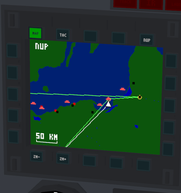<br>
<b>MAP</b> - Top-down map of the theater with the own aircraft (triangle), the route and
waypoints, airbases and ground objects. A scale bar is shown at the bottom left. During a radar
sweep, the map shows the radar's coverage (chapter 7.3).</td>
<td width="50%"><br>
<b>TAC</b> - Heading-up tactical display with a grid (spacing shown at the bottom). Own aircraft
in blue. Other aircraft are shown as triangles pointing in their direction of flight: red at
the same altitude (±1000 ft), dark red below, yellow above. Missiles are shown as short lines;
radar sites, airbases and targets as icons.</td>
</tr>
<tr>
<td><br>
<b>TC</b> - Tracking camera. Shows the current target with its name, range, bearing and
zoom factor. AHD / RGT / REAR / LFT (keys / , . M) point the camera ahead, right, rear or left;
each press also picks the nearest object in that direction. The last bottom button sets the zoom
(AUTO by range, then 1X..6X; also `[` / `]`).</td>
<td>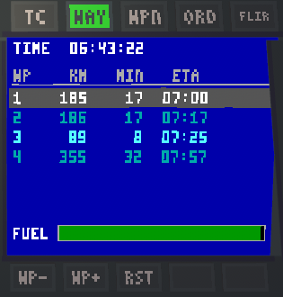<br>
<b>WAY</b> - Mission time and waypoint table: distance, flight time and ETA for each waypoint,
and a fuel bar (reserve green, needed white and blue, used black). WP- / WP+ (PgUp / PgDn)
select a waypoint. F8 edits it (red): keypad 8 / 2 / 4 / 6 move it over the MAP, 9 / 3 select
the last / next one; F7 leaves. RST (Shift F8) restores the original route. In the cockpit the bezel buttons of the MFD's side edges do the same: down the left edge UP, DN, LFT, RGT move the selected waypoint and RST resets the route; on the right edge WP+ / WP- (top) select the waypoint and MOV (bottom) is F8, lit while the page is in edit mode. The slew and RST buttons work in edit mode only (they are blank before). The classic cockpit has them too, as arrows (up, down, left, right, reset) down the left edge of the right MFD and MOV at the bottom of its right edge.</td>
</tr>
<tr>
<td>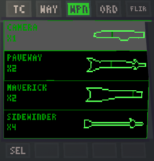<br>
<b>WPN</b> - The weapons carried and how many are left; the selected one is highlighted.
SEL (Space) selects the next weapon, after the last one the gun; the button next to it shows
the bombsight mode, CCIP or CCRP, and switches it (Alt F2).</td>
<td>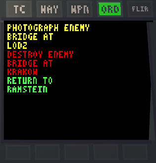<br>
<b>ORD</b> - Mission orders: primary objective (yellow), secondary objective (red), landing
base (green).</td>
</tr>
<tr>
<td>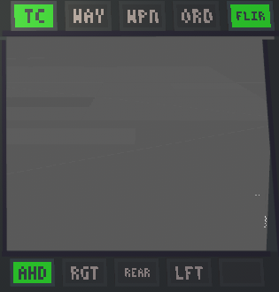<br>
<b>FLIR</b> - The tracking camera as a black-and-white thermal picture: aircraft, vehicles and
buildings appear bright.</td>
<td></td>
</tr>
</table>

## 4.10 Modern avionics

With the modern avionics each MFD can show any of five F-16 style formats, chosen with the
bottom row of bezel buttons: **HSD**, **HARM**, **TGP**, **MAP** and **SMS**; the third MFD
(F-117A, Tornado) offers **HSI** in place of TGP. The buttons' functions are written on the display next
to them (lit = selected); the bezel caps are blank. Choosing a format another MFD shows swaps
the two. F3 cycles the left MFD through HSD, MAP
and HARM; F5 / F10 bring up SMS, the camera keys the TGP (F6 too, switching its FLIR on or
off with each press), F7 the waypoint table.

**Weapons by master mode.** With the modern avionics each weapon belongs to a HUD mode, as in
the F-16: the air-to-air missiles (AIM-9, AIM-120, Stinger) to **AA**, the bombs, Mavericks,
HARMs, rockets and the other air-to-ground stores to **AG**, the gun to either. Space steps only
through the weapons of the mode you are in, and changing the mode (F2, the AA and AG buttons,
nearest target) selects one of the new mode's weapons. In **NAV** nothing fires, the gun
included; the trigger then tells you which mode to select. The camera and the fuel tanks work in
every mode. With the classic avionics every weapon can be selected and fired in any mode.

| Format | Top row buttons | Shows |
|---|---|---|
| HSD | DEP / CEN, RNG-, range, RNG+, SOI | Horizontal situation display, heading up: range rings (the range in km is the outer ring), the route with the current steerpoint ringed, SAM sites with their missile's reach as red threat rings, hostile (red) and friendly (green) aircraft, ships (hull symbols, red or green; armed ones with their threat ring), missiles, the mission targets (cyan diamonds); the locked target is boxed. |
| HARM | ALL / SAM / AIR, SOI | The radars painting the aircraft, like the RWR: at their bearing, the most dangerous nearest the centre (chapter 3.2). |
| TGP | FLIR, zoom, SP, CZ, SOI | The targeting pod (tracking camera), see below. The pod's mode (SLV / AREA / PNT / SP) is shown bottom left, the zoom bottom right (AUTO: by range). |
| MAP | NUP / HUP, ZM-, ZM+, WAY | The moving map in muted colours; WAY switches to the waypoint table (SOI; the side edges have UP, DN, LFT, RGT, RST, WP+, WP- and MOV): while it is the SOI, the keypad moves the waypoint being edited (F8). |
| SMS | WPN, ORD, SEL, CCIP / CCRP | Stores (WPN): the inventory by station, mirrored pairs on one row, the selected store highlighted, the bombsight mode and the **release program** down the sides: RP+ / RP- set how many bombs one release drops (1-4, a *ripple*), SPC+ / SPC- the spacing between their impacts (25-500 ft, 100 by default). ORD: the mission orders. |
| HSI | WP-, WP+ | Horizontal situation indicator (chapter 4.11). |

**Sensor of interest (SOI).** The HSD, HARM display or TGP with the white frame is the SOI (its
SOI button, or Alt S to move it). Its cursor moves with the **sensor/cursor slew** controls:
keypad 8 / 2 / 4 / 6, the left VR thumbstick or two bound joystick axes. **Lock cursor target**
(keypad Enter, left thumbstick click or a bound button) locks what is under the cursor: an
aircraft, a ground object, a ship or a radar. Held on the HSD or HARM display it opens a 4×
magnified window; letting go locks. Z / X change the HSD range. The cursor stays on its target
as you turn.

**Targeting pod.** The TGP format and how to work the pod (SLV, AREA, PNT, SP, CZ, zoom and
locking with it) are in chapter 5.2. The HSD shows where the pod looks: a green diamond on its
ground point with a dashed line from the aircraft.

## 4.11 The HSI page (third MFD)

A heading-up compass rose with the heading boxed above it. WP- / WP+ select the previous / next
steerpoint.

* Green **course arrow**: the leg to the current steerpoint. Its middle part, the **deviation
  bar**, shows how far you are off the course (one dot 2.5 km, two dots 5 km).
* Small green triangle: TO (along the arrow) or FROM (once the steerpoint is passed).
* Cyan **bearing pointer**: points at the steerpoint.
* Left: steerpoint number, distance (km), ETA. Right: bearing, course, ground speed (kt).


---

# 5. SENSORS AND TARGETING

A weapon is only as good as the lock you give it. This chapter covers finding and locking targets:
the basic procedure, the targeting pod, and the helmet sights.

## 5.1 Finding and hitting a target

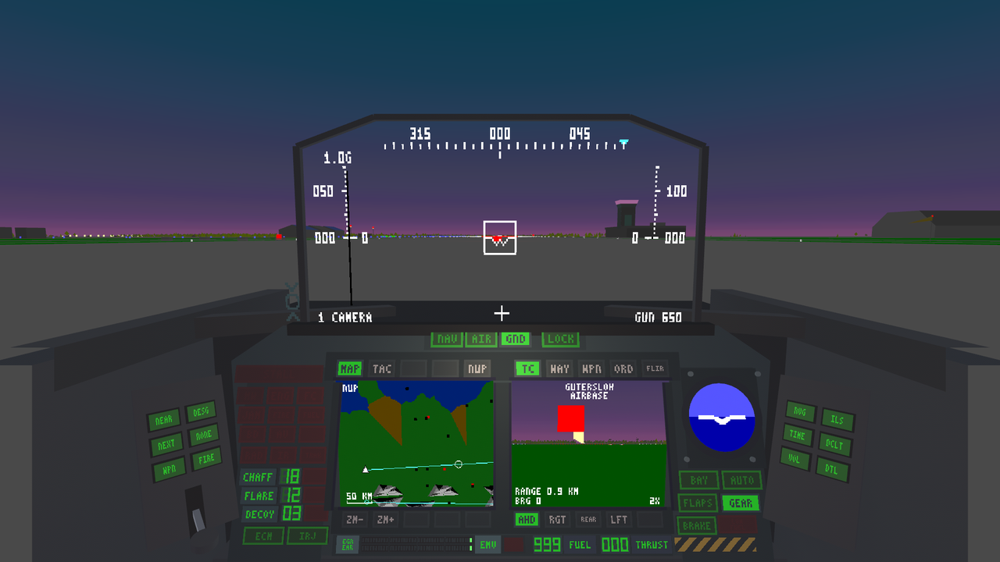

The picture shows a ground target locked in GND mode: the HUD box marks the target, the TC page
shows the target (here *Gutersloh Airbase*, 0.9 km), and the GND lamp is lit.

**Procedure**

1. Select the weapon with **WPN** (Space). The HUD shows it at the bottom left.
2. Lock a target: **NEAR** (T) for the nearest target ahead, **DESG** (N) to designate,
   **NEXT** (B) to step through targets. The camera keys (/ . , M) also select targets in
   their direction.
3. F-117A: open the bay doors (**BAY**, 8). The other aircraft carry their stores outside (the
   RAH-66 opens its doors itself).
4. Release with Enter (gamepad A, VR: right trigger) when **LOCK** is steady. In the F-117A and the
   RAH-66 releases fail with *Bay closed* (the Comanche opens its doors by itself);
   with a bank angle above about 67°, or on the ground (*Insufficient Altitude*).
5. Close the bay doors. Open doors increase the radar signature (chapter 7.1).

**Bombing:** free-fall and retarded bombs have two release modes; CCIP is the default. Switch
with Alt F2, the F-16's **A-G** button pressed again in AG mode, or the CCIP / CCRP button on the
weapons page. The HUD shows the mode at the bottom left (in AG mode).

* **CCIP** (continuously computed impact point): put the pipper at the end of the bomb fall line
  on the target and release with Enter. Free-fall bombs need a dive or some height to bring the
  pipper into the HUD; low and level, retarded bombs do.
* **CCRP** (continuously computed release point): lock the target (NEAR, DESG, NEXT or a display
  lock), steer the flight path marker onto the azimuth steering line and hold Enter (or the
  trigger): the bomb is released by itself when the solution cue reaches the flight path marker,
  i.e. when the target passes the release point. Pressing Enter does not release the bomb in
  CCRP; without a target the HUD says *No target designated*. Let go of the button to hold
  the release. With the targeting pod slewed off the lock, CCRP aims at the pod's point.
* **Ripple**: the SMS page's release program (chapter 4.10) drops up to four bombs per release,
  spaced along your track; in CCRP the stick is centred on the target.

**Gun:** select it with **WPN** (Space) after the last weapon, or fire it with Backspace
whatever is selected. Hold the trigger (Enter, gamepad A, VR: right trigger) with the target in
the gun pipper (chapter 6.3). The real F-117A has no gun: with *Realistic weapons* there is none.

**Weapon view:** Shift F4 follows your newest missile or bomb in flight from behind (above a
falling bomb); pressed again it switches to your next weapon in flight. After the impact the camera
stays on the explosion and slowly pulls back for 10 seconds, then returns to the view you came
from. The right mouse button orbits around the weapon and the mouse wheel zooms.

Ground targets under cloud cannot be designated (*Target obscured*). IR and optical seekers
(AIM-9, Maverick, laser-guided bombs) need a clear line of sight.

With Sidewinders selected in the air-to-air HUD mode you hear the seeker: a low growl while it
searches, a higher growl once the locked target is in its view (the LOCK oval), and a
steady high tone when the target is in range: fire.

**Weapons**: the stores, their ranges and how to deliver each one are in chapter 6; locking
with the targeting pod and the helmet sights in chapter 5.

## 5.2 The targeting pod

The F-16C and the F-117A carry a targeting pod (TGP) with the modern avionics; its picture is the
**TGP** format on an MFD (chapter 4.10). With the classic avionics the TC page shows the same
camera, pointed only by the camera keys. On the AH-1Z, the RAH-66 and the OH-58D (its mast-mounted sight) the pod is always working, with or without
its format on a display. The pod's picture shows in the forward cockpit view, not while you look
left, right or back.

**Bringing it up.** The TGP button under an MFD, or a camera key: `/` `.` `,` `M` point it
ahead, rear, right or left and pick the nearest object that way; T (nearest target) does the
same ahead. F6 brings up the TGP and switches its thermal picture (FLIR) on or off with each
press. B (next target) moves the pod onto the next target without bringing up the page; N
(designate) and Shift B (clear) leave it where it looks.

The format's top row: **FLIR** (black-and-white thermal picture), the **zoom** (AUTO or 1X..6X),
**SP** (snowplow), **CZ** (cursor zero, blank in A-A) and **SOI**. Bottom left the pod's mode,
bottom right the zoom; the cross in the middle is where the pod looks.

| Mode | The pod... | How you get there |
|---|---|---|
| **SLV** (slaved) | looks at the locked target. Without a lock it looks where the camera keys turned it, about 10° below the horizon (the AH-1Z's and RAH-66's look where you look, chapter 5.4). | Every target key (T, B, the camera keys), every lock on a display. |
| **AREA** | turns with the slew controls, steadied against the aircraft's motion. | Slew with the pod the SOI. |
| **PNT** (point) | holds the ground point it looks at, wherever the aircraft flies. | A moment (0.15 s) after the slew stops, on a ground point within 40 km. Above the horizon or farther, it stays in AREA. |
| **SP** (snowplow) | looks straight ahead and about 9° down, turning with the aircraft, holding nothing; the locks are dropped. | SP with the pod the SOI. Slew from there, or press a target key. |

**Finding and locking a target with the pod:**

1. Make the TGP the **SOI** (its SOI button, or Alt S until the white frame is on it). The pod
   only slews while its format is up and it is the SOI.
2. Point it near the target: **CZ** turns it to the current steerpoint (on a strike that is the
   target) and holds it there; a camera key turns it to a quarter; SP puts it ahead of the nose.
3. **Slew** onto the target: keypad 8 / 2 / 4 / 6 (and the diagonals 7 / 9 / 1 / 3), the left VR
   thumbstick, or the two joystick axes bound as *Sensor/cursor slew X/Y* (chapter 1.4). Full
   deflection turns the pod about 28° a second at 1X, half that at each zoom step (under 1° a
   second at 6X), so zoom in for the last bit. Beyond 3 km the response is finer around the
   centre and a held slew starts slowly, building up to full rate within a second: tap it for
   small corrections.
4. **Zoom**: the zoom button steps AUTO, 1X .. 6X; `[` / `]` zoom out and in, and so do Z / X
   while the pod is the SOI. 1X shows about 17°, each step half of that; AUTO zooms in one step
   each time the range doubles from 500 m.
5. **Let go.** The pod holds the point (PNT). Settled within 30 m of a vehicle, building or site
   it locks it by itself: the HUD goes to GND and the pod to SLV, following the lock. An
   anti-aircraft gun can't be locked; the pod just holds on it. On a **moving tank or IFV** the pod
   point-tracks the vehicle as it drives, and the lock follows it until it is destroyed.
6. Otherwise press **Lock cursor target** (keypad Enter, the left thumbstick click in VR, or a
   bound button): it locks the object nearest the pod's point within about 125 m, else the
   ground point itself (*GROUND POINT*), and the pod follows the lock (SLV). In SP it locks the
   ground ahead of the snowplow line; in SLV the button does nothing. Under a cloud the HUD says
   *Target obscured* and nothing is locked.

The pod turns about 170° either side of the nose, 100° down and 29° up from the airframe. Where
it looks shows on the HUD and the helmet visor (a small circle with a dot) and on the HSD (a green
diamond with a dashed line from the aircraft).

**Which weapons use the pod.** The **Hellfire** flies to wherever the pod looks, lock or no lock
(chapter 6.5). The **Maverick**'s and the Hellfire's launch zones are measured to the pod's
point when you have slewed it off the lock. The laser-guided **GBU-12** does not need the pod: it
guides on the locked target however it was locked, as long as you can see it (chapter 6.6). Every
other weapon uses the lock, which the pod is one way to make.

## 5.3 The F-16C's helmet (HMCS)

The F-16C's pilot wears a helmet-mounted cueing system (HMCS), the AH-1Z's, RAH-66's and OH-58D's crews a full
helmet-mounted display (5.4). The other aircraft have neither. The symbology is drawn on the visor,
40° wide and 30° high, wherever you look in the cockpit (also in the look left, right and rear
views), and lies on the world like the HUD's.

**Where you look** is the helmet sight:

- **Desktop:** hold the right mouse button and move the mouse (up to about 150° either side);
  the wheel zooms meanwhile.
- **Head or eye tracking** (chapter 1.4): the tracker turns the view and the sight with it; Home
  recentres.
- **VR:** Your VR headset orientation.

**The HMCS shows** the horizon, the boxed airspeed (left) and altitude (right), the route's
waypoints (the current steerpoint larger, with its number), the locked target (a box on a ground
target, a diamond on an aircraft; off the visor an arrow points towards it), where the targeting
pod looks, and with Sidewinders selected the seeker's circle. It has no aiming cross.

**Locking an aircraft by looking at it (Sidewinder):**

1. Select the **AIM-9** (Space) and the **AIR** mode (F2, or the F-16C's A-A button).
2. Look at the aircraft. The seeker's 6° circle follows your eyes up to 40° off the nose.
3. The seeker locks the aircraft nearest the middle of the circle by itself (no button): a
   diamond on it, and the growl rises. It must be in sight, not behind a cloud.
4. Keep looking at it. The steady high tone says it is in range: fire (Enter). Look away and the
   seeker loses it as it leaves the circle.

The seeker does not tell friend from foe: in multiplayer it locks other players as readily. A
lock you made yourself (T, B, the HSD cursor) is kept: the circle then sits on that target
instead of following your eyes, and the lock is not dropped when you look away.

The helmet only aims the Sidewinder. The AIM-120 locks with the HUD keys and the HSD, ground
targets with the target keys, the displays and the pod (5.2); the F-16C's pod does not follow the
helmet.

## 5.4 The AH-1Z's and RAH-66's helmet (HMD)

The AH-1Z's, the RAH-66's and the OH-58D's visor shows everything the HMCS does except the waypoints, and:

- a **cross** where you look: the line of sight that a helmet-slaved gun follows;
- the turret gun's **pipper** while the gun is slaved to the helmet, where its rounds go; at the
  visor's edge it blinks, crossed out, when the target is beyond the turret's reach;
- the gun line under the cross while the gun is selected (`GUN 510 HMS` / `GUN 510 TGP`).

**The pod follows your eyes.** Without a lock their pod (SLV) looks wherever you look;
with one it looks at the lock. So:

- **A Hellfire fired without a lock goes where you are looking** (and keeps following the pod,
  so keep looking at the target until it hits).
- **To lock a ground target by looking at it:** look at it, nudge the slew with the TGP the SOI
  (the pod goes to AREA from your line of sight), and let go: it settles on the point and locks
  what is there (5.2, step 5), or press **Lock cursor target**. T and B also pick targets in the
  pod's direction.
- **Aircraft** lock as on the F-16C: the Sidewinder's seeker follows your eyes (5.3).

**The turret gun** is two entries in the weapon cycle (Space): **GUN HMS**, the turret pointing
wherever you look, then **GUN TGP**, the turret following the pod; the next press goes on to the
missiles. The turret turns 110° either side, 50° down and 20° up.


---

# 6. ARMS AND EQUIPMENT

## 6.1 Rules for every weapon

- **HUD mode:** air-to-air weapons in AIR, all others in GND. T (nearest target) switches to
  the selected weapon's mode by itself.
- **Release:** the F-117A's bay doors open (*Bay closed*, except the fuel tank; the RAH-66 opens
  its own; every other aircraft carries its stores outside), bank under 67°, and in the air (*Insufficient Altitude* on
  the ground or the deck). At most four of your weapons fly at a time: a fifth press uses up a
  round without firing it. Each shot comes off the bay or station with the most rounds left.
- **Lock:** a guided air-to-ground missile is given its target at launch only while the LOCK
  lamp is on (the target in front of you and within its range); fired without, it flies on
  blind. The HARM only takes a radar, the Penguin and the Harpoon only a ship.
- **Clear sky:** the Sidewinder, the Maverick, the Hellfire and the laser-guided bombs need to
  see their target: none of them can be aimed at a target under a cloud. Radar weapons see
  through clouds.
- **Effect:** each weapon works better against some targets than others: a hit with too light
  a weapon may leave the target standing (*Ineffective*). The HARM only kills radars, the
  Durandal and the mines runways; the Maverick and the Hellfire are best against armour,
  launchers and radars; the GBU-12 and the CBU-72 do well against nearly everything.

**The launch zone.** With a missile selected and a target locked, the HUD's scale shows the
range at which it can reach the target: a line from the shortest to the longest range with a
caret at the target's range, and for air-to-air missiles a box for the no-escape range (the
target can't outrun the missile even if it turns away at launch). The zone is worked out by
flying the real missile from your present speed, altitude and pitch, so climbing, diving and
speeding up move it. **SHOOT** blinks while the caret is in the zone, **TOO CLOSE** inside the
shortest range. The guided bombs have no zone: their cue is *IN RNG*.

**Realistic and classic guidance** (the *Guidance* switch, chapter 1.2). Classic missiles turn in
fixed steps and fly until their fuel time runs out. Realistic missiles fly proportional
navigation to the collision point, burn their motor for the real one's burn time (the smoke trail
ends with it) and then glide, slowing with every turn; they must see the target within 30° of
their nose to lock on. In a campaign or a coop game the server's setting applies.

## 6.2 Ranges and who carries what

The ranges are those the LOADOUT page gives for each store (in level flight at 450 kt, ballistic
bombs at 500 kt); a missile reaches farther from higher and faster, and an air-to-air missile
farther head-on.

| Weapon | Against | Range | Launch / release height | Carried by |
|---|---|---|---|---|
| AIM-9M Sidewinder | Aircraft (IR) | 1-12 km | Any | F-117A*, F-16C, Tornado, A-10C, AV-8B, AH-1Z (wingtips) |
| AIM-120A AMRAAM | Aircraft (radar) | 1-38 km | Any | F-117A*, F-16C, Tornado (wing rails) |
| FIM-92 Stinger | Aircraft (IR) | 1-6 km | Any | RAH-66 (6 per bay door), OH-58D (2 per pylon) |
| AGM-88A HARM | Radars | 9-50 km | 5,000-20,000 ft | F-117A, F-16C, Tornado |
| Penguin 3 | Ships | 6-14 km (classic guidance 13-14) | 100-500 ft | F-117A, F-16C, Tornado |
| AGM-84A Harpoon | Ships | 6-41 km | 2,000-5,000 ft | F-117A, F-16C, Tornado, AV-8B (inboard) |
| AGM-65 Maverick | Ground (TV) | 5-10 km | 2,000-5,000 ft | F-117A, F-16C, Tornado, A-10C, AV-8B |
| AGM-114 Hellfire | Ground (laser, the pod's spot) | 4-8 km | 2,000-3,000 ft | AH-1Z (16), RAH-66 (3 per bay door), OH-58D (2 per pylon) |
| GBU-12 Paveway | Ground (laser) | 1.5 km to 2.5 × height (14 km from 15,000 ft) | 15,000-25,000 ft | F-117A, F-16C, Tornado, A-10C, AV-8B |
| Mk 20 Rockeye II, CBU-72 FAE | Ground (laser) | 1.5 km to 2.5 × height (3.7 km from 3,000 ft) | 3,000-5,000 ft | F-117A, F-16C, Tornado, A-10C, AV-8B |
| Mk 82 LDGP | Ground | 5-11 km short of the target | 3,000-20,000 ft | F-117A, F-16C, Tornado, A-10C, AV-8B |
| Mk 122 Fireye | Ground | 0.9-2.2 km short | 100-500 ft | F-117A, F-16C, Tornado, A-10C, AV-8B |
| Mk 20 Rockeye, Mk 35 | Ground | 1.1-1.6 km short | 300-1,000 ft | F-117A, F-16C, Tornado, A-10C, AV-8B |
| Mk 82 Snakeye, ISCB-1 mines | Ground | 0.9-1.3 km short | 200-500 ft | F-117A, F-16C, Tornado, A-10C, AV-8B |
| BLU-107 Durandal | Runways | 0.9-1.3 km short of the runway | 200-500 ft | F-117A, F-16C, Tornado, A-10C, AV-8B |
| IR/optical camera | Recon target | Photos from 2-8 km | Any | F-117A, F-16C, Tornado, A-10C, AV-8B (centreline) |
| 20 mm gun | Air and ground | Up to 2 km (ground: 4 km) | Any | All but the real F-117A and the UH-60, OH-58D and CH-47 (510 rounds) |
| M3P .50 cal pod | Air and ground | Up to 2 km (ground: 4 km) | Any | OH-58D (500 rounds per pod, along the nose) |

\* Not with *Realistic weapons*. Which station of each aircraft takes which store is in chapter 3; the
LOADOUT page greys out what a station can't carry.

## 6.3 Air-to-air: Sidewinder, AMRAAM, Stinger and the gun

**AIM-9M Sidewinder.** Infrared: it needs to see the target (no cloud between) and locks without
radar. Select it in AIR mode; the HUD locks the nearest aircraft within 4 km ahead by itself, T
locks the nearest one ahead, B steps outwards. With the F-16C's or the AH-1Z's helmet, look at
the target instead (chapter 5.3). Listen to the seeker: a low growl while it searches, a higher
growl once it sees the locked target, a steady high tone in range. Its motor burns 5 s; fire it
inside the launch zone.

**AIM-120A AMRAAM.** Radar guided: lock with T, B, NEXT or the HSD cursor (no line of sight
needed, clouds don't matter). It is the long-range weapon: fire from the launch zone's longest
range inwards, the no-escape box for a sure kill against a manoeuvring target.

With realistic guidance it **lofts** against targets beyond about 6 km: it climbs (14° to 34°,
steeper for farther targets), flies high where it loses little speed and dives on the target.
**Pull up 10-20° before a long-range shot**: the missile has less climbing to do and the zone on
the HUD grows. Its motor burns 8 s, then it glides.

**FIM-92 Stinger** (RAH-66, OH-58D). A very short range infrared missile from the Comanche's bay doors or the Kiowa Warrior's pylons: 1-6 km,
farther head-on. It locks and is aimed like the Sidewinder, by the helmet or the HUD keys, and its seeker
growls the same way. The doors open when you fire and close again four seconds after the last shot.

**Gun.** Select it after the last weapon (Space) or fire it with Backspace whatever is selected,
and hold the trigger. 510 rounds. The rounds leave at 1050 m/s plus your airspeed and drop; with
an aircraft locked put it in the gun pipper (SHOOT flashes within 2 km, the arc around the pipper
unwinds with range, chapter 4.1). Against the ground the pipper shows where the rounds hit within
4 km. A round counts as a hit within 150 m of its target against green opponents, 60 m against
elite ones.

## 6.4 HARM and the anti-ship missiles

**AGM-88A HARM.** Kills only radars: SAM sites and the radar of a ZSU-23-4 Shilka.
Lock a radar on the **HARM** display (modern avionics): it shows the radars that are painting you,
the most dangerous nearest the centre; ALL / SAM / AIR filters them. Put the cursor on one and
press Lock cursor target: the HUD goes to GND with the site locked. T and B also lock radar sites.
Fire from 9-50 km, from 5,000 to 20,000 ft; a high, fast launch reaches farthest. A radar must be
on the air to show on the HARM display, so the HARM is fired at sites that are looking for you:
fire before they see you, from beyond their missile range (chapter 13.2).

**Penguin 3** and **AGM-84A Harpoon.** Ships only: lock the ship (T, B or the HSD cursor; ships
show from far out on the HSD) and fire inside the zone. The Penguin is a short-range weapon for a
low run, 6-14 km from 100-500 ft, its motor burning all the way. The Harpoon flies 6-41 km on its
turbojet, from 2,000-5,000 ft. Fire from outside the ship's SAM range where you can (chapter
10.4).

## 6.5 Maverick and Hellfire

**AGM-65 Maverick.** A TV guided missile against anything on the ground, best against armour,
launchers and radars. It needs a clear view of the target. Lock it in GND mode (T, B, the HSD
or the pod), and fire with the LOCK lamp on and the caret in the zone: 5-10 km, from 2,000-5,000
ft. With the pod slewed off the lock the zone is measured to the pod's point, but the missile
flies at the lock.

**AGM-114 Hellfire** (AH-1Z, RAH-66, OH-58D). Laser guided: it flies to wherever the targeting pod
looks and follows the pod as it moves, so **keep the pod on the target until it hits**. It needs a
line of sight to the spot. SHOOT shows when the spot is in the zone, with or without a lock. In
the AH-1Z the pod follows your eyes without a lock (chapter 5.4), so you can fire just by
looking at the target. Range 4-8 km, from 2,000-3,000 ft.

**Lobbing a Hellfire.** With realistic guidance it flies straight along your nose for up to 1 s
before turning to the spot, and its motor burns only 2.5 s. Against a distant target, raise the
nose until the caret is in the zone and SHOOT shows: the missile climbs, coasts farther and comes
down from above. A level shot from a low hover runs out of speed about 7 km out.

## 6.6 Laser-guided bombs: GBU-12, Rockeye II, CBU-72

The GBU-12 Paveway, the Mk 20 Rockeye II and the CBU-72 fuel-air bomb glide down to the
**locked ground target**, steering all the way. The laser is assumed to be yours: the bomb guides
as long as you can see the target, whichever way you locked it (T, B, N, the HSD or the pod; the
pod's picture is not needed), and a cloud between you and the target leaves it falling blind.
Changing the lock in flight sends the bomb to the new target.

1. Lock the target in GND mode. The HUD shows the azimuth steering line and the release cue.
2. Fly the flight path marker onto the steering line and bring the target into range: the LOCK
   lamp lights within 5 times your height, **IN RNG** shows within 2.5 times the height (at
   least 1.5 km).
3. Release with the LOCK lamp steady, and keep the lock (and the target clear of clouds) until
   the bomb hits.

The GBU-12 is dropped from high up (15,000-25,000 ft: 14 km from 15,000 ft, 18 km from 25,000 ft),
out of reach of the guns and MANPADS; the cluster bombs from 3,000-5,000 ft.

## 6.7 Unguided bombs

Free-fall bombs (Mk 82 LDGP, Mk 122 Fireye) and retarded and cluster bombs (Mk 82 Snakeye, Mk 20
Rockeye, Mk 35, ISCB-1 mines, Durandal) are aimed with the bombsight, CCIP or CCRP (chapter 5.1).
Free-fall bombs keep their speed and land far ahead (about 4,000 ft from 500 ft at 450 kt).
Retarded bombs slow down within seconds and fall steeply, landing behind you, so they can be
dropped low: 200-1,000 ft, about 1 km short (table in 7.2). Lofting a bomb throws it farther; the
CCIP pipper always shows where it would land.

**Durandal** and the **ISCB-1** mines are for runways: release on the runway's line, 0.9-1.3 km
short, from 200-500 ft. A bomb that goes off close under you damages your own aircraft: don't
release free-fall bombs low and slow.

## 6.8 Camera, fuel tank and cargo

**IR/optical camera.** For reconnaissance objectives: open the bay, bring up the camera page (TC
or TGP), lock the recon target and put the nose on it (the camera looks about 10° down). The HUD's cue walks you through it
(*SELECT CAMERA*, *OPEN BAY*, ...) and says *TARGET IN VIEW - SHOOT* when a photo counts: within
8 km against green opponents, down to 2 km against elite ones. Each press of Enter takes a frame.

**Fuel tank.** Releasing it transfers its 1,900 lb into the aircraft's tanks (no bay doors
needed).

**Special cargo.** Release on *Drop supplies now*, within 4 km of the drop zone.


---

# 7. TECHNIQUES AND TACTICS

The aircraft and the weapons are only half of the story. The other half is the enemy's sensors:
its radars, its fighters' radars and the eyes of its gunners. This chapter explains how they find
you and what you can do about it.

## 7.1 How a radar finds you

**SIGNAL AND EMV.** Each sweep of an enemy radar produces a *signal* against your aircraft. Your
aircraft has its own *electromagnetic visibility*, the **EMV**. You are detected when
**signal + EMV is more than 100**.

Your **EMV** grows with:

- **Altitude**: the higher you fly, the larger it is.
- **Speed**: 500 kt adds about 13.
- **Bank angle**: a 90° bank adds 32, as the radar sees the whole underside.
- **Open bay doors**: +24. An aircraft carrying its stores outside (the F-16C, the A-10C, the
  Tornado, the AV-8B) counts as an F-117A with its bays always open.
- **Your own ECM jammer**: +16. A jammer is a radio transmitter, and it can be heard.

The radar's **signal** depends on:

- **Distance**: it falls off steadily with range and reaches zero at the radar's maximum range.
- **The ground under you**: open sea gives the strongest echo, normal land less, hills half of
  that. Over **mountains** no radar can pick you out of the clutter.
- **Height above the radar**: an aircraft high above a nearby radar is in the blind cone over it.
  At 10,000 ft above a site, a radar closer than about 10 km can't see you.
- **Aspect and radar type** (7.4).
- **The enemy's skill**: Veteran and Elite crews get more out of their radars.

**WHAT DETECTION MEANS.** A detection raises the site's alert level, sounds the radar warning,
lights the EMV lamp and stops time acceleration. A site that stays alerted raises a theater-wide
alarm, starts tracking you (the **TRACK** lamp) and fires when you are within its missile's lock
range. After repeated detections the HUD reports *Radar ID*: they know who you are. A signal
below the threshold only produces a short tone, and each sweep that misses you lowers the
site's alert level again.

Enemy fighters that have found you on radar still have to see you to identify you: about 8 km by
day and 4 km at night, never through cloud.

## 7.2 The radar bar graph (F-117A)


The F-117A shows the contest between radar and stealth on two strips of LED segments under its
right MFD:

- **EGR** (upper strip): the signal of the last **ground** radar sweep.
- **EAR** (lower strip): the signal of the last **airborne** radar sweep.

The radar's signal lights segments from the **left, in yellow**. Your own EMV lights segments from
the **right, in green**. Segments lit by both turn **red**: the two add up to more than 100 and
**you have been detected**. The gap between yellow and green is your margin. In the picture an
airborne radar (lower strip) is sweeping the aircraft; the bars don't meet, and it doesn't see
it.

The classic cockpit shows the same values in one gauge: the EMV as a red bar from the right (the
blue remainder is the margin), the EGR and EAR signals growing from the left over it. The other
aircraft have no bar graph: they rely on their radar warning receivers (chapter 3.2).

## 7.3 Radar coverage on the map

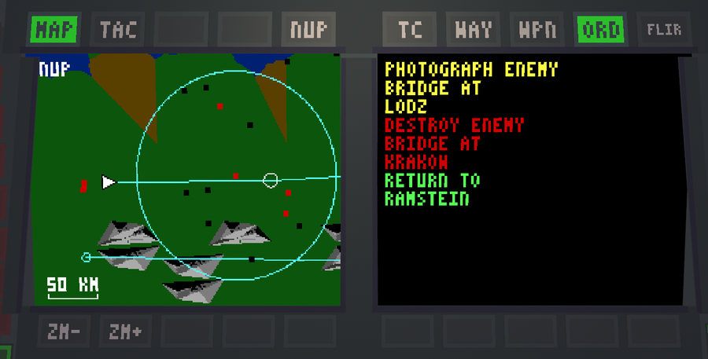

During each sweep the MAP page draws the radar's coverage as a circle around it. The radius is the
distance at which that radar would detect you **with your current EMV**: if your aircraft symbol is
inside the circle, you are detected. A searching radar draws a full circle; an alerted ground site
a 90° sector pointing at you. Ground radars are dark red (weak), red (strong) or yellow (detected),
airborne radars cyan (not detected) or white (detected). In the picture you are outside an
airborne radar's cyan circle and unseen.

## 7.4 Pulse and Doppler

| Type | Used by | Sees best | Sees worst |
|---|---|---|---|
| **Pulse radar** | SA-2, SA-5, SA-8B, SA-11, SA-13, SA-N-5, SA-N-7, Rapier, Tiger, Seacat; MiG-17, MiG-21, MiG-23, MiG-25, F-4E, F-5, Yak-38 | An aircraft seen from the side (beam aspect) | An aircraft flying straight towards or away from it |
| **Doppler radar** | SA-10, SA-12, SA-15, SA-17, SA-21, SA-22, SA-N-4, SA-N-6, Hawk, OTH radar; MiG-29, MiG-31, Su-27, Su-34, Su-35, F-14, Mirage F-1, IL-76 | An aircraft flying fast, straight towards or away from it | An aircraft flying slowly at right angles to it |

Ground radars sweep all around. Fighter radars only see about 67° either side of the fighter's nose;
the IL-76's airborne radar sees all around.

## 7.5 Staying unseen

- **Keep your EMV low.** Fly low, at moderate speed, with small bank angles. Open the bay doors
  only for the release. Switch the ECM on only against a missile in flight.
- **Use the terrain.** Fly over mountains and hills, through the valleys. Avoid open water near
  radars.
- **Mind the obstacles down low.** Buildings, trees, pylons and power lines are solid. Flying into
  one ends the flight as surely as a mountain (with *Crash protection* it throws you back up).
- **Fly the right aspect.** Nose towards or away from **pulse** radars; at right angles to
  **Doppler** radars, and slow down.
- **Watch the bar graph.** When the yellow and green bars close in on each other, turn, descend or
  slow down.
- **Watch the map.** Keep your symbol outside the coverage circles, and stay out of the forward
  sector of enemy fighters.
- **Keep your distance.** A site beyond its missile's lock range can see you but not engage.
- **Plan the route.** The mission planner (chapter 8.2) shows where each radar would see you at the
  height you plan to fly. Ten minutes there save a lot of chaff later.

## 7.6 Defeating missiles

The **LAUNCH** and **IR** lamps tell you what kind of missile is in the air; the **MASTER CAUTION**
light warns of any missile.

| Guidance | Examples | Countermeasures |
|---|---|---|
| Radar command | SA-2, SA-5, Tiger, Seacat | Chaff; ECM (always works). |
| Semi-active radar | SA-8B, SA-11, SA-15, SA-17, SA-22, SA-N-4, SA-N-7, Hawk, Rapier, AA-6, AA-7, AA-9, AIM-7 | Chaff; ECM beyond a minimum distance. |
| Active radar | SA-10, SA-12, SA-21, SA-N-6, AA-10 | ECM beyond a minimum distance; chaff only while flying at right angles to the missile. |
| Infrared, all-aspect | AA-2, AA-6 (IR), SA-N-5, SA-14 | Flares; IR jammer (always works). |
| Infrared, rear-aspect | SA-13, AA-8, AA-10 (IR), AIM-9 (older) | Flares; IR jammer beyond a minimum distance. Can only lock on from behind you. |

The minimum distance for the ECM and IR jammers is about 6 km against Green opponents, 10 km
Regular, 14 km Veteran and 18 km Elite. A **decoy** draws missiles, and the alarm position, away from
you while it is active. A radar-guided missile more than about 8 km from you loses guidance when its
launcher stops tracking you, so breaking the lock (bringing signal + EMV under 100) also defeats
missiles at long range.

With *Real* guidance, energy is the other way out. When a missile's smoke trail ends, its motor has
burnt out: a hard turn away, or a dive into thicker air while it is high, makes it bleed speed until
it can no longer follow.

## 7.7 The guns and the shoulder-launched missiles

With *Air defence: Real* (the default), guns and MANPADS teams defend the enemy's airfields, targets
and towns (chapter 13.3). Except for the Shilka they have no radar: they see you by eye, about
8 km by day, 4 km under a full moon and 2 km on a moonless night, never through cloud. A MANPADS
launch gives no radar warning at all: the first you'll know of it is the IR lamp. At night, the
dark is the F-117A's best armour; by day, stay above 4,500 m or below the horizon of the guns.

## 7.8 Flying low

Low level is where the strike aircraft live, and where most of them die. A few rules:

- **Trim and let go.** With the modern flight model the fly-by-wire holds the attitude when you
  release the stick; *Auto trim* holds it for you.
- **Watch the radar altitude**, the "R" below the HUD's altitude box under 5,000 ft. The barometric
  altitude doesn't know about the hill in front of you.
- **Let the autopilot fly the route.** Key 7 follows the waypoints; in the Tornado it also follows
  the terrain at 65 ft (chapter 3.4).
- **Turn with the terrain, not across it.** A valley hides you from every radar that isn't in it.

## 7.9 Landing

1. Bring up the **ILS** (F9): the landing guidance on the centre display and, approaching the
   runway, the steering bars on the HUD. Fly the flight path marker to where the bars cross to be
   on the centreline and the 3° glide path.
2. **Gear down** (6), **flaps** (9). Check the gear lights: a green lamp at each wheel.
3. Fly the approach on speed: in the F-16C the AOA indexer left of the HUD shows a green circle; in
   the F-117A the bracket left of the flight path marker should centre on it.
4. Throttle back over the threshold, flare gently, and hold the **brakes** (0) once you are down.
5. In a dynamic campaign, stop on the runway and the ground crew comes out (chapter 9.5).

Helicopters and the Harrier land anywhere flat and friendly: arrive slow, settle onto the ground,
and you're down.

**Air traffic control.** The friendly airfields talk to you on the radio, on the panel next to the
HUD with a click of the squelch. You don't key anything: your own calls go out by themselves
when you get there, in green under your callsign (Nighthawk 1-1, Viper 1-1, Hawk 1-1 and so on;
in coop the last number is yours).

- **Departure.** On the runway you report ready and the tower clears you for takeoff, or lines you
  up to wait while traffic is on final. Through 2,000 ft or 5 km out, departure control lets you
  go on your way.
- **Recovery in good weather.** Heading home within about 20 miles of the field, you call inbound
  and approach sends you to the **initial**, 3 miles out on the runway's centreline at
  1,000-2,000 ft. Report initial, fly over the runway and **break** into the circuit, and turn
  base with the gear down: the tower clears you to land, or tells you to continue while the
  runway is busy. Coming straight in on final with the gear down works too. With the gear up
  inside 2 miles the tower calls "check gear", then sends you around.
- **Recovery in low cloud or poor visibility** (cloud base under 3,000 ft or under 5 km
  visibility). Approach gives you headings and an altitude to an 8-mile final, then the **GCA**
  controller talks you down every few seconds: left or right of course with a heading to fly,
  above or below the glidepath, the miles to touchdown, the landing clearance at 4 miles and
  "runway in sight?" at decision height. "Too low, climb immediately" means exactly that.
- **Helicopters** report ready from the pad and come straight in to the helipad.
- **Diversions.** If your field has been bombed shut or lost, approach sends you to the nearest
  open one, with a heading and the distance, and moves your landing waypoint there.

The AI aircraft don't listen to the tower; it only works you around them. Air traffic control can
be switched off under *Air traffic control* in the options and the in-flight menu's GAME page.

**Spoken ATC.** The calls can also be heard, through the radio's loudspeaker. No voice comes
with the game: open *Options > Sound > Voices* and download one (60-80 MB each, freely
licensed Piper voices; the dialog shows each one's licence and credit). Choose one for the
controllers and one for yourself, and press *Preview* to hear them. VCTK (British) and
LibriTTS-R (American) hold many speakers in one download: pick a different speaker for yourself,
and with *A different controller at each station* the tower, approach and GCA each talk with
their own. Piper voices (`.onnx` with its `.onnx.json`) put into the voices folder by hand are
found too. Their volume is the *ATC voice* slider, under the *Radio* one. Not in the browser version, where the calls stay
text.

## 7.10 When it goes wrong: ejection and rescue

The jets have ejection seats; the helicopters don't, so their crews ride it down.


After a good ejection over enemy territory (Shift-F10, or the ejection handle) the mission goes
on from the ground. The view follows the pilot down and on the ground, and a panel shows the
rescue's progress, with buttons for the signal flare and time acceleration (click them; in VR,
point and pull the trigger).

- A **UH-60** comes from the nearest friendly airfield's alert area. Close in it cannot find you
  without a **signal flare** (the flare key, 1): fire one when it is near (you have three).
- **Mi-24 Hinds** from the nearest enemy airfield search the area. A flare also shows them where you
  are, and a Hind passing close may spot you. If one gets to you first you are captured.
- Wait too long (15 minutes against green opponents, 9 against elite ones) and you are captured.
- Time acceleration (Shift-Z) runs four times faster while you wait. A dynamic campaign runs in
  real time: there the panel has **SKIP EXTRACTION** (Alt-Q) instead, which ends the sortie and
  leaves the rescue to the mission board (chapter 9.9).

Picked up: the mission ends like a parachute landing. Over friendly territory or the sea the
mission ends when the parachute lands.


---

# 8. SINGLE MISSIONS AND THE CAREER

## 8.1 Single missions

A single mission is generated from the options of the single mission screen (chapter 1.2): a theater,
a situation, an opponent, a mission kind and an aircraft. The mission is a fresh one each time:
targets, routes, enemy patrols and weather are rolled anew with NEW MISSION.

| Mission | The job |
|---|---|
| **Strike** | A ground target to destroy, photograph or reach, with a primary and a secondary objective, and a base to land at. |
| **Air to air** | Intercept an enemy aircraft: a transport, a bomber or a fighter patrol. |
| **Strike training** / **Air training** | The same missions as practice: hits do you no harm, **Alt R** reloads your stores, and the points count half. |
| **Drone defense** | Ukraine only: stop a wave of Geran attack drones before they reach a city or a nuclear power plant, then bomb their launch site (chapter 10.2). |

The mission summary and briefing list the objectives, the bases, the weather, the armament and the
intelligence. Read them, plan the route, check the loadout, and fly. *Save mission* in the in-flight menu
keeps a flight to continue later from LOAD.

## 8.2 The mission planner


*Plan route* in the menu opens the theater map with the mission's route. The targets and the
landing base stay where they are; between them you add, move and remove navigation points:

| Action | |
|---|---|
| Click a leg | Add a point there (up to 16 points). |
| Drag a point | Move it. |
| Right click a point | Remove it. |
| Drag the map, mouse wheel | Pan, zoom. |
| Point at a symbol | Its tooltip: what and where it is. |
| RESET | Back to the briefed route. |

Each SAM site shows its missile range as a dotted red circle and, filled in orange, where its radar would
detect you, flown at the selected profile (*Low* 500 ft, *Medium* 5000 ft or *High* 20,000 ft, at
480 kt with the bay doors shut and wings level; banking, opening the doors, the ECM jammer and
speed make the circles larger). Sites that are off the air are drawn faint. The panel lists the
legs with distance and time and how many km of the route a radar would see. In drone defense
missions the drones' starting points are marked.

Every zoomable map (the planner's, the debrief's flight map, the campaign's war map and AIR
DEFENSE map) shows a **tooltip** for what is under the mouse pointer: what it is (airfield, city,
SAM site, radar, ship, tank, aircraft...), its name, its side and what the mission knows about it
(a site's radar and ranges, a route point's distance and time from the previous one, a target's
type), beside its symbol enlarged (classic or APP-6, as the map draws it). Cities, towns and depots
have one too where the map picture shows them; overlapping symbols are listed together, one under
the other.

In flight the INS and the autopilot follow the planned route. When a target is done, the next
waypoint is the point after it, so the planned way home is flown as well. The planned route also
goes along with *Fly in VR*.

## 8.3 The debrief


After every flight the **debrief** shows the result, the statistics, the points and a rating, and
a timeline of the mission (kills, radar and visual identifications, objectives). Points: primary
objective 100, secondary 50, each aircraft or ground target 10 (+5 for an aircraft shot down
before it saw you), each drone 15; −5 for each identification, −10 for each missile hit; landing
+25, crash −50, captured −100. The sum is multiplied by the difficulty (opponents and situation;
training missions count half).

**Flight map.** *FLIGHT MAP* shows your track on the theater map, coloured by how close the
radars came to detecting you (green out of reach, amber close, red detectable), with the radars
that tracked you and markers where they did, where missiles were fired, where you were hit and
where you scored. Drag the slider or press *PLAY* to replay the flight. *Radar exposure* sums it
up. Drag to pan, wheel to zoom; *RESULTS* goes back.

**Tacview.** With *Tacview export* checked in OPTIONS > GAME, every flight is also saved as a Tacview
recording (`.acmi`) in the game's folder for your files under `tacview` (on Windows
`Documents\My Games\Stealth Mission 89\tacview`, on Linux `~/.local/share/stealth-mission-89/tacview`;
Appendix B):
your aircraft, the enemy aircraft and missiles, the radar sites and airfields. The theater is laid
on the globe around one of its real airbases at the game's scale, so the rest of it lies only
roughly where the real places are.

**Tacview real-time telemetry.** With it checked, the game hosts a Tacview session while you
fly: in Tacview choose *Record > Real-Time Telemetry*, address `127.0.0.1`, port `42674`, no
password. Tacview can join before or during the flight; the session lasts one flight (one sortie
in a campaign). For another computer, start the game with `--tacview-address 0.0.0.0` (or
`<ip>:<port>`, optionally `--tacview-password <text>`) and open the firewall.

## 8.4 The career

*Career* in the main menu keeps pilot records: enlist a pilot by name, then start a
**tour of duty**, 12 sorties in the theater, situation and opponents chosen beside the records
(fixed while the selected pilot is on a tour). The aircraft, realism and weather
options there apply to every sortie. *Start tour* or *Fly next sortie* shows the sortie's briefing
with PLAN ROUTE, LOADOUT and FLY; NEW SORTIE picks another one, BACK returns to the records. A
sortie starts at its rolled time. In a tour:

- What you destroy stays destroyed for the rest of the tour, and new targets are never ones you
  already hit.
- Points add up to promotions: First Lieutenant 300, Captain 800, Major 1800, Lieutenant Colonel
  3500, Colonel 6000. A finished tour earns 200 extra points.
- A mission can earn the Air Medal (150 points), Distinguished Flying Cross (300), Silver Star
  (500), Air Force Cross (800) or Medal of Honor (1200); hits taken earn the Purple Heart.
- A crash or failed ejection ends the career (killed in action); so does being captured after an
  ejection (prisoner of war).


Single missions from the menu do not count for any pilot.


---

# 9. THE DYNAMIC CAMPAIGN

> *"No plan survives first contact with the enemy."* So, roughly, wrote the Prussian field marshal
> Helmuth von Moltke in 1871. In the dynamic campaign, plans and decisions are yours to make.
> It's you, your resources, aircraft, helicopters and armour against the enemy force.

In a single mission the world waits for you and you can press ESC to pause the game at any time. 
In the dynamic campaign there is no pause function. A whole theater is at war, and the war runs 
on in real time while you fly, while you plan, while you sit at the mission board
deciding what to do next. Enemy armour columns roll towards your towns. Helicopters lift off to seize
airfields. Raids come in against your bases, patrols go up, an AWACS starts its orbit behind the front.
In Ukraine, drone waves cross the border at night. Your side fights the same war: it sends its own
columns and insertions, repairs what was destroyed, and puts fighters up when raiders come close.

You are one pilot in it, or one of up to 64 in a multiplayer campaign (chapter 11). You take your
missions from a board that follows the situation, fly them in any of the ten aircraft, and come back
to the board. You can't be killed or lost for good: after every sortie you are back on the Ops screen.
But the places your side holds, the materiel it has, the air defences it builds: all of that is won or
lost one sortie at a time.

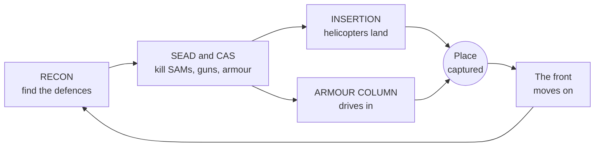

## 9.1 Starting a campaign

DYNAMIC CAMPAIGN in the main menu lists your saved campaigns (theater and hours played) with CONTINUE,
IN VR and DELETE, and the options for a new one:

| Group | Options |
|---|---|
| **Campaign** | *Theater*. *Situation*: Cold War, Limited War or Conventional War, how many enemy aircraft fly. *Opponents*: Green to Elite, the enemy's skill and how often it attacks. |
| **Conditions** | *Weather*: *Dynamic* or *Clear sky*. *Start time* (default 08:00). *Day and night*: a day lasts 24 h (real time), 2 h, 1 h (the default) or 30 min. |
| **Simulation** | *Damage*, *Guidance*, *Air defence* and *Crash protection* (chapter 1.2). |

START begins the campaign and saves it at once. A campaign keeps the rules it was started with,
whoever continues or serves it later. With dynamic weather the sky changes once or twice a campaign day:
mostly fair, sometimes overcast, now and then thunderstorms; each change builds up or thins out over
4 to 8 minutes. The Ukraine and Central Europe theaters, with their land fronts, see the most armour;
island and sea theaters (Cuba, the Persian Gulf) see none, and Libya's places lie too far apart for it.

## 9.2 The Ops screen

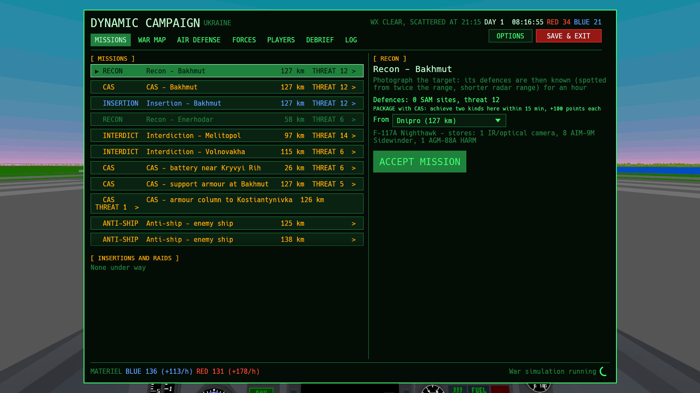

The campaign opens on the **Ops screen**. Its header shows the score (*BLUE n RED n*: the places each side
holds), the campaign's day and time, the weather now and the next change, **SAVE & EXIT** and
**OPTIONS**. The footer shows both sides' materiel and income.

| Tab | Shows |
|---|---|
| **MISSIONS** | The mission board (9.4), the selected mission's details, and below the board the insertions and raids under way with their countdowns, the enemy AWACS's time left and the pilots down. |
| **WAR MAP** | The theater (below). |
| **AIR DEFENSE** | Your side's Gepard, Patriot and drone sites, who mans them, and the buttons to designate new ones (9.13). |
| **FORCES** | Both sides side by side: places held, materiel and income per hour and where it comes from, fighters and helicopters on the ground and in the air, where the materiel went, and the prices (9.10). |
| **PLAYERS** | The pilots in the campaign, what they do, their sorties, points and rank; the leaderboard of everyone who has flown in it; the campaign's rules. |
| **DEBRIEF** | The last sortie's result, kills, points, medal and rank, and what happened meanwhile. |
| **LOG** | The war's events, newest first: for example *Armour column leaves Kostiantynivka to take Bakhmut* |
| **CHAT** | Multiplayer only. |

The clock doesn't stop for the in-flight menu. **SAVE & EXIT** saves and leaves: the war stops until you
continue it; aircraft in the air are lost and insertions under way start again from their base, while
armour columns stay where they were and drive on. The campaign is also saved every minute.

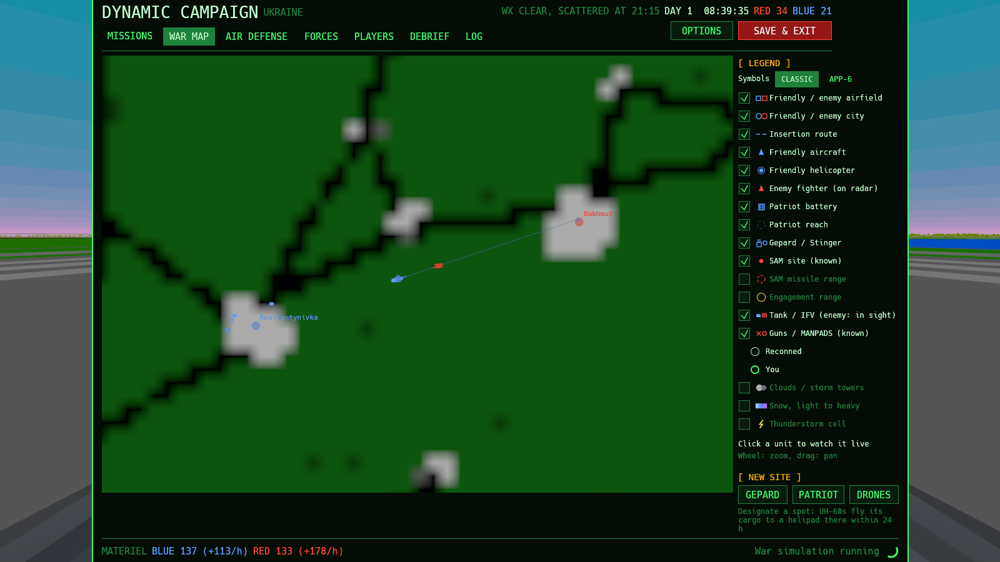

**The war map** shows the theater: airfields (squares) and cities (circles) in their side's colour, a
white ring where you have fresh reconnaissance, the insertion routes, friendly aircraft and
helicopters, the enemy fighters on radar, the known SAM sites, guns and MANPADS, the **armour**, and
you. A tank is a filled box, an infantry fighting vehicle (IFV) a crossed box, with a tick showing its
heading while it drives. Your own columns' remaining route is a faint dashed line with an arrowhead. Your
own armour always shows; enemy armour only while one of your ground units or drones has it in sight. The
checkboxes in the legend beside the map switch each kind of symbol on and off (clouds, snow and storm
cells, SAM and engagement ranges among them), and the *Symbols* switch chooses between the game's
classic symbols and NATO's **APP-6** military map symbols. Pointing at a symbol shows its tooltip
(chapter 8.2). Click a unit to watch it live; the wheel zooms, dragging pans. The selected mission's target is circled.

## 9.3 Places and the front

The theater is made of **places**: cities and airfields, an airfield and the city beside it counting as
one. Each belongs to the friendly side (blue), the enemy (red) or neither (neutral places never change
hands). Every SAM site and radar belongs to the nearest place of its side.

**What defends a place.** An enemy place has its SAM sites and radars, anti-aircraft guns and MANPADS
teams (chapter 13.3), and a **garrison** of armour: two tanks and an IFV, three tanks and an IFV at an
airfield, standing between 400 m and 1.25 km from it. Your own places have a garrison too, and their own
point defence: two Gepards and two Stinger teams at each airfield, a Stinger team in each city.

The **front** is the up to three enemy places nearest your own, within 150 km (else the nearest one).
The board offers the front places' missions, each with its **threat**: three for each live SAM site,
one for each gun, MANPADS team and armoured vehicle within 6 km.

**Taking a place.** A place changes hands in one of two ways:

- **By air**: one helicopter of an insertion lands within 1.5 km of the place's airfield (else its city)
  and stays down (9.6).
- **By land**: an armour column fights its way to the place, and the garrison is gone (9.7).

A captured place has its cities and airfield repaired and loses its old SAM sites for good. The new
owner's guns and garrison move in, and an airfield taken brings its captor two fighters and two
helicopters. The front and the board change at once.

So the war goes: find out what defends a front place (RECON); take down its SAM sites (SEAD), its guns
and its armour (CAS); then send the helicopters in (INSERTION, ESCORT) or clear the way for your armour
(CAS - support armour). Command orders a free insertion against a front place by itself once nothing
defends it any more: no SAM sites, no guns, no armour (at most every 20 minutes).

## 9.4 The mission board

The board lists up to twelve missions, the urgent ones first (interceptions, enemy armour, defence,
rescue, the AWACS), each with its kind, target, distance from the selected base and threat. It is rebuilt
every minute, after every capture and as soon as a target is destroyed. A mission stays on the board as
long as its situation lasts.

| Kind | Points | Offered | Achieved when |
|---|---|---|---|
| **RECON** | 100 | Each front place without fresh intelligence. | You photograph its main object. For an hour its defences see you at 0.7 times their range, you see them at twice yours, and the target keys pick its objects from twice as far. |
| **SEAD** | 150 | Front places with SAM sites or radars. | At least half of the listed sites are destroyed, by anyone (AI SEAD too). |
| **CAS** | 120 | Front places with guns, MANPADS or armour. | You destroy at least half of the listed units. |
| **CAS - battery** | 120 | An enemy gun battery pushed forward near your bases (9.8). | You destroy at least half of its guns. |
| **CAS - armour column** | 120 | Each enemy armour column on the move. Its threat is the number of air defence guns left in it. | At least half of its vehicles are destroyed. |
| **CAS - support armour** | 120 | Each friendly column on the move whose target still has enemy units within 6 km. | At least half of them are destroyed, or you were there when the place fell to the column. |
| **STRIKE** | 150 | Front places with an intact airfield. | The airfield is destroyed. It launches no aircraft until repaired. |
| **INSERTION** | 150 | Front places within 300 km of a friendly base. | The insertion takes the place. UH-60 only (9.6). |
| **ESCORT** | 120 | Each friendly insertion. | You were there and the place is taken. |
| **INTERCEPT** | 150 | Each enemy insertion. | You were there and it failed. You meet it halfway along its route. |
| **DEFEND** | 150 | Each enemy raid on an airfield, and each drone wave (DRONE DEFENSE). | You were there and every attacker was shot down (or it gave up after an hour). |
| **INTERDICT** | 200 | Up to two enemy places behind the front, within 350 km. | The city is destroyed (*Deep strike*: the airfield, where there is no city). |
| **ANTI-SHIP** | 150 | Up to two enemy ships near friendly places. | The ship is sunk. |
| **CAP** | 100 | Where enemy aircraft are near a friendly place or an insertion's target; else over the friendly place nearest the front. | 10 minutes airborne within 20 km of the point; each kill there counts 5 minutes. A friendly aircraft lost there sets the clock back. |
| **CSAR** | 150 | Each pilot down and waiting (9.9). | 2 minutes airborne within 5 km of the pilot, or there when they are rescued; in the UH-60, land beside them, wait 30 s for them to board, and land at a friendly base. |
| **AWACS** | 250 | While the enemy AWACS is up. | It is shot down, by anyone. |
| **LOGISTICS** | 100 | Each cargo load for a new air defence site. | You set its crate down by the site's helipad. UH-60 or CH-47 (9.14). |
| **RESUPPLY** | 100 | Each air defence site that ran out or asked for a resupply. | You hover at the unit for 10 s. UH-60 or CH-47 (9.14). |

The game counts a player as involved in activity if they were at least 2 minutes in the air within 20 km
of the helicopters, attackers or column, their target or the meeting point while it is going on, 
or an air kill there. A sortie that ends while its insertion, raid or rescue is still going on, with you
there, is settled later, and the points are added at the mission conclusion.

The mission's details show its description, the defences (SAM sites, threat, whether your intelligence is
fresh), the other missions it makes a package with (9.11), the base to take off from (any friendly
airfield or carrier, bombed or not) with its distance, and the aircraft and stores. **REQUEST AI SEAD**
sends two friendly strike aircraft against one of the place's SAM sites a minute later (15 materiel and
two fighters; one request per place at a time); their kills count for your SEAD. **ACCEPT MISSION** opens
the briefing.

## 9.5 Flying a sortie

The **briefing** has two pages. ROUTE & THREATS plans the route as the mission planner does (chapter 8.2),
showing only the radars your side has found. LOADOUT lists every aircraft allowed on the mission and
chooses its stores (BRIEFED restores the mission's). It offers the aircraft you flew last if it suits the
mission, else the best one. TAKE OFF puts you on the chosen base's runway or deck.

| Mission | Suited aircraft, best first |
|---|---|
| RECON, STRIKE | F-117A, F-16C, Tornado, A-10C, AV-8B |
| ANTI-SHIP | F-117A, F-16C, Tornado |
| INTERDICT | F-117A, Tornado, F-16C, A-10C |
| SEAD | F-16C, Tornado, F-117A |
| CAP, DEFEND, AWACS | F-16C |
| INTERCEPT | F-16C, AH-1Z, RAH-66, OH-58D |
| CAS (all kinds) | A-10C, AV-8B, AH-1Z, RAH-66, OH-58D, F-16C, Tornado, F-117A |
| ESCORT | AH-1Z, RAH-66, OH-58D, AV-8B, F-16C, A-10C |
| INSERTION | UH-60 only |
| LOGISTICS, RESUPPLY | UH-60, CH-47 only |
| CSAR | UH-60 best; any aircraft can hold the air over a downed pilot |

Every aircraft but the UH-60 and the CH-47 may fly any mission except INSERTION, LOGISTICS and
RESUPPLY; the UH-60 flies only those and CSAR, the CH-47 only LOGISTICS and RESUPPLY. You may achieve more than the mission you accepted: every kill counts, and objectives at the same
place make a package.

**Coming home.** Stop on a friendly runway (or, in a helicopter or the Harrier, set down at a friendly base)
and the ground crew comes out: **REARM & REFUEL** fills you up for another mission in the same sortie,
**END SORTIE** ends it as landed (+25 points). END SORTIE in the in-flight menu ends it where you are, as
aborted (no landing points). A crash ends the sortie a few seconds later. Either way the debrief follows and
you are back at the board.

## 9.6 Insertions

**ORDER INSERTION** on an INSERTION mission sends four helicopters from the friendly base nearest the place
(within 300 km); they lift off three minutes later. Your orders cost nothing, and you always have
helicopters for them. One insertion per place at a time, only against front places. The board then offers
its ESCORT: fly cover for them, or lead them yourself (**FLY THE UH-60**, which joins the insertion under
way or starts one at once with your wingmen).

The insertion fails when all its helicopters are shot down, or when they are still in the air after 90
minutes. When they come within 80 km of an enemy airfield the enemy sends a fighter after them. Flying the
UH-60 yourself, land within 1.5 km of the place and stay on the ground for 15 seconds; ending your sortie
leaves the others flying on.

## 9.7 The ground war

<table>
<tr>
<td width="50%">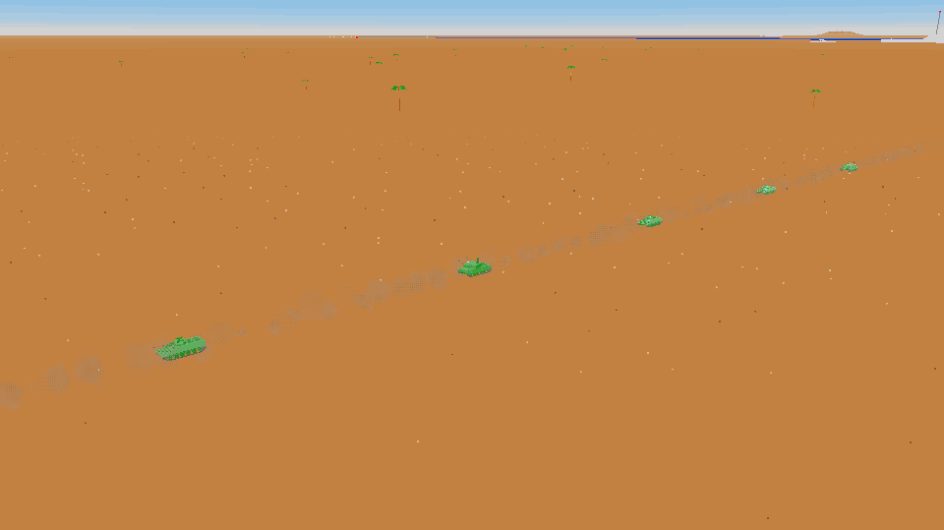<br>
An armour column on the march, raising dust.</td>
<td width="50%">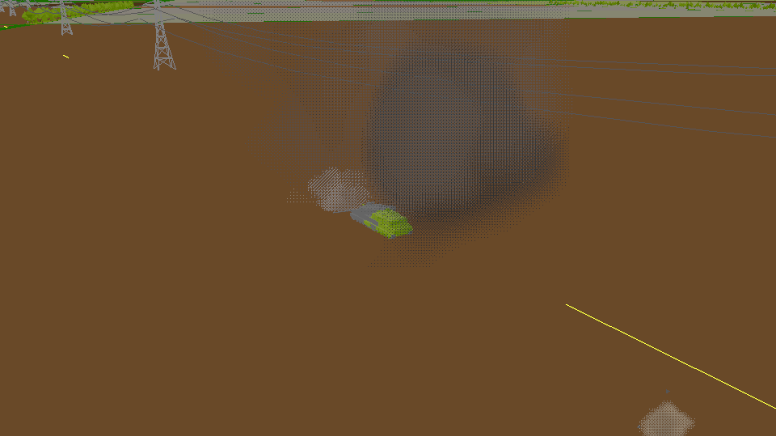<br>
Under fire: smoke, tracers and a hit.</td>
</tr>
</table>

While you fight in the air, the armies fight on the ground. Each side sends **armour columns** to take
the enemy's places by land, and each place is defended by a garrison of its own.

**THE VEHICLES.**

| | Vehicle | Side | Armament in the game |
|---|---|---|---|
| 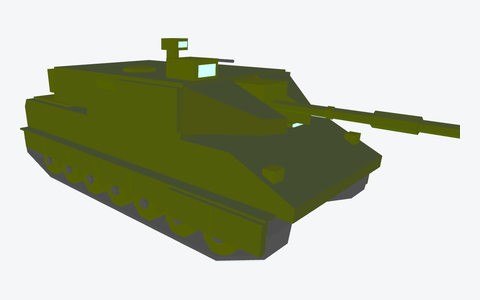 | **Leopard 2** main battle tank | Friendly | 120 mm gun, out to 3 km, a round every 6 s |
| 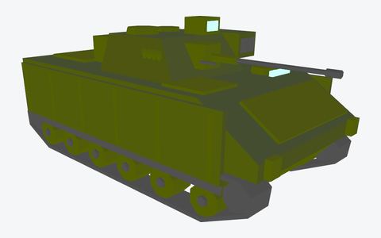 | **M2 Bradley** infantry fighting vehicle | Friendly | 25 mm autocannon, out to 2 km, bursts of 3-5 rounds; carries the infantry |
| 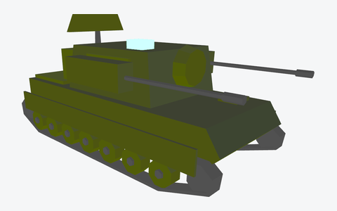 | **Gepard** anti-aircraft tank | Friendly | Twin 35 mm guns against aircraft, and against vehicles out to 1.5 km |
| 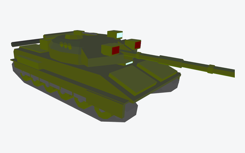 | **T-90** main battle tank | Enemy | 125 mm gun, out to 3 km, a round every 7.5 s |
| 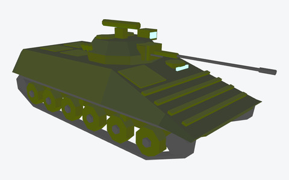 | **BMP-2** infantry fighting vehicle | Enemy | 30 mm autocannon, out to 2 km, bursts of 3-5 rounds; carries the infantry |
| 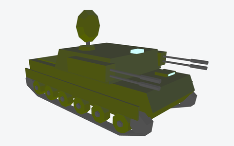 | **ZSU-23-4 Shilka** anti-aircraft tank | Enemy | Quad 23 mm guns against aircraft, and against vehicles out to 1.5 km |

The Leopard 2 was West Germany's answer to the Soviet tank armies, in service since 1979 and today the most
widespread Western tank in Europe; Ukraine has fought with it since 2023. The T-90 is Russia's development
of the T-72, in service since 1992. The Bradley (1981) and the BMP-2 (1980) each carry a squad of
infantry behind their armour and an autocannon in their turret. Both kinds have been in action against
each other in Ukraine.

**A COLUMN** is seven vehicles, head first: two tanks, an IFV, an anti-aircraft tank (a Gepard on your side,
a Shilka on the enemy's), two more IFVs and a tank. Each side has at most one column on the move at a time.
Your side sends one 25 minutes after its last one ended; the enemy every 45, 35, 25 or 20 minutes from Green
to Elite. A column costs its side 15 materiel. The log announces it: *Intelligence: enemy armour column
leaves Bakhmut for Kostiantynivka*.

**WHERE IT GOES.** To the nearest enemy place it can drive to, no more than 120 km by road. Columns can't
cross mountains (ground more than 100 m above its surroundings) or open water; rivers up to about 500 m wide
they ford or bridge. They march at 72 km/h in line, 60 m apart, raising dust. A column still on the road
after four hours is called off.

**HOW IT FIGHTS.** Each vehicle sees about 4 km where the terrain allows, and a side also sees whatever its
drones see (chapter 10.4). When any vehicle of a column has an enemy in sight within its gun's reach (at most
1.5 km), the column halts and fights; until then the tanks fire on the move, at half their usual accuracy.

- **Tanks** fire one round at a time, preferring enemy tanks. A tank round kills an IFV outright and a tank
  in one or two hits.
- **IFVs** fire bursts from their autocannon: about a dozen hits destroy an IFV, twenty to thirty a tank.
- The **anti-aircraft tanks** shoot at aircraft first. When the sky is clear they turn their guns on enemy
  IFVs and other light vehicles, never on tanks.

You'll see the muzzle flashes and tracers, hear the reports from where each round was fired, and see the
rounds strike.

**TAKING THE PLACE.** Two kilometres short of its goal the column leaves the road and attacks in line
abreast, 90 m apart, at a walking 22 km/h, stopping 400 m from the place. When its head is within 2.5 km and
no enemy vehicle remains within 6 km (guns and MANPADS don't count), the place falls, **as long as at least
one IFV survives** to put infantry on the ground. If the column got there with only tanks, the log reports
*Armour cleared Bakhmut without infantry: helicopters to take it*, and its side orders a helicopter
insertion to finish the job, for up to 30 minutes. The column that took the place hands it over to the new
garrison and leaves the field.

A column whose vehicles are all destroyed has failed. Columns that are over stop where they are. Destroyed
garrison vehicles are replaced one at a time, every 30 minutes, for 4 materiel each; a column's losses are
never replaced.

**WHAT YOU CAN DO.**

- **Stop the enemy's columns.** *CAS - armour column* puts you over a column on the move. Take out its
  Shilka first if you are low, then the IFVs: a column without IFVs can't take a place by itself. Mavericks,
  Hellfires, Paveways and the gun all work; the targeting pod tracks a moving vehicle (chapter 5.2).
- **Clear the way for yours.** *CAS - support armour* sends you against the guns, MANPADS and tanks around
  the place your column is heading for. Every one you kill is one fewer for your tanks to fight.
- **Watch from above.** A Stork drone over the road shows the enemy's column to your guns, your FP-2s and
  the war map (chapter 10).
- **Strike the garrisons** before an insertion. With armour standing within 6 km, a place still counts as
  defended, and Command won't send its free insertion.

Each vehicle destroyed counts as a ground kill (20 points).

## 9.8 The enemy fights back

| Action | How often (Green .. Elite) | What happens |
|---|---|---|
| **Armour column** | 45 / 35 / 25 / 20 min after the last one ended | Seven vehicles against the nearest friendly place within 120 km of road (9.7). *CAS - armour column*. |
| **Insertion** | Every 75 / 50 / 35 / 25 min, warned 5 min ahead | Four helicopters against one of the two weakest friendly places near the front (fewest SAM sites, guns and armour). A place where its insertions failed in the last two hours counts as stronger. INTERCEPT it. |
| **Raid** | Every 60 / 40 / 28 / 18 min, warned 2 min ahead | Two strike aircraft, escorted by two fighters that take off 90 s earlier, against one of the two friendly airfields nearest it. A hit destroys the airfield: it launches no AI aircraft until repaired, though you can still take off from it. DEFEND it. |
| **Patrols** | Every 6 min (3 with the AWACS up) | Fighters from the airfields near the front, at most 2 to 4 in the air by the situation, sent at the insertions and raids, else at the friendly place nearest the front. |
| **AWACS** | Every 90 min, for an hour | Orbits behind the front; its patrols go up twice as often and are sent straight at you. Shoot it down (AWACS). |
| **Forward batteries** | Checked every 10 min, when nothing is on the board near your bases | Two Shilkas, two or three S-60 guns and a MANPADS team 15-35 km from a friendly base near the front, at most two batteries: *CAS - battery*. |
| **Drone waves** (Ukraine) | Every 80 / 55 / 40 / 30 min, warned 3 min ahead | Six Geran-2s at a friendly city (else an airfield) within 300 km of an enemy base; the first one through destroys it. DEFEND (DRONE DEFENSE) it (chapter 10.3). |

Your own side defends too: an airfield scrambles one or two fighters when enemy aircraft come within 40 km,
its Gepards and Stinger teams engage what comes closer, and Patriot batteries stand at airfields well behind
the front.

Everything destroyed is repaired by its owner, as long as it has the materiel: SAM sites, cities and ships
after 45 minutes, airfields after an hour. Guns and MANPADS teams are replaced one per place every 20
minutes, garrison armour one vehicle every 30.


## 9.9 Pilots down (CSAR)

Ejecting over enemy country costs the friendly side 30 materiel and a fighter until you are out
(never your own next sortie). Once the parachute is down a UH-60 comes for you as in a single
mission (chapter 7.10), in real time: picked up, the materiel and the fighter come back; captured,
they stay lost.

**SKIP EXTRACTION** (or END SORTIE) does not wait for it: the sortie ends and the board posts a
CSAR mission instead. Any player who holds the air within 5 km of the pilot for 2 minutes, or
brings them home in the UH-60, gets them out. Otherwise, after 20 minutes, a rescue helicopter may
still get through (four times in ten); if it doesn't, the pilot is captured. Either rescue gives
back what the pilot cost.

## 9.10 Materiel and aircraft

Each side's AI fights with the materiel its places bring in and with the aircraft it has left.
Each side starts with 150 materiel and holds at most 400. The income per hour is 20, plus 2 per
place, plus 3 per intact city.

| Costs | Materiel |
|---|---|
| Insertion (AI) | 20 |
| Armour column | 15 |
| Raid | 15 |
| Drone wave (enemy) | 12 |
| Forward battery (enemy) | 6 |
| AI SEAD (yours) | 15 |
| AWACS sortie | 20 |
| Patrol or scramble, per fighter | 2 |
| Repair: airfield / ship / SAM site / city / gun | 25 / 20 / 15 / 10 / 2 |
| Replacement garrison vehicle | 4 |
| New fighter / helicopter | 15 / 4 |

Aircraft shot down are gone; every hour each side buys new ones while its materiel lasts
(helicopters first). An enemy that runs out can't repair, attack or replace its losses.
INTERDICT missions strike its income: a city destroyed costs it 20 materiel at once and its 3 an
hour until rebuilt. An AWACS shot down costs it 60. Your own side's AI pays from its materiel too
(its armour columns, repairs, scrambles and replacements), but your own sorties, aircraft and insertion
orders cost nothing.

## 9.11 Points, ranks and packages

Every sortie earns points: the objective's (100 to 250 by kind, once it is settled), 50 per
aircraft and 20 per ground kill (SAM sites, guns, MANPADS, tanks and IFVs), and 25 for landing at a friendly base
and ending the sortie there. They earn the career's ranks over the campaign, and its medals for
one sortie's points (chapter 8.3); the debrief shows them.

**Packages**: objectives of two different kinds achieved at one place within 15 minutes (SEAD and
STRIKE, say, or CAS and the ESCORT of an insertion) earn every sortie of the package 100 more
points. The mission's details name the other missions at the place. CAP, ANTI-SHIP, AWACS, CSAR,
battery CAS and the CAS against an armour column have no place and make no packages; *CAS - support
armour* does.

## 9.12 Winning and losing

The war is won when the enemy holds no airfield, and lost when the friendly side holds neither an
airfield nor a carrier. The end screen shows the result and every pilot's record; sorties in the
air may still finish. Then start a new campaign from the menu (a dedicated server starts the next
one by itself, chapter 11).

A campaign continued from its save goes on where it was, except that aircraft in the air are
back on the ground, insertions and raids under way wait to start again, and the AWACS is down. Armour
columns drive on from where they were.

## 9.13 Air defence operations

Your side can build its own air defence: **Gepard** anti-aircraft guns, **Patriot** batteries
and **drone command centers** (10.4). A player designates the spot, UH-60 pilots fly in the
cargo (9.14), and anyone can man the finished site.

The **Flakpanzer Gepard** was built in West Germany in the 1970s on the Leopard 1 tank's hull: two 35 mm
Oerlikon cannon, a search radar on the turret's back and a tracking radar on its front. Retired by the
Bundeswehr in 2010, it was sent to Ukraine from 2022, and became famous there as one of the most effective
weapons against Shahed drones: cheap rounds against cheap drones. The **MIM-104 Patriot** has defended
American and allied airspace since the 1980s; its phased-array radar tracks dozens of targets and guides
missiles that reach out to beyond 100 km. In May 2023 a Ukrainian Patriot battery shot down a Kinzhal
air-launched ballistic missile over Kyiv, the first known interception of the type.

| Site | Cargo loads | Armament |
|---|---|---|
| **Gepard** | 1 | Twin 35 mm guns firing airburst rounds, out to 2 km. 640 rounds ready, 640 in stock. |
| **Patriot** | 3 | A radar with launchers of four missiles each, out to 80 km. 8 missiles in stock. |
| **Drones** | 1 | 4 Stork, 8 FP-2 and 6 interceptor drones (10.4). |

**Designating a site**

1. On the Ops screen's WAR MAP or AIR DEFENSE tab, press **GEPARD**, **PATRIOT** or **DRONES**
   under *New site*.
2. Move the pointer over the map. A green circle shows where the site may go; a red one names
   the reason it can't (not friendly territory, water, too close to a town, airfield, site or
   other units, no open ground, no friendly airfield to fly the cargo from).
3. Click to designate it. Right click or Esc cancels.

A helipad appears with the loads delivered and the time left (`PATRIOT 1/3 23:41`). All loads
must arrive within 24 hours, or the helipad is gone. At most three sites can wait for cargo at
once. Once the last load is in, the unit stands beside the pad.

**Manning a site**

The AIR DEFENSE tab lists your side's sites: who mans each one (*auto* when nobody does), the
aircraft on its radar, what is ready and its stock. **ENTER** takes you to its console,
**LEAVE** back to the Ops screen. Unmanned Patriots and Gepards fight on their own. The Gepard of
your own armour column is listed too and can be manned on the move; while you man a Gepard it fires only
where you aim it.

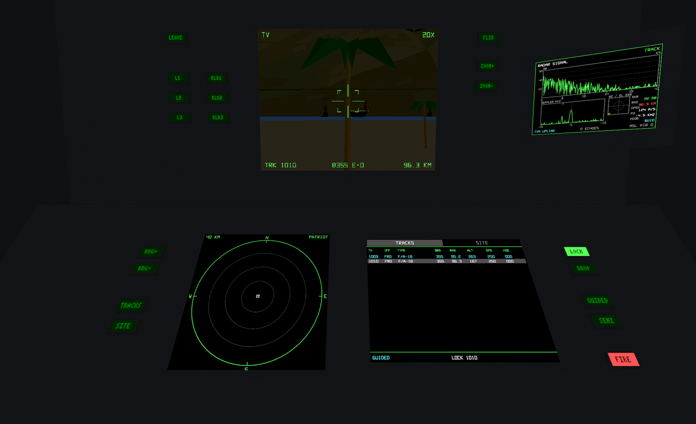

The Patriot and Gepard consoles share one layout:

* **Camera** (top): the tracking camera on the radar's or the Gepard's mast, following the
  lock. **FLIR** switches colour / thermal, **ZOOM+** / **ZOOM-** zoom.
* **Air picture** (bottom left): the tracks around the site, north up, friendly and hostile
  symbols with their type and a heading line. **RNG+** / **RNG-** set its range.
* **Board** (bottom right): **TRACKS** lists the radar's tracks (click one to select it);
  **SITE** shows the launchers, missiles ready, the stock, reloads and **REQUEST RESUPPLY**.
* **Engaging**: select a track, **LOCK** it (**DROP** lets go), then **FIRE**.
* **Signal monitor / target data** (top right): see below.

**Patriot.** Missiles go out to 80 km. **GUIDED** missiles are steered by the radar (hard to
decoy, one target at a time); **SEMI** missiles home on the radar's illumination (several targets
at once, easier to decoy). **L1**-**L3** pick the launcher to fire from; **RLD1**-**RLD3**
reload an empty one from the stock (4 minutes).

<table>
<tr>
<td width="50%">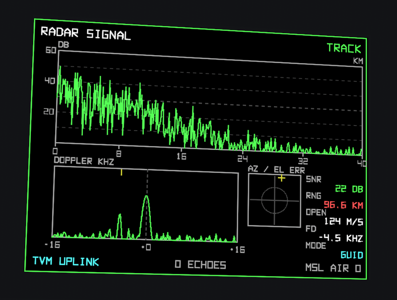</td>
<td>The Patriot's <b>radar signal monitor</b> shows what the radar receives:
<ul>
<li>Top: the echo strength against range, with the lock's echo standing out of the noise.</li>
<li>Bottom left: the locked target's Doppler spectrum: its speed line, engine or rotor
modulation beside it.</li>
<li>Bottom middle: the lock's angle error in the beam (it wanders more on a weak echo).</li>
<li>Right: signal to noise, range, closing (CLOS) or opening (OPEN) speed, Doppler shift,
guidance mode and the battery's missiles in the air.</li>
</ul></td>
</tr>
</table>

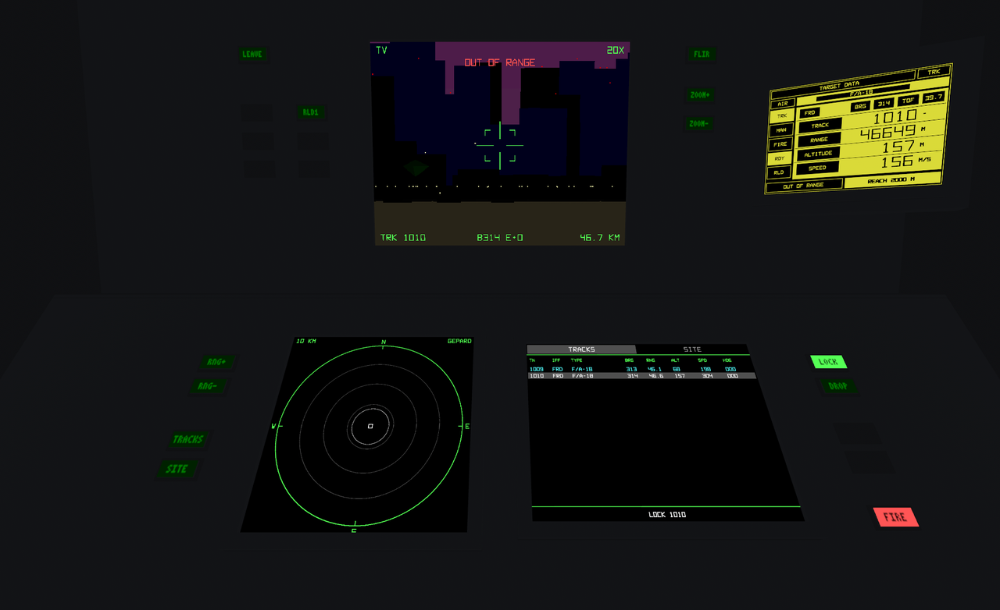

**Gepard.** It fires bursts of airburst rounds out to 2 km. Without a lock the stick slews the
turret by hand and the camera looks along the guns, marking each aircraft in reach with its
lead. **RLD1** refills the guns from the stock.

<table>
<tr>
<td width="50%">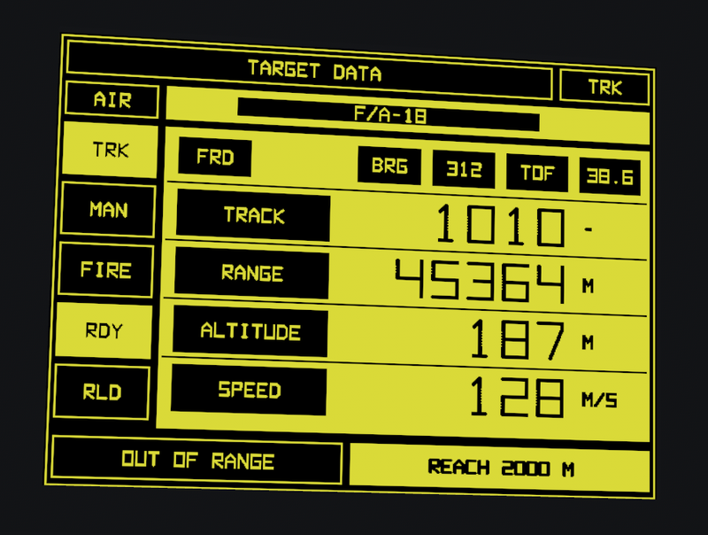</td>
<td>The Gepard's <b>target data display</b> shows the locked track:
<ul>
<li>Top: the type, friend or foe, the bearing and the shells' time of flight.</li>
<li>Middle: the track number, range, altitude and speed.</li>
<li>Left: the state lamps: tracking (TRK), slewed by hand (MAN), firing, rounds ready (RDY),
refilling (RLD).</li>
<li>Bottom: whether the target is in reach (2,000 m).</li>
</ul></td>
</tr>
</table>

## 9.14 Logistics

UH-60 and CH-47 pilots keep the air defence going: they fly the cargo for new sites and the
resupplies for existing ones. Both are missions on the board (UH-60 or CH-47, 100 points). If no player takes one,
an AI helicopter flies it.

**Cargo for a new site (LOGISTICS, sling load)**

Each load of a designated site (9.13) is a **LOGISTICS** mission (`PATRIOT 2/3 - <site>`). Its
crate waits beside the runway of the nearest friendly airfield; after 30 minutes without a
player, an AI UH-60 brings it.

1. Take the mission and take off in the UH-60 or the CH-47 from the crate's airfield.
2. Hover low over the crate: below 50 ft, slower than 15 kt, within 8 m of it. *Cargo hooked*:
   the winch lifts it on its rope under the helicopter.
3. Fly to the helipad. The crate swings on the rope: accelerate and turn gently, slow down
   early, and let the swing settle before you set it down.
4. Lower the crate onto the ground within 90 m of the helipad. *Cargo set down*: the load is
   delivered.

Any UH-60 or CH-47 can hook any waiting crate, and other players see it hanging under your helicopter.

**Resupply (RESUPPLY)**

A site that runs out of stock orders a resupply by itself; at a Patriot or Gepard console you
can also press **REQUEST RESUPPLY** on the SITE page. It becomes a **RESUPPLY** mission:

1. Take the mission and fly the UH-60 or the CH-47 to the unit.
2. Hover within 50 m of it, under 100 ft and slower than 15 kt, for 10 seconds.
3. The load goes down and the site's stock is full again.

After 5 minutes without a player, an AI helicopter flies it from the nearest airfield.

## 9.15 Tips

- Clear a front place's SAM sites and guns and Command sends the helicopters in for free; or
  order the insertion yourself and fly its escort.
- STRIKE the enemy's airfields near the front: for an hour they send no patrols or raids.
- The enemy goes for your weakest places. Keep the guns and SAM sites there standing, and
  intercept its insertions: a failed one keeps it away from that place for two hours.
- Fly RECON first on a well defended place: with fresh intelligence its defences see you later
  and you see them sooner.
- INTERDICT when the enemy's materiel runs high: without it, it can't repair or attack.
- Land and REARM & REFUEL rather than ending the sortie in the air: you keep the landing points
  and can fly the next mission at once.


---

# 10. DRONE WARFARE

> **KYIV. 17 October 2022, early morning.** Commuters on their way to work hear a sound like a moped
> overhead, then explosions. Small delta-winged aircraft, painted white, are diving into the city centre.
> Soldiers and policemen fire at them with rifles from the streets. One of the drones hits a residential
> building, killing people inside. The drones are Iranian-designed **Shahed-136**s, called **Geran-2** in
> Russian service, and over the following years they will come in their thousands.

## 10.1 The cheap weapon

Unmanned aircraft are nearly as old as manned ones. Radio-controlled target drones trained gunners in
the 1930s; reconnaissance drones photographed North Vietnam in the 1960s; Israel's small Scout and
Mastiff drones found Syrian SAM sites in the Bekaa Valley in 1982. From 2001 on, the American Predator and
Reaper, armed with Hellfires, hunted single vehicles across half the world. In 2020 the Turkish Bayraktar
TB2 destroyed Armenian air defences and armour over Nagorno-Karabakh, and in the first weeks of the
Russian invasion of Ukraine in 2022 it became a symbol of the resistance.

But the real revolution was cheap. In Ukraine, both sides learned to fight with drones that cost less than
a car, or less than a phone:

- **One-way attack drones** such as the Shahed-136 / Geran-2: a delta wing with a piston engine and a
  pusher propeller, a warhead of some 50 kg, and a range of well over 1,000 km. They fly slowly and low,
  in waves, to hit power stations, cities and airfields. Every one shot down by a missile costs the
  defender far more than it cost the attacker. The jet-powered Geran-3 (Shahed-238) followed from late
  2024, several times as fast.
- **Reconnaissance drones** watch the front day and night and direct the artillery onto what they find.
  The Ukrainian **Leleka-100** ("leleka" is Ukrainian for stork) is one: a small fixed-wing drone launched
  by hand or catapult, flying for hours with a gimballed camera.
- **Strike drones**, from first-person-view quadcopters carrying an anti-tank grenade to fixed-wing drones
  that dive into a target tens of kilometres away, have made every vehicle near the front a target.
- **Interceptor drones**, fast, bullet-shaped quadcopters launched against the Shaheds, appeared in 2025:
  a drone that costs a few thousand dollars to stop one that costs tens of thousands.

The game puts you on both ends of that war: in the cockpit of a fighter or a Gepard against the Geran
waves, and at the console of a drone command center that sends its own Storks, strike drones and
interceptors out over the front.

## 10.2 Drone defense: the single mission


*Mission: Drone defense* in the single mission screen (Ukraine only). Russian Geran drones are on their way
to a Ukrainian city, or one time in four to the South Ukraine nuclear power plant. They start already in
the air from the two nearest launch sites; the first arrives 9-12 minutes after you start, the others 30-75
seconds apart. You take off from the nearest airfield with air-to-air missiles, the gun and two Paveways
(with *Realistic weapons*: the Paveways and extra fuel).

| | Drone | In the game |
|---|---|---|
| 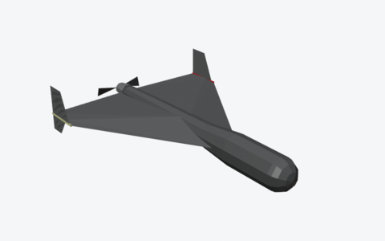 | **Geran-2** (Shahed-136) | Piston engine and pusher propeller, about 185 km/h, low (600-1,500 ft). No radar, unarmed: it flies straight at its target and dives into it. |
| 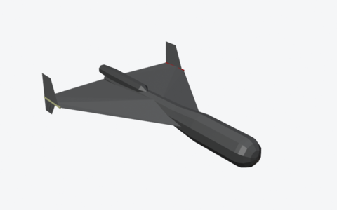 | **Geran-3** (Shahed-238) | The jet version: about 600 km/h, flying higher (2,500-5,000 ft). Otherwise like the Geran-2. |

- The **primary objective** is met when every drone is down or through and no more than the briefed number
  got through. A drone that hits the nuclear power plant fails the mission.
- The **secondary objective** is the launch site the drones came from: Paveways.
- The wave is 4 to 12 drones; higher opponents and harsher situations send more, a bigger share of them
  Geran-3s, and let fewer through.
- The early warning network shows every drone on the TAC display (open deltas) and on the map. They have no
  radar and don't fight back, but the Geran-2 is small, slow and low: **slow down behind it** and use the
  gun or a Sidewinder. Flying past one at 500 kt gives you a second to shoot.
- Each drone shot down counts 15 points.

<table>
<tr>
<td width="40%"><br>
The drones (crosses) on the MAP page, on their way to Poltava.</td>
<td><br>
A Sidewinder on its way.</td>
</tr>
</table>

In Ukraine strike missions a few drones may also cross the theater; shooting them down earns points too.

## 10.3 Drone waves in the campaign

In a Ukraine campaign the enemy sends a wave of **six Geran-2s** every 80, 55, 40 or 30 minutes (Green to
Elite), warned 3 minutes ahead, at a friendly city, or an airfield when no city is in reach. They cruise
at about 150 m. **The first drone through destroys its target.** The board posts a DEFEND (DRONE DEFENSE)
mission: you were there and every drone was shot down. A wave costs the enemy 12 materiel.

Your airfields' Gepards and Stinger teams engage the drones that come within their reach, and a manned
Gepard (chapter 9.13) is a fine way to spend a wave: its airburst rounds were made for this. A drone
command center's interceptors (10.4) can meet them on the way.

## 10.4 The drone command center

Your side can build drone command centers, much as it builds Gepard and Patriot sites, and anyone can
fly drones from their consoles. A center launches three types of drones, up to five in the air at once.

**Building and manning a center.** Designate a DRONES site (chapter 9.13) and fly in its one load
(chapter 9.14). It starts with 4 Storks, 8 FP-2s and 6 interceptors, and orders a resupply as soon as one
type runs out. On the AIR DEFENSE tab, **ENTER** takes you to its console, **LEAVE** back to the Ops screen.


The desk screen is the ground control station: the drone list on the left, the map with the drones, their
routes, the terrain's height in shades and contour lines, friendly units and the enemy units your drones
have found. The large screen shows the selected drone's camera, with a flight path marker in the forward
view. The screen at the top right shows each drone's battery.

**Launching a drone.**

1. Press **NEW DRONE** and pick the type: **STK**, **FP2** or **INT**.
2. Click the map to add waypoints (up to 12). Clicking a contact ends the route on it.
3. Select a waypoint to change it: **TYPE** changes its type, **ALT+** / **ALT-** its height, **DEL**
   deletes it. Drag it to move it. The map's arrows pan, **C** centres, **+** and **-** zoom.
4. Press **LAUNCH** (**CANCEL** drops the plan). The drone leaves the rail and flies its route; the rail
   is ready for the next one 15 seconds later (*RAIL READY*).

| Waypoint | Drones | What it does |
|---|---|---|
| **NAV** | All | Fly over it, on to the next. |
| **LOITER** | All | Circle it until told otherwise (Stork 900 m, FP-2 600 m, interceptor 400 m radius). Must be the last point. |
| **TERMINATE** | FP-2 | Dive into the ground point. Must be the last point. |

A route that ends without either circles its last point. Waypoints can be changed while the drone flies.

**Flying it.** Click a drone or its row to select it. **NEXT** makes the selected waypoint the next one,
**FWD** switches between the gimballed camera and the forward flight camera. **MANUAL** (or **MAN** on the
panel) flies it with the stick, rudder and throttle (the stick holds the attitude when released); **AUTO**
sends it back on its route. The panel's **FLIR**, **ZOOM**, **TRACK** (hold the camera on the point under
its crosshair) and **SLAVE** (back to the next waypoint) work the camera like a targeting pod. The list
shows each drone's state: AUTO, LOITER, ATTACK, MANUAL, DIVE, LOCK. A drone with an empty battery goes down
and is lost.

## 10.5 The drones

<table>
<tr>
<td width="33%"><br><b>Stork-100</b> surveillance drone</td>
<td width="33%"><br><b>FP-2</b> attack drone</td>
<td width="33%"><br><b>Interceptor</b> quadrotor</td>
</tr>
</table>

| | Stork-100 | FP-2 | Interceptor |
|---|---|---|---|
| Role | Surveillance | One-way attack | Air-to-air, one-way |
| Cruise / top speed | 90 / 120 km/h | 180 / 215 km/h, 300 km/h in the dive | about 200 km/h at hover throttle / 600 km/h |
| Endurance | 2.5 h | 1.2 h | about 8 min, less at high throttle |
| Sensor | Finds air defences and ground units within 6 km | 2 km | None |
| Cameras | Forward and gimballed zoom | Forward and gimballed | Forward only |
| Warhead | None | Destroys everything within about 60 m | Detonates within 6 m of its target |
| Planned height | 800 m | 300 m | 500 m |

**STORK-100.** Slow, quiet and patient. It finds enemy SAM sites, guns, MANPADS teams and armour within 6 km
and marks them on the map, for every console and every player: the FP-2s can strike them, the war map shows
them, and your ground units' guns can fire at what it sees. A LOITER point over a road or a front place
keeps it watching. Moving enemy armour is only known while a drone or a friendly unit has it in sight.

**FP-2.** A simple fixed-wing one-way attack drone with a heavy warhead: it destroys every ground unit within
about 60 m, of either side, so mind your own. End its route with **TERMINATE** on a contact the Stork found,
and it dives into it. If controlled manually, simply put the camera's crosshair on the target and fly it in.

**INTERCEPTOR.** A rocket-shaped quadrotor, up to 600 km/h, with only about eight minutes of battery, less at
full throttle. Fast enough to catch a Geran-2 easily; the jet Geran-3 *can* be caught, but it is very
difficult. Plan a **LOITER** point in the target's path at its height: the map shows aircraft and drones in
the air with their heights.

**Auto lock-on.** The interceptor locks on by itself to the nearest aircraft or drone within 500 m and about
20° of its nose. The camera marks the target, the list says LOCK, and from then on it steers itself: open the
throttle and let it close in. It loses the lock beyond 1.5 km. It can't tell friend from foe, so keep it away
from friendly aircraft; a crash into the ground sets off its warhead too, friendly units nearby included.

**Against air defences.** The enemy's radars and gunners find a drone only within 2 km, and their shells and
missiles have a much smaller chance of killing something so small. A drone is not invisible, but it gets
closer than any aircraft.

## 10.6 Drone tactics

- **Stork first.** An FP-2 without a target is a wasted FP-2. Send a Stork to loiter over the front place or
  the road, and wait for its contacts.
- **Strike columns on the move.** An enemy armour column on the road is a line of contacts: one FP-2 per
  vehicle, the Shilka and the IFVs first.
- **Interceptors don't chase.** At hover throttle a Geran-2 drifts away from an interceptor following it. Put
  the interceptor in the drones' path, loitering at their height, and let the lock-on do the rest; or fly it
  by hand at full throttle for the last mile.
- **Watch the batteries.** The interceptor's flight time of eight minutes is short; launch it when the wave 
  is close, not when it is announced, and remember that full throttle eats the battery even more quickly.
- **Share the picture.** In multiplayer, what one center's Stork finds, every drone center's FP-2s can strike.


---

# 11. MULTIPLAYER

The dynamic campaign is best fought together: up to 64 pilots and drone operators on one side, one
flying SEAD while another leads the helicopters in, a third mans the Gepard at the airfield the raid is
heading for. There are many roles for players to fill, not everyone has to be a hotshot in a fighter jet.

## 11.1 Your name

The MULTIPLAYER screen asks for your name first; the other players know you by it, and the
campaign keeps your sorties under it: join again under the same name and they are yours again. In
a VR headset, click a text field with the laser pointer and a keyboard opens under it; press its
keys with the trigger and DONE when finished. Keys type at the blinking cursor: click in the text
to place it, or move it with ← and →. The career's pilot name uses the same field.

## 11.2 Joining

JOIN A GAME lists the **public servers** at the top: each one's name, the pilots in it out of
how many it takes, the theater, the situation and the campaign's clock. JOIN on a row connects
to it (REFRESH fetches the list again; a server of another game version is greyed out). The
same list is on the web at https://sm-master.playspoon.com, where a server opens up for its
settings, the places each side holds and who flies what.

Or type the server's IP address or host name, with the port after a colon if it is not the
default 28989 (`192.168.1.20`, `sm89.example.org:29000`, `[2001:db8::1]:28989`), and CONNECT.
Either way you come to the campaign's Ops screen; your aircraft waits at a friendly base.

## 11.3 Hosting

HOST A GAME serves a new campaign (theater, opponents, situation) or one of your saved ones, and
you fly in it. Give the server a name (the others see it when they join; without one it is
"<your name>'s campaign"), choose the UDP port and how many players may join, and whether the
game is on the public server list (on by default); to play over the internet,
forward that UDP port to your computer in your router. The campaign is saved on your computer as
when you play alone.

## 11.4 Who decides what

The server decides how the war is fought, for everybody: realistic damage, realistic guidance, no
crashes, time of day (moonlit nights shorten the enemy's visual range), realistic F-117A
weapons and friendly fire, and of course the campaign's own options. The weather is the same for
everybody: the same clouds in the same places, and the same lightning strikes. Each player keeps their own cockpit (classic or
modern), flight model, avionics, HUD, shaders, shadows and lights, and picks their aircraft for each sortie on the briefing's LOADOUT page.

## 11.5 On the Ops screen

The Ops screen and the campaign itself work as when you play alone (chapter 9). In coop:

- **PLAYERS** lists everybody in the campaign: who is on the mission board, who flies what, the
  sorties flown and objectives achieved, points and rank, and each player's ping; under it the
  leaderboard keeps every pilot's record, also of those who have left (a newcomer taking a free
  slot does not take the record with it), and the line at the bottom names the campaign's rules.
- **CHAT** has every message of the game so far (newest at the bottom, the list scrolls) and a
  field to write one: Enter or SEND sends it. In a VR headset a keyboard opens under the field.
- **SAVE & EXIT** (top right, under the clock) leaves the campaign; as the host it also ends the
  game for the others. On a server that is not yours the button reads **DISCONNECT**: the war goes
  on on the server, and nothing is saved on your computer.
- Every player takes their own missions from the board and may order insertions. Kills and
  objectives count for the player whose weapon it was. Players taking off from the same base line
  up in a staggered formation on the runway: the first in the middle, far enough down the runway
  for the others, then rows of two behind.

## 11.6 Chat and radio

Who joins and leaves, and what the players write, comes up on a panel next to the HUD's lower
right corner, with the sender's name; it grows with the messages (the last six, the newest at the
bottom) and fades out once they are a few seconds old. In flight, press **Y** to write: a field
opens under the panel, which stays up while you type, and every key types into it (none of the
other keys works meanwhile). Enter sends the message, Esc cancels it. What you send shows in the
panel too.

In the air the other players are friendly contacts on the MFD; their missiles and tracers show
like yours. Another player can be locked and shot at like an enemy: with the server's **friendly
fire** rule the hits damage them, without it missiles burst harmlessly and rounds just spark.

Your cannon hits are judged on your computer and checked by the server; missiles and bombs are
flown by the server.

**The radio.** Hold **CapsLock** to talk and every player in the game hears you, in the air
or on the Ops screen, through a radio's loudspeaker: a narrow band, a hiss under the voice
and the squelch's click as each transmission starts and ends. Any joystick or VR controller
button can be mapped to *PTT* in the CONTROLS dialog (the right VR controller's stick click by default); it talks while held. The microphone
opens the first time you press the key. While you transmit, the panel next to the HUD reads
TRANSMITTING; while someone else does, it shows who is on the radio, and so does the PLAYERS
list, where MUTE silences a player for you. OPTIONS > SOUND has the radio's volume, the
microphone's gain and which microphone to use, and turns push-to-talk off.

If your connection drops during a sortie, your aircraft waits for you for 30 seconds: join again
under the same name and fly on. After that the sortie ends as aborted.

## 11.7 Dedicated server

The game's executable runs a server without a window with `--dedicated`:

```
stealth-mission-89 --dedicated --theater ukraine --name "Friday night ops" --port 28989 --friendly-fire
```

| Switch | |
|---|---|
| `--name <text>` | Server name, shown to the players. |
| `--port <n>` | UDP port (default 28989). |
| `--max-players <n>` | 1 to 64 (default 64). |
| `--theater <id>` | central_europe, cuba, desert_storm, korea, libya, middle_east, north_cape, persian_gulf, ukraine, vietnam. Default: the saved campaign's, else central_europe. |
| `--roe <0..2>`, `--opponents <0..3>`, `--seed <n>`, `--start-hour <h>` | A new campaign's options. |
| `--sky-ratio <x>` | The sky runs x times faster than real time (default 24: a day per hour). |
| `--clear-sky` | A new campaign without weather (else it changes once or twice a day). |
| `--classic-damage`, `--classic-guidance`, `--classic-time` | Classic damage, guidance and a fixed time of day instead of the default realistic damage, realistic guidance and moving sun and moon. |
| `--no-crashes`, `--realistic-weapons`, `--friendly-fire` | The other rules. |
| `--classic-terrain` | The classic flat ground instead of the default rolling hills and highlands; the players see and fly the server's terrain. |
| `--save <file>` | The campaign file (default `campaigns/dedicated.json` in the game's folder for your files, Appendix B). |
| `--send-rate <hz>` | How often the moving world goes to the players, 1 to 15 times a second (default 7.5). More is smoother; less leaves bandwidth for more players. |
| `--master <url>` | The server list to be on (default `https://sm-master.playspoon.com`; reported every 30 seconds). |
| `--no-master` | Not on the server list: players join by address. |
| `--plain` | Log lines instead of the console screen. |
| `--no-rotate` | When the campaign is won or lost, keep it instead of starting the next one. |

The server saves the campaign (which side holds which place, what is destroyed, the players'
records, its rules) every minute and when it stops, and goes on from the save when it starts
again, under the rules it was started with: the rule switches apply to a new campaign. Started
with another `--theater` than the saved campaign's, it begins a new campaign and keeps the old
save next to it (`dedicated.json.<theater>.bak.json`).

While no player is connected the war waits: the clock stops, and the enemy takes nothing while
nobody can defend it. The first player to join sets it going again. The server list shows such
a server as *waiting for players*.

When the war is won or lost, every player sees the result with each pilot's record and a
countdown. Two minutes later (at once, if nobody is connected) the server keeps the finished
campaign as `dedicated.json.<theater>.won-<time>.json` (or `lost-`) and starts a new one in the
same theater. The players are disconnected and join the new campaign again.

In a terminal the server shows a console screen: its uptime, the places and airfields each side
holds, the players and what they do, and the recent events with their times (UTC). **q**, Esc or
Ctrl-C stops it (it saves first). Without a terminal (a service, `--plain`) it writes the events
as log lines; SIGTERM or Ctrl-C stops it the same way.


---

# 12. AREAS OF CONFLICT

Ten theaters, from the Cold War's hottest corners to the war in Ukraine. Each has its own map, weather,
bases and enemy order of battle; the enemy's aircraft and air defences are listed in chapter 13. Most are
"what if" wars: the date in each heading is the date the missions are set on, which also decides the moon
and the stars over you at night.

## 12.1 Libya - 14 April 1986

On the night of 14-15 April 1986, American F-111s from England and Navy jets from the carriers in the
Mediterranean struck Tripoli and Benghazi in Operation **El Dorado Canyon**, in reprisal for a terrorist
bombing in West Berlin. The Gulf of Sidra, which Libya claimed as its own waters, had seen American and
Libyan aircraft clash twice before. The theater covers the Libyan coast and the gulf: desert, clear skies
most days, a long sea approach. Libya flies MiG-23s, MiG-25s and MiG-29s, defends itself with SA-2 and
SA-5 batteries, and puts missile boats to sea. Friendly F/A-18s fly from the carriers.

## 12.2 Persian Gulf - 18 April 1988

The **Tanker War**: from 1984 Iran and Iraq attacked each other's oil tankers, and the US Navy escorted
Kuwaiti tankers through the Gulf under the American flag. On 18 April 1988, after an American frigate had
struck an Iranian mine, the Navy struck back in Operation **Praying Mantis**, its biggest surface battle
since the Second World War. The enemy here is Iran, flying the American-built F-4E, F-5 and F-14 it bought
before 1979, with Hawk, Rapier and Tiger missiles and missile boats with Seacats. Over water and coastal
desert, in the clearest weather of all the theaters, with nowhere to hide but low over the sea.

## 12.3 North Cape - 1 March 1985

Arctic Norway and the Kola Peninsula, home of the Soviet Northern Fleet and its ballistic missile
submarines. In a war in the 1980s, NATO's plans called for carrier strikes on Murmansk's bases, while the
Soviets would have tried to break out into the Atlantic past the North Cape. Expect frequent low overcast,
snow, and the northern lights on clear nights. The enemy flies MiG-25s and MiG-31s, MiG-29s, Su-27s,
carrier-based Yak-38s and an IL-76 radar aircraft; SA-5 and SA-10 batteries, a large phased-array radar,
Krivak frigates, cargo ships and a surfaced Typhoon guard the coast.

## 12.4 Central Europe - 8 September 1987

The war that was never fought: NATO against the Warsaw Pact over the two Germanys, the most heavily
defended airspace on earth. Here you meet the Soviet Union's best: MiG-29s and Su-27s, MiG-31s with long-range
missiles, an IL-76 AWACS, and the densest SAM belt of any theater: SA-5, SA-10, SA-11, SA-12 and SA-13, an
over-the-horizon radar, patrol boats in the Baltic. Clear skies only 15 % of the time. Its land fronts make it
a theater for armour columns in the campaign.

## 12.5 Vietnam - 2 May 1993

Hanoi and Haiphong, two decades after the American war ended, in a conflict that never happened. Jungle and
mountains, and thunderstorms in nearly a third of the missions. The enemy's MiG-23s carry AA-6 missiles, its
Yak-38s fly from the sea, and its SA-2s, the same type that fought the American air raids of 1965-72,
stand beside SA-5s.

## 12.6 Middle East - 6 October 1990

The eastern Mediterranean and the Levant, seventeen years to the day after the Yom Kippur War began. A
hypothetical war against the region's Soviet-equipped air forces, flown from friendly bases and carriers, under mostly clear
skies. MiG-23s, MiG-29s and MiG-31s, F-5s, and SA-2 and SA-5 batteries.

## 12.7 Desert Storm - 17 January 1991

The first night of the air war against Iraq, the F-117A's finest hour. Kuwait and southern Iraq, mostly
clear desert skies. Iraq flies everything from MiG-17s to MiG-29s and French Mirage F-1s with radar missiles,
behind SA-2 and SA-5 batteries and a mass of anti-aircraft guns. Friendly F-15s and A-10s share the sky
with you.

## 12.8 Cuba - 3 November 1994

A Caribbean island theater, decades after the missile crisis of 1962, with sea and land targets alike.
MiG-17s with guns only, MiG-21s, MiG-23s and MiG-29s, SA-2 and SA-5 batteries, missile boats, an
intelligence trawler and tankers. Tropical weather, with storms in about one mission in seven. With no land
front to cross, the campaign here is fought by air.

## 12.9 Korea - 25 June 1996

The peninsula north of the demilitarized zone, on the anniversary of the North's invasion of 1950.
Mountainous terrain, changeable weather: any sky is likely. North Korea has the widest mix of all: MiG-17s
to Su-27s, SA-2, SA-5, SA-8B, SA-10 and SA-12, missile boats with SA-N-6s, and armed fishing boats.

## 12.10 Ukraine - 1 October 2026

Eastern Ukraine, Crimea and southern Russia: a front line from Kharkiv to Kherson, open farmland and ruined
towns at the front. This is the modern war, and the game's newest theater. The enemy flies MiG-31s, Su-34
strike fighters and Su-35s, with an IL-76 radar aircraft behind them; its air defence is a layered network
of S-400 (SA-21), Buk-M2 (SA-17), Pantsir (SA-22) and Tor-M2 (SA-15) systems under an over-the-horizon radar.
Geran drones cross the front in waves (chapter 10). In the campaign, armour columns fight their way between
the towns of the Donbas (chapter 9.7), and the drone command centers come into their own.


---

# 13. KNOW YOUR ENEMY

These tables show the aircraft, air defences, ships and armour you may encounter.

Ranges are in km. **Radar range** is the distance at which the radar signal reaches zero. 
**lock range** is the distance within which a missile may be launched.

Theaters: LB Libya, PG Persian Gulf, NC North Cape, CE Central Europe, VN Vietnam, ME Middle
East, DS Desert Storm, CU Cuba, KO Korea, UA Ukraine. 

## 13.1 Aircraft

| | Aircraft | Description |
|---|---|---|
|  | **MiG-17 Fresco** | Older fighter. Pulse radar, 50 km. Armament: AA-2 (IR, 14 km) in DS; guns only in CU and KO. |
|  | **MiG-21 Fishbed** | Light fighter. Pulse radar, 40 km. Armament: AA-2 (IR, 14 km); AA-6 (IR, 50 km) in DS. Theaters: CU, KO, DS. |
|  | **MiG-23 Flogger** | Fighter, the most common type. Pulse radar, 50 km. Armament: AA-2 (IR, 14 km) in CU, KO, DS, LB, ME; AA-8 (IR rear-aspect, 12 km) in CE; AA-6 (radar or IR, 50 km) in VN. |
|  | **MiG-25 Foxbat / MiG-31 Foxhound** | Interceptors (same model). MiG-25: pulse radar 70 km, AA-6 (semi-active radar or IR, 50 km); CE, LB, NC. MiG-31: Doppler radar 100 km, AA-9 (semi-active radar, 82 km) in CE, NC, UA; AA-6 in ME, UA. |
|  | **MiG-29 Fulcrum** | Fighter. Doppler radar, 80 km. Armament: AA-10 (active radar, 64 km) in CE, NC; AA-10 (IR rear-aspect, 64 km) in CU, KO, DS, LB, ME. |
|  | **Su-27 Flanker** | Fighter. Doppler radar, 80 km. Armament: AA-10 (IR rear-aspect, 64 km). Theaters: CE, KO, NC, UA. |
|  | **Su-34 Fullback / Su-35 Flanker-E** | Ukraine's strike fighter and fighter (drawn with the Su-27 model). Su-34: Doppler radar 80 km, AA-8 (IR rear-aspect, 12 km). Su-35: Doppler radar 100 km, AA-10 (active radar, 64 km). Theater: UA. |
|  | **Yak-38 Forger** | Carrier-based fighter. Pulse radar, 50 km. Armament: AA-2 (IR, 14 km) in VN; AA-8 (IR rear-aspect, 12 km) in NC. |
|  | **Mirage F-1** | Fighter (Iraq). Doppler radar, 100 km. Armament: AA-6 (semi-active radar, 50 km). Theater: DS. |
|  | **F-5 Tiger** | Light fighter. Pulse radar, 40 km. Armament: AA-2 (IR, 14 km) in ME; AIM-7 (semi-active radar, 44 km) in PG. |
|  | **F-4E Phantom** | Fighter. Enemy in PG: pulse radar 70 km, AIM-9 (IR rear-aspect, 12 km). Friendly and unarmed in CE, CU, KO, NC, UA, VN. |
|  | **F-14 Tomcat** | Fighter (Iran). Doppler radar, 80 km. Armament: AIM-9 (IR rear-aspect, 12 km). Theater: PG. |
|  | **IL-76 Mainstay** | Airborne early warning aircraft. Doppler radar, 200 km, sees all around. Armament listed: AA-10 (active radar, 64 km). Theaters: CE, NC, UA. |
|  | **An-72 Coaler** | Transport. No radar, unarmed. All theaters; a typical air-to-air mission target. |
|  | **Mi-24 Hind** | Attack helicopter. Flies low, hovers, guns a low and slow player at close range; hunts a downed pilot (chapter 7.10). |
|  | **UH-60 Black Hawk** | Friendly rescue helicopter (chapter 7.10). |
|  | **Geran-2** (Shahed-136) | Attack drone (Ukraine). Piston engine and pusher propeller, about 185 km/h, low. No radar, unarmed: it flies straight at its target and dives into it. Shown on the TAC display as an open delta. |
|  | **Geran-3** (Shahed-238) | The jet version: about 600 km/h, flies higher. Otherwise like the Geran-2. |
|  | **F/A-18 Hornet** | Friendly fighter. No threat. LB, ME, NC, PG, CE, UA. |
|  | **F-15 Eagle** | Friendly fighter. No threat. DS. |
|  | **A-10 Thunderbolt II** | Friendly ground attack aircraft. No threat. DS. |

## 13.2 Air defences

SAM sites appear on the map as radar sites. The site model differs by theater; the SAM type
determines radar and missile:

| CE / UA | LB | PG | KO | VN | DS |
|---|---|---|---|---|---|
|  |  |  |  |  |  |

| SAM | Radar | Radar range | Missile guidance | Lock range | Theaters |
|---|---|---|---|---|---|
| **SA-2** | Pulse | 200 | Radar command | 125 | CU, KO, DS, LB, ME, VN |
| **SA-5** | Pulse | 350 | Radar command | 150 | CE, CU, KO, DS, LB, ME, NC, VN |
| **SA-8B** | Pulse | 125 | Semi-active radar | 65 | KO |
| **SA-10** | Doppler | 320 | Active radar | 125 | CE, KO, NC, UA |
| **SA-11** | Pulse | 200 | Semi-active radar | 100 | CE |
| **SA-12** | Doppler | 250 | Active radar | 125 | CE, KO |
| **SA-13** | Pulse | 125 | IR (rear-aspect) | 65 | CE |
| **SA-21** (S-400) | Doppler | 400 | Active radar | 200 | UA |
| **SA-17** (Buk-M2) | Doppler | 250 | Semi-active radar | 110 | UA |
| **SA-22** (Pantsir) | Doppler | 130 | Semi-active radar | 60 | UA |
| **SA-15** (Tor-M2) | Doppler | 125 | Semi-active radar | 50 | UA |
| **Hawk** | Doppler | 175 | Semi-active radar | 125 | PG |
| **Rapier** | Pulse | 75 | Semi-active radar | 65 | PG |
| **Tiger** | Pulse | 65 | Radar command | 30 | PG |

| | Radar | Description |
|---|---|---|
|  | **OTH / LPAR radar** | Over-the-horizon and large phased-array early warning radars. Doppler, 500 km. No missiles; a detection raises the theater-wide alarm. CE, UA (OTH), NC (LPAR). |

## 13.3 Guns and MANPADS

With *Air defence* set to *Real* in the Realism section (the default), guns and shoulder-launched
missiles defend the enemy's airfields, the targets and the towns.

| Unit | Where | Sees you | Reach |
|---|---|---|---|
| **ZSU-23-4 Shilka** | 1-3 around each enemy airfield and target | Its Gun Dish radar (on the RWR as **A**: your EMV counts as against a SAM), or by eye | 2.5 km, below 2000 m. Fires bursts of 23 mm tracers |
| **S-60** | Batteries of 2-4 guns at airfields and targets (not in a cold war) | By eye only | 6 km, below 4500 m. Its 57 mm shells burst in black puffs around you |
| **MANPADS team** | In and around the towns | By eye only | 5 km, below 3500 m. Fires an SA-14 (IR) at most once a minute; no radar warning |

Seeing by eye takes daylight or moonlight (about 8 km by day, 4 km under a full moon, 2 km on a
moonless night with the *Time of day* switch on) and a clear line of sight through the clouds.
Bombs, missiles and the gun destroy the guns and the teams; a HARM fired at a Shilka's radar on
the HARM page flies at the spot where it stands.

## 13.4 Ships

Ships stand out on the open sea: they are drawn from about 25 km away and keep their detailed
models further out than other objects. Every ship shows on the HSD, where the cursor can lock it.

| | Ship | Description |
|---|---|---|
|  | **Missile boat / Patrol boat** | Armed with ship-based SAMs. Missile boat: SA-N-4 (Doppler 200 km, semi-active radar, 30 km), SA-N-5 (pulse 150 km, IR, 30 km) in LB, CU, KO; SA-N-6 (Doppler 320 km, active radar, 125 km) in KO; Seacat (pulse 200 km, radar command, 30 km) in PG. Patrol boat: SA-N-5, SA-N-7 (pulse 200 km, semi-active radar, 100 km) in CE, UA. |
|  | **Destroyer** | Warship. LB, PG, NC, VN, ME, DS, CU, KO. |
|  | **Krivak** | Soviet frigate. NC. |
|  | **Aegis cruiser** | Cruiser. PG. |
|  | **Typhoon** | Soviet ballistic missile submarine (surfaced). NC. |
|  | **Oil tanker** | Tanker. LB, PG, CU. |
|  | **Cargo ship** | Freighter. NC; merchant ships also appear in CU, ME, DS and KO. |
|  | **Trawler** | Intelligence trawler. CU. |
|  | **Armed fishing boat** | KO. |
|  | **Aircraft carrier** | US carriers (USS America, Nimitz, Kennedy, ...). Friendly; takeoff and landing base in carrier missions (not with *Realistic weapons*). |

Only the missile boats and patrol boats carry air defences. The other ships have no air defences in
the game.

## 13.5 Armour

In the dynamic campaign each place has a garrison of tanks and infantry fighting vehicles, and armour
columns drive between the places (chapter 9.7). Your targeting pod tracks them as they move.

| | Vehicle | Side | Description |
|---|---|---|---|
|  | **T-90** | Enemy | Main battle tank. 125 mm gun, 3 km. Two or three in each garrison, three in each column. |
|  | **BMP-2** | Enemy | Infantry fighting vehicle. 30 mm autocannon, 2 km. Its infantry takes the places its column reaches. |
|  | **ZSU-23-4 Shilka** | Enemy | One in each column, besides those at the airfields and targets (13.3). |
|  | **Leopard 2** | Friendly | Main battle tank. 120 mm gun, 3 km. |
|  | **M2 Bradley** | Friendly | Infantry fighting vehicle. 25 mm autocannon, 2 km. |
|  | **Gepard** | Friendly | Anti-aircraft tank: two at each friendly airfield, one in each column, and the sites you build (chapter 9.13). |

## 13.6 Your own air defences

Your side's places are defended too: two Gepards and two Stinger teams at each airfield, a Stinger team
in each city, Patriot batteries at the airfields well behind the front, and whatever Gepard, Patriot and
drone sites the players build. They engage enemy aircraft and drones by themselves.


---

# APPENDICES

## Appendix A: Key controls summary

Every key can be rebound in OPTIONS > CONTROLS (chapter 1.4); in flight, the in-flight menu's KEY GUIDE and
the kneeboard list them as bound. Keys are bound by their position on the keyboard and named here as on a US
keyboard. The complete table, with the classic game's keys, is in [keys.md](keys.md).

| Group | Action | Key |
|---|---|---|
| **Flight** | Stick (pitch / roll) | Arrow keys (rebindable); double-tap for full deflection |
| | Rudder (yaw) left / right | Q / E |
| | Stick sensitivity | Ins |
| | Throttle up / down | `=` / `-` |
| | Full / idle throttle | Shift `=` / Shift `-` |
| | Gear / autopilot / bay doors / flaps / brakes | 6 / 7 / 8 / 9 / 0 |
| | Eject | Shift F10 |
| | Harrier nozzles: one notch down / aft, to the hover stop / fully aft | F / R, Shift F / Shift R |
| | Master caution: silence the alarms | Alt C |
| **Weapons** | Select weapon / fire / gun | Space / Enter / Backspace |
| | Flare / chaff / IR jammer / ECM / decoy | 1 / 2 / 3 / 4 / 5 |
| **Targeting** | Nearest target ahead | T |
| | Slew the SOI's cursor / lock the target under it / SOI to the other MFD (modern avionics) | keypad 1-9 / keypad Enter / Alt S |
| | Designate new target / next target / clear target | N / B / Shift B |
| | Tracking camera ahead / rear / right / left | `/` / `.` / `,` / M |
| | Tracking camera zoom in / out | `]` / `[` |
| **Displays** | HUD mode / declutter | F2 / V |
| | Bombsight CCIP / CCRP | Alt F2 |
| | MAP / TAC (left MFD) | F3 |
| | Map zoom in / out, north up / heading up | Alt Z / Alt X / Alt F3 |
| | Night vision goggles | F4 |
| | Weapons page / FLIR / ILS / mission orders | F5 / F6 / F9 / F10 |
| **Navigation** | Waypoint page / edit waypoints / reset waypoints | F7 / F8 / Shift F8 |
| | Kneeboard: show, next page, hide (chapter 4.8) | K |
| | Previous / next waypoint | PgUp / PgDn |
| **Views** | Cockpit | F1 |
| | Look ahead / rear / left / right | Shift `/` / Shift `.` / Shift `,` / Shift M |
| | Slot / chase / side / weapon / tactical / inverse tactical | Shift F1 … Shift F6 |
| | Free camera (W A S D, Q / E, Shift faster, Ctrl slower) | Shift F7 |
| | Zoom / unzoom / wide angle | Z / X / C |
| | Look around (cockpit) / orbit (external views) | Right mouse button |
| | Zoom in and out (cockpit: up to 6x; external views: the camera distance) | Mouse wheel with the right mouse button held, or hold Numpad `*` / Numpad `/` (bindable to joystick buttons as *View zoom in / out*) |
| | Recentre head tracking (chapter 1.4) | Home |
| **Time** | Time acceleration / normal | Shift Z / Shift X |
| **Game** | Settings menu (pauses) / detail / sound level | Esc, Pause, Alt P, gamepad Start / Alt D / Alt V |
| | Training / resupply / quit | Alt T / Alt R / Alt Q |
| | Chat (multiplayer, chapter 11) | Y |
| | Record an animated GIF: start / stop | F12 |
| | Fullscreen | Alt Enter, F11 |

## Appendix B: Your files

The game keeps everything it writes for you in one folder:

| System | Folder |
|---|---|
| Windows | `Documents\My Games\Stealth Mission 89` |
| macOS | `~/Library/Application Support/stealth-mission-89` |
| Linux, Steam Deck, Steam Frame | `~/.local/share/stealth-mission-89` |

In it: `saves` (single missions saved in flight), `pilots` (career), `campaigns` (dynamic
campaigns), `config` (your options and key bindings), `tacview` (Tacview recordings) and the log
of the last start. Copy the folder to keep your progress or to take it to another computer. With
Steam Cloud, the saves, pilots and campaigns follow you from one computer to another, also
between Windows, macOS and Linux; your options and bindings stay on each computer.

## Appendix C: Glossary

| Term | Meaning |
|---|---|
| **AA / A-A** | Air-to-air. |
| **AG / A-G** | Air-to-ground. |
| **AOA** | Angle of attack: the angle between the wing and the airflow. |
| **APP-6** | NATO's standard for military map symbols. |
| **AWACS** | Airborne Warning and Control System: a radar aircraft. |
| **CAP** | Combat air patrol. |
| **CAS** | Close air support: attacks on enemy forces near your own. |
| **CCIP / CCRP** | Continuously computed impact point / release point: the two bombsight modes. |
| **CSAR** | Combat search and rescue. |
| **DED** | Data entry display: the small text display under the HUD. |
| **ECM** | Electronic countermeasures: the radar jammer. |
| **EGR / EAR** | The F-117A's bar graph strips for ground and airborne radar signals. |
| **EMV** | Electromagnetic visibility: how visible your aircraft is to radar. |
| **E-scope** | The Tornado's terrain following radar display. |
| **FLIR** | Forward-looking infrared: a thermal camera. |
| **HMCS / HMD** | Helmet-mounted cueing system / helmet-mounted display. |
| **HSD / HSI** | Horizontal situation display / indicator. |
| **HUD** | Head-up display. |
| **IFV** | Infantry fighting vehicle: an armoured carrier with a gun, such as the Bradley or the BMP-2. |
| **ILS** | Instrument landing system. |
| **INS** | Inertial navigation system. |
| **IRJ** | Infrared jammer. |
| **MANPADS** | Man-portable air defence system: a shoulder-launched missile. |
| **MFD / MPD** | Multi-function display / multi-purpose display. |
| **OTH** | Over-the-horizon (radar). |
| **RCS** | Radar cross section. |
| **RWR** | Radar warning receiver. |
| **SAM** | Surface-to-air missile. |
| **SEAD** | Suppression of enemy air defences. |
| **SMS** | Stores management system: the weapons page. |
| **SOI** | Sensor of interest: the display your slew controls move. |
| **SPI** | Sensor point of interest: the point the targeting pod marks. |
| **TFR** | Terrain following radar. |
| **TGP** | Targeting pod. |
| **V/STOL** | Vertical/short take-off and landing. |
